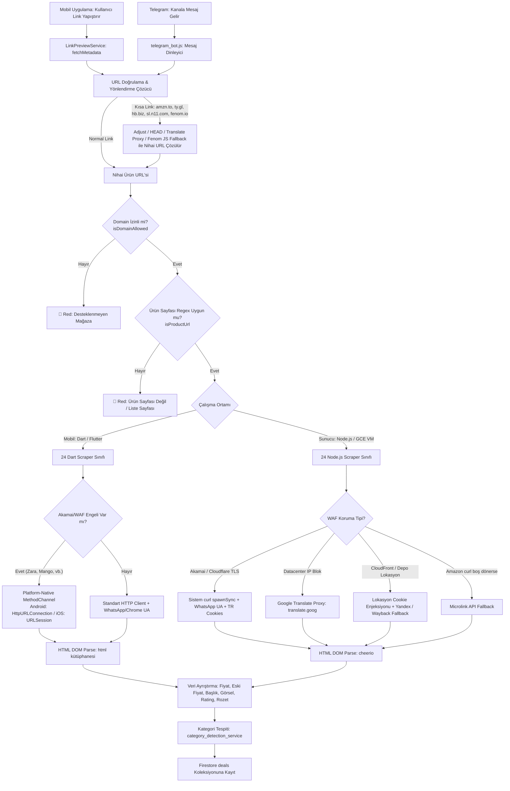
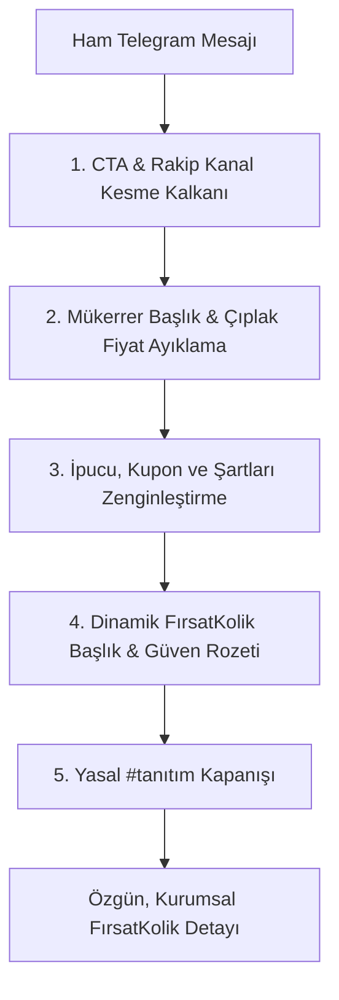

# 🕷️ FırsatKolik — Scraping Mimarisi ve Otonom Botlar Master Rehberi

> [!IMPORTANT]
> **Base Doküman & Scraping Kontratı:** Bu doküman, FırsatKolik platformunun mobil istemci (Flutter/Dart) ve sunucu (Compute Engine VM / Node.js) katmanlarındaki tüm e-ticaret veri kazıma (scraping) mekanizmasını, 24 mağaza çözümleme stratejilerini, WAF/TLS bypass motorlarını, canlı API entegrasyonlarını, Telegram botunu ve metadata katmanını yöneten **ana orkestratör (Base Contract)** dokümandır. Her bir alt mimarinin ayrıntılı teknik referansları ilgili bölümlerde doğrudan bağlantılanmıştır.

Bu doküman; **FırsatKolik** platformunun mobil istemci (Flutter/Dart), sunucu (Compute Engine VM üzerinde Docker / Node.js; `cloud-run-bot` dizin adı tarihsel kalıntıdır) ve bot katmanlarındaki tüm scraping (veri kazıma) mekanizmasını, 24 entegre mağaza için bypass stratejilerini, URL doğrulama zincirini, canlı API ve tersine mühendislik çözümlerini, metadata katmanını (`originalPrice`, `ratingValue`, `priceLabel`), kategori tespit motorunu ve deployment süreçlerini tanımlayan **resmi mimari sözleşmedir (Documentation Contract)**.

---

## 📑 İçindekiler
1. [🌟 Genel Mimari ve İki Motorlu İstek Akışı](#1--genel-mimari-ve-i̇ki-motorlu-i̇stek-akışı)
2. [🔍 URL Kontrol ve Doğrulama Zinciri (4 Aşamalı Filtre)](#2--url-kontrol-ve-doğrulama-zinciri-4-aşamalı-filtre)
3. [🏪 24 Entegre Mağaza ve Detaylı Çözümleme Stratejileri](#3--24-entegre-mağaza-ve-detaylı-çözümleme-stratejileri)
4. [🛡️ Bot Koruması ve WAF Bypass Yöntemleri (6 Katmanlı)](#4-️-bot-koruması-ve-waf-bypass-yöntemleri-6-katmanlı)
5. [📱 İstemci Tarafı Platform-Native HTTP Bypass (MethodChannel)](#5--i̇stemci-tarafı-platform-native-http-bypass-methodchannel)
6. [🏷️ Özel Üyelik ve Fiyat Etiketi Mekanizması (priceLabel)](#6-️-özel-üyelik-ve-fiyat-etiketi-mekanizması-pricelabel)
7. [📉 İndirimsiz Liste Fiyatı (originalPrice) ve İndirim Oranı](#7--i̇ndirimsiz-liste-fiyatı-originalprice-ve-i̇ndirim-oranı)
8. [⭐ Değerlendirme, Puan ve Marka Katmanı (Metadata)](#8-️-değerlendirme-puan-ve-marka-katmanı-metadata)
9. [🤖 Telegram Botu ve Canlı Kanal Dinleyici Mimarisi](#9--telegram-botu-ve-canlı-kanal-dinleyici-mimarisi)
10. [🧠 Kategori Tespit Motoru ve Reklam Mevzuatı Uyumu](#10--kategori-tespit-motoru-ve-reklam-mevzuatı-uyumu)
11. [🚀 Bulut Altyapısı, Docker ve Deployment (deploy_to_vm.py)](#11--bulut-altyapısı-docker-ve-deployment-deploy_to_vmpy)
12. [📊 24 Mağaza İçin Kapsamlı Özet Karar Matrisi](#12--24-mağaza-için-kapsamlı-özet-karar-matrisi)
13. [🧪 Birim Testleri ve Doğrulama Süitleri](#13--birim-testleri-ve-doğrulama-süitleri)
14. [🔧 Sorun Giderme ve Hata Ayıklama (Troubleshooting)](#14--sorun-giderme-ve-hata-ayıklama-troubleshooting)
15. [📂 İlgili Kaynak Kod Dosyaları ve Referanslar](#15--ilgili-kaynak-kod-dosyaları-ve-referanslar)

---

## 1. 🌟 Genel Mimari ve İki Motorlu İstek Akışı

> 🔗 **Detaylı Referans Dokümanı:**
> - [Uçtan Uca Scraping Mimarisi ve Veri Akışları Kılavuzu](file:///d:/firsatkolik/documentation/_arsiv/scraping-ve-botlar/end_to_end_scraping_architecture.md) — İstemci/sunucu iş akışı, Cloud Run vs VM farkları ve Admin SDK veri akışları.

FırsatKolik platformunda fırsat akışları iki bağımsız kaynaktan beslenir:
1. **İstemci Motoru (Client-Side / Flutter - Dart):** Kullanıcının mobil uygulama içerisindeki "Fırsat Paylaş" ekranından (`SubmitDealScreen`) link yapıştırdığı senaryodur. `LinkPreviewService` tarafından URL alanında 400ms debounce ile tetiklenir (`submit_deal_screen.dart:473`).
2. **Sunucu Motoru (Server-Side / Google Cloud - Node.js):** Telegram kanallarını 7/24 dinleyen `telegram_bot.js` ve geçmiş mesajları tarayan `fetch_history.js` servisleridir. `link_scraper_service.js` üzerinden çalışır.



---

## 2. 🔍 URL Kontrol ve Doğrulama Zinciri (5 Aşamalı Filtre)

Sisteme giren her URL veya paylaşılan metin, scraping yapılmadan önce şu 5 aşamalı sıkı filtreden geçirilir:

```
[ Gelen Ham Veri (Paylaşım Menüsü, Pano veya Manuel Giriş) ]
                 │
                 ▼
 0. 🧠 AKILLI URL & MOBİL PAYLAŞIM NORMALİZASYONU (DealUrlDetector)
    - Şemasız alan adları (www.mavi.com/..., boyner.com.tr/...) ➔ https:// ile tamamlama
    - Metin içerisinden veya paylaşımlardan e-ticaret bağlantılarını izole etme
    - Sondaki noktalama işaretlerinin (. , ; ! ? )) temizlenmesi
                 │
                 ▼
 1. 🔗 KISA LİNK & YÖNLENDİRME ÇÖZME (Redirect Resolution)
    - amzn.to, amzn.eu, link.amazon, amzlinks.in, fenom.io ➔ Amazon ürün linki (link.amazon -> amzlinks.in HTTP 200 WhatsApp UA durumunda HTML <base href> btn_url çözümlemesi; fenom.io için JavaScript appLink/fallbackLink regex)
    - ty.gl ➔ curl (-sL, url_effective) + TR Cookies ile Trendyol ürün linki
    - hb.biz ➔ redirect: 'manual' + Adjust fallback parametresi
    - sl.n11.com/n/ ➔ Google Translate Proxy ile Play Store yönlendirmesinden kurtarma
    - pzrm.me ➔ Pazarama 302 zinciri takibi
    - Çoklu Mağaza HTML Body Fallback: Aracı sayfalar 200 OK döndüğünde meta-refresh, JS redirect, canonical ve regex (Trendyol, Hepsiburada, Amazon vb.) ile otomatik kurtarma
                 │
                 ▼
 2. 🏪 İZİNLİ MAĞAZA KONTROLÜ (Domain Allowlist)
    - Allowlist JSON'u kontrol edilir (assets/data/domain_allowlist_extended.json: `store_count` 294, `domain_count` 297; ürün regex kuralı 22 mağazada)
                 │
                 ▼
 3. 🎯 ÜRÜN SAYFASI REGEX KONTROLÜ (Product Path Verification)
    - Mağazaya özel product_path_rules desenleri kontrol edilir.
    - Ana sayfa, kategori listesi, sepet veya arama sonuçları engellenir.
                 │
                 ▼
 4. 🧹 URL PARAMETRE TEMİZLİĞİ (Affiliate / Tracking Strip)
    - Büyük mağazalarda takip parametreleri temizlenir.
    - Sadece zorunlu satıcı/varyant parametreleri (smid, boutiqueId, merchantId, p) korunur.
```

---

## 3. 🏪 24 Entegre Mağaza ve Detaylı Çözümleme Stratejileri

> 🔗 **Detaylı Referans Dokümanı:**
> - [Scraping Kuralları ve Stratejileri Rehberi](file:///d:/firsatkolik/documentation/scraping-ve-botlar/scraping_rules_and_strategies.md) — 24 mağazanın DOM seçicileri, regex desenleri ve özel çerez ayarları.

Platform bünyesinde tam desteklenen 24 e-ticaret mağazası ve uygulanan özel teknikler:

### 1. Amazon (`amazon.com.tr`, `amzn.to`, `amzn.eu`, `link.amazon`, `amzlinks.in`, `fenom.io`)
- **Kısa Linkler & Aracı Yönlendiriciler:** `amzn.to`, `amzn.eu`, `link.amazon`, `amzlinks.in` ve `fenom.io` kısa linkleri yönlendirme zinciri takibiyle asıl ürün sayfasına çözülür. `link.amazon` linkleri `amzlinks.in` aracı servisine yönlenir; `amzlinks.in` WhatsApp UA tespit ettiğinde 302 yerine 200 OK döndüğünden, HTML gövdesindeki `<base href="...">` ve `btn_url` parametresi `Uri.decodeComponent` ile çözümlenerek doğrudan kanonik Amazon TR ürün linkine ulaşılır. `fenom.io` için ise JavaScript `appLink` / `fallbackLink` regex ayıklaması kullanılır.
- **Fiyat Seçicileri & Dublike Savunması:** `.a-price` ve `.apex-pricetopay-value` konteynerlerinde çift metin (`.a-offscreen` + `aria-hidden`) birleşmesini önlemek için öncelikle `.a-offscreen` tekil metni alınır, boşsa `aria-hidden` altındaki `.a-price-whole` + `.` + `.a-price-fraction` birleştirilir. `parsePriceText` seviyesinde ardışık tekrarlanan fiyat kalıplarına karşı (`269,91TL269,91TL` -> `269.91`) çift katmanlı savunma kalkanı bulunur.
- **Amazon Depo (İkinci El / Açılmış Kutu):** `smid=A215JX4S9CANSO` parametresi tespit edildiğinde `#apex-pricetopay-accessibility-label`, `.apex-pricetopay-value`, `#usedBuySection .offer-price` ve `.aok-offscreen` seçicileri önceliklendirilerek Depo fiyatı kazınır ve `isAmazonWarehouse: true` atanır. Normal ürünlerde birincil seçiciler önceliklidir.
- **1x1 Boş Görsel Filtresi:** Amazon bazen 43-byte boyutunda boş şeffaf piksel döner; `isLogoUrl` ve byte filtreleriyle elenerek `img#landingImage` veya `img#imgBlkFront` DOM elemanları taranır.
- **Fiyat Rozeti:** `#primeExclusivePricingMessage` veya `#primeSavingsUpsellBlock` var ise `priceLabel: "Prime Fırsatı"` atanır.
- **Sunucu Bypass:** `curl` spawnSync (`WhatsApp/2.23.4.15 A` UA); `curl` boş dönerse Microlink API (`prerender` kapalı) fallback'i. ABD konum kısıtlamasının aşılması garanti değildir. Fiyatların karusellerden sızmaması için seçiciler `#rightCol` ve `#centerCol` ana bloklarıyla sınırlandırılmıştır.

### 2. Hepsiburada (`hepsiburada.com`, `hb.biz`, `app.hb.biz`)
- **Kısa Link Çözümleme (`hb.biz`):** Akamai engeline takılmamak için `redirect: 'manual'` yöntemiyle HTTP GET/HEAD atılır, ilk 301 yönlendirmesindeki `Location` başlığından `adj.st` URL'i yakalanır ve `adjust_fallback` / `adj_fallback` parametresinden gerçek ürün linki çıkarılır.
- **Canlı Fiyat API Entegrasyonu & `_HbApiPriceResult` Modeli:** Hepsiburada normal, Premium ve sepetteki indirimli fiyatları HTML DOM'da gizler. Scraper:
  1. `<script id="reduxStore">` verisinden `sku`, `listingId`, `merchantId`, `productId`, `tagList`, `rootCategoryList` ayıklar.
  2. **Etiket Filtreleme (`_isIgnoredHbTag`):** Redux `tagList` içerisindeki `ilk-siparis`, `yeni-uye` gibi genel üyelik/onboarding kupon etiketleri temizlenir. Hepsiburada'nın tüm Premium kampanyaları (`premium-a-gec`, `premiuma-gec` vb.) ve sepete özel etiketleri ise tam yetkiyle API'ye iletilir.
  3. Hepsiburada'nın resmi `withoutAffordability` (birincil buybox satıcısı) ve `otherMerchants` (tüm diğer satıcılar) POST API'lerine paralel (`Future.wait` / `Promise.all`) istek atar.
  4. Sepetteki indirimleri ve Premium kulüp fiyatlarını alabilmek için `x-gotham_app-key: All`, `x-gotham_is_include_premium_clubs: true`, `x-gotham_is_enabled_evaluate_coupon: true`, `x-gotham_is_enabled_next_eligible_campaign: true` ve `x-gotham_is_include_payment_campaigns: true` gateway başlıklarını gönderir.
  5. **Kampanya Doğrulama (`_isValidPremiumCampaignResult`):** Gelen API yanıtındaki `evaluateAsPremiumResult` kampanyaları denetlenir; gerçek Premium indirimi içeren kampanyalar (`isPremium: true`) ile sepete özel indirimler (`evaluateResult` / `priceData`, `isPremium: false`) karşılaştırılır ve en avantajlı geçerli fiyat `_lastApiResult` referansında saklanır.
- **3 Kademeli Hiyerarşik Premium Rozet Tespiti (`scrapePriceLabel`):**
  1. *Yetkili Kaynak (API):* `_lastApiResult` üzerinden doğrudan `isPremium` bayrağı okunur (`true` ise `priceLabel: "Premium ile"`, genel sepet indirimi ise `null`). Böylece sepete özel indirimler (örn: %5, %15 Sepet İndirimi) sahte rozet üretmez.
  2. *Özel DOM Rozetleri (Offline/Statik):* API çağrısı yapılamadığında `[data-test-id*="premium-price"]`, `[class*="PremiumPrice"]`, `[data-test-id="loyalty-discount"]` seçicileri taranır.
  3. *Katı Fiyat Regex:* Sadece açık fiyat içeren `^(?:hepsiburada\s*)?premium['’]?\s*(?:ile|la)\s*[\d.,]+\s*(?:tl|₺)?$` yaprak metinleri kabul edilir.
- **Sunucu Bypass:** Akamai Bot Manager, Google Translate ve Googlebot IP'lerini Captcha sayfasına (`HBBlockandCaptcha.html`) yönlendirir. Sunucuda `spawnSync('curl', [...])` + `WhatsApp` UA ile doğrudan erişilir.

### 3. Trendyol (`trendyol.com`, `ty.gl`)
- **Kısa Link Çözümleme (`ty.gl`):** WhatsApp UA ve Türkiye çerezleri ile sistem `curl -sL -w %{url_effective}` kullanılarak çözülür (`adjust_redirect` parametresi üzerinden doğrudan ürün linkine erişilir).
- **Varyant Desteği (`ProductGroup`):** Çoklu beden/renk içeren sayfalarda root tipi `ProductGroup` olarak geldiğinde ilk varyantın alakasız fiyatı yerine `findProductInJson` ile ana ürünün geçerli aktif fiyatı çözümlenir.
- **Kampanya & Sepet İndirimi Fallback'i (`.campaign-price-wrapper` / State Fallback):**
  - Bazı kampanya veya sepet indirimli ürünlerde Trendyol sayfaya `application/ld+json` script bloğu basmaz.
  - Bu tür sayfalarda satış fiyatı DOM'da `<p class="new-price">`, indirimsiz fiyat ise `<p class="old-price">` altında tutulur.
  - DOM seçicilerine ek olarak `__PRODUCT_DETAIL_APP_INITIAL_STATE__` veya `__NEXT_DATA__` script nesnesindeki `discountedPrice` ve `sellingPrice` verileri regex/JSON fallback olarak taranır; böylece JSON-LD bulunmayan ürünlerin de fiyatı 0 TL kalmadan %100 doğrulukla ayıklanır.
- **Fiyat Rozeti:** `.plus-price` veya `data-plus-price` tespit edildiğinde `priceLabel: "Plus'a Özel"` atanır.
- **Sunucu Bypass (Yurt Dışı IP Yönlendirmesi):** Bot VM'i ABD IP'sinde (us-central1) olduğundan Trendyol istekleri `/en/select-country` sayfasına yönlendirir. İstek `curl` ile atılırken `Cookie: storefrontId=1; countryCode=TR; language=tr` çerezleri eklenir; böylece Trendyol botu Türkiye'deki bir kullanıcı gibi algılar ve local butik indirimli fiyatları döner.

### 4. N11 (`n11.com`, `sl.n11.com`)
- **Kısa Link Çözümleme (`sl.n11.com/n/`):** `sl.n11.com/n/...` linkleri `www.n11.com/n/...` formatına dönüştürülerek Google Translate Proxy tüneli üzerinden çözülür; böylece Adjust'ın Google Play Store yönlendirmesi tamamen bypass edilir.
- **Dinamik Sepet İndirimi & Fiyat Çözümleme (`personalizedDetail` REST API):** 
  - N11, "Sepette %X İndirim" kampanyalarını ilk gelen statik HTML'e basmaz; tarayıcı ön yüzü arka planda `POST https://www.n11.com/rest/v1/personalizedDetail` uç noktasına istek atarak anlık sepet indirimini (`instantDiscountedPrice`) ve eski fiyatı (`oldPrice`) yükler.
  - Scraper, `window.model`'den `productId`, `categoryId` ve ürün slug bilgisini çekip bu API'ye `WhatsApp/2.23.4.15 A` kimliği ve HTTP/1.1 TLS istemcisiyle istek atar (`instantDiscountedPrice` / `finalPrice` ➔ `price`, `oldPrice` / `displayPrice` ➔ `originalPrice`).
  - Statik model fallback'inde ise `product.price` ve `product.displayPrice` alanları karşılaştırılarak **düşük olan indirimli satış fiyatı**, **yüksek olan ise indirimsiz liste fiyatı** olarak seçilir.
- **Abonelik / Rozet Politikası:** N11'de Amazon Prime veya Hepsiburada Premium gibi ücretli bir Plus/Premium üyelik modeli bulunmadığı için `priceLabel` alanı standart mağazalar gibi her zaman `null` döner; arayüzde üye rozeti tetiklenmez.
- **Sunucu Bypass:** Google Cloud datacenter IP engeli `https://www-n11-com.translate.goog/path?...` Google Translate Proxy yöntemiyle aşılır.

### 5. Pazarama (`pazarama.com`)
- **Plus Üyelik Önceliği:** Pazarama Plus üyelerine sunulan özel indirimli fiyatlar standart JSON-LD'de yer almaz. Scraper öncelikle sayfada `plus-icon` veya `pz-plus-icon` logolarını arar; varsa kapsayıcı altındaki Plus indirimli fiyatı ayıklar ve `priceLabel: "Plus ile"` atar. Yoksa standart JSON-LD fiyatına fallback yapar.

### 6. Getir (`getir.com`)
- **Çerez ve Konum Entegrasyonu:** Getir konum tabanlı çalıştığı için lokasyon çerezleri olmadan depo-özel ürünler 404 döner. İstek başlıklarına `locale=tr; language=tr; countryCode=TR; appType=GETIR` çerezleri eklenir.
- **Next.js JSON-LD & DOM:** Ürün bilgileri `<script id="__NEXT_DATA__">` JSON bloğundan parse edilir. Açıklama için `description` ve `content` alanları öncelikli okunur.
- **Sunucu Bypass (Çok Katmanlı):**
  1. **Lokasyon Çerezli curl:** İlk deneme özel lokasyon çerezleriyle yapılır.
  2. **Yandex Translate Proxy:** WAF engeli durumunda `https://translate.yandex.ru/translate?url=...` tüneline yönlendirilir ve `__NEXT_DATA__` kurtarılır.
  3. **Wayback Machine Fallback:** Depo ürünlerinde 404 alınırsa Wayback Machine arşivi taranarak başlık ve görsel kurtarılır.

### 7. Zara (`zara.com`)
- **Akamai Bot Manager Engeli:** Zara standart HTTP istemcilerini JA3/TLS parmak izi analiziyle engelleyip `2.8 KB`'lık `bm-verify` challenge sayfasına yönlendirir.
- **İstemci Bypass:** Android (`HttpURLConnection`) ve iOS (`URLSession`) **Platform-Native MethodChannel** üzerinden yerel işletim sistemi ağ katmanıyla çekilir.
- **Veri Kaynağı:** HTML içindeki `zara.analyticsData` script'i regex ile taranarak `mainPrice` ve `productName` alanları ayıklanır.

### 8. Mango (`mango.com`)
- **React CSS Modules:** Mango artık JSON-LD'ye değil React CSS Modules sınıflarına (`SinglePrice`, `ZoomableImage`) ve `sr-only` erişilebilirlik fiyat etiketlerine (`Güncel fiyat [.]`, `Üstü çizili ilk fiyat [.]`) dayanır; Vercel WAF `WhatsApp` UA'ya 429 verdiği için masaüstü Chrome 124 UA kullanılır (`getHeadersForUrl`, `link_scraper_service.js:41`). Eski `self.__next_f.push` ayrıştırması kodda yoktur.
- **Veri Kaynağı:** DOM `SinglePrice` (`discounted`/`crossed`/`finalPrice`) ve `sr-only` etiketleri; JSON-LD yalnızca fallback. Mobil istemcide Native HTTP tünellemesi kullanılır.

### 9. Beymen (`beymen.com`)
- **BEYMEN.productMain Entegrasyonu:** Sepet indirimleri dahil en güncel fiyatı veren `promotedOrActualPrice` ve tam ürün ismini tutan `displayName` alanları doğrudan script'ten regex ile yakalanır.
- **JSON-LD Sanitizer & DOM Fallback:** Kaçışsız çift tırnaklar ve satır sonları temizlenir. `h1` sadece marka adını içerdiğinden asıl ürün başlığı `.o-productDetail__description` etiketinden alınır.

### 10. İdefix (`idefix.com`)
- **Canlı ecomapi Entegrasyonu:** İdefix statik HTML'de değerlendirme (`averageRating`) ve oy sayılarını (`reviewCount`) basmaz. Ürün ID'si (`p-{productId}`) çıkarılarak resmi e-ticaret yorum servisine (`https://ecomapi.idefix.com/api/product/{productId}/detail/review`) canlı GET isteği atılır.

### 11. DeFacto (`defacto.com.tr`)
- **Javascript `PRODUCT_DETAIL_LASTVISITED`:** Sepet indirimli fiyatlar DOM'da bulunmaz. `window.PRODUCT_DETAIL_LASTVISITED` script bloğundaki `DiscountPrice` ve `CampaignDiscountedPrice` alanları regex ile taranır. Unicode karakter bozuklukları `_decodeUnicode` filtresi ile temizlenir.

### 12. PttAVM (`pttavm.com`)
- **WAF:** Cloudflare, Node.js `fetch` TLS parmak izini engeller.
- **Sunucu Bypass:** `curl` spawnSync + `WhatsApp` UA (`fetchHtml` → `curlFetchHtml`). Kodda ayrıca bir Microlink dalı vardır (`link_scraper_service.js:1058`) ama `curl` dalı önce döndüğü için ulaşılamaz (ölü kod). ⚠️ VM IP'sinden `curl` ile 200 dönüp dönmediği doğrulanmalı.

### 13. Vatan Bilgisayar (`vatanbilgisayar.com`)
- **Sunucu Bypass:** Google Cloud IP engeli `translate.goog` (Google Translate Proxy) yöntemiyle aşılır. DOM seçicisi `.product-list__price` ile fiyat doğrulanır.

### 14. İtopya (`itopya.com`)
- **Canlı Yorum API'si:** Ürün HTML çekimi `translate.goog` ile yapılır; değerlendirme puanı için `/Urun/UrunYorum?id=...` API'sine doğrudan istek atılır.

### 15. Teknosa (`teknosa.com`)
- **TLS/JA3 Engeli:** Cloudflare WAF engeli sunucuda `curl` spawnSync + `WhatsApp` UA ile aşılır. JSON-LD şeması parse edilir.

### 16. Mavi (`mavi.com`)
- **Standart Yapı:** `WhatsApp` User-Agent taklidi + `application/ld+json` şeması. Görseller `sky-static.mavi.com` CDN deseniyle doğrulanır.
- **Mobil Paylaşım:** Mavi mobil uygulaması güncel sürümlerinde doğrudan standart HTTP/HTTPS ürün bağlantısı (`https://www.mavi.com/.../p/...`) paylaşmaktadır. Ürün sayfaları Allowlist regex doğrulaması (`\/p\/[a-z0-9-]+\/?$`) ile tam uyumlu çalışır.

### 17. MediaMarkt (`mediamarkt.com.tr`)
- **Googlebot UA Taklidi:** Cloudflare korumasını aşmak için `Googlebot/2.1 (+http://www.google.com/bot.html)` User-Agent değeri doğrudan atanır.

### 18. İncehesap (`incehesap.com`)
- **iOS UA & curl:** Sunucuda `curl` + iPhone Safari UA ile HTML çekilir (WhatsApp UA yalnızca `incehesap.com/u/...` kısa link çözümünde kullanılır); JSON-LD şemaları ve DOM fiyatları parse edilir.

### 19. Havit (`havitstore.com.tr`)
- **E-Ticaret Altyapısı:** Standart Chrome UA + DOM seçicileri ve JSON-LD şeması.

### 20. Migros (`migros.com.tr`)
- **SSR vs SPA Mimarisi (Hemen vs Sanalmarket/Pazaryeri):** Migros Hemen (`/hemen/...`) sayfaları SSR (Server-Side Rendering) ile derlenip HTML içinde zengin JSON-LD ve og:image barındırırken; Migros Sanalmarket ve Pazaryeri (`/grocery-mp/...`, `/sanalmarket/...`) sayfaları Angular SPA mimarisiyle çalışır. Ham HTML içinde yalnızca generic `<title>Migros</title>` ve standart afiş görseli (`sanalmarket-seo-34706362.png`) bulunur.
- **Hexadecimal (On-Altılık) SKU Çözücü:** Migros web URL'lerindeki slug sonu `-p-[hex]` deseni yakalanıp onaltılık tabandan (`radix: 16`) onluk tabana çevrilerek Migros ürün SKU'su elde edilir (Örn: `soke-un-1-kg-p-4c73e1` ➔ `4c73e1` [hex] = `5010401` [dec]; `ugg-bot-p-3150731` ➔ `3150731` [hex] = `51709745` [dec]; `gepettoys-p-229439a` ➔ `229439a` [hex] = `36258714` [dec]).
- **Çok Kanallı Paralel Screens API ve Kampanya Aday Seçimi (Multi-Channel Promotion Merging):** Migros, bazı ürünlerde Money indirimlerini yalnızca express/hemen kanalında (`/rest/hemen/products/screens/{productId}`), bazı ürünlerde ise genel pazaryeri kanalında (`/rest/products/screens/{productId}`) yayımlamaktadır. Scraper, `prepare()` aşamasında her iki uç noktayı `Future.wait` / `Promise.all` ile paralel (~150-200ms) sorgular. İki uç noktanın `storeProductInfoDTO` verileri `_scoreCandidate` algoritmasıyla incelenir; aktif indirim (`discountRate > 0`, `loyaltyPrice < regularPrice`, `shownPrice < regularPrice`, `PRICE_PROMOTED`, `CROSS_PROMOTED`, `crmDiscountTags`) veya daha düşük net satış fiyatı sunan kanal otomatik seçilir ve eksik alanlar (görsel, marka, açıklama, kategori) çapraz yedeklenir. Böylece pazar yerinden paylaşılan bir ürünün dahi express kanalındaki Money indirimi eksiksiz yakalanır.
- **Eşzamanlılık & Bellek İzolasyonu (Expando / WeakMap):** Çift tıklama, arka arkaya paylaşım veya sunucuda eşzamanlı Telegram mesajlarında bellek karışması (race condition) ve sızıntı riskini sıfırlamak için Dart tarafında `Expando<Map<String, dynamic>>`, Node.js tarafında `WeakMap` kullanılarak önbellek doğrudan `dom.Document` / `$` referansına bağlanır; DOM çöp toplayıcı tarafından silindiğinde bellek 0ms'de otomatik temizlenir.
- **Placeholder Afiş Filtrelemesi:** `sanalmarket-seo-...png`, `hemen-seo-...png` ve `migrosone.com/.../custom/` afişleri `_isLogoUrl` filtresiyle engellenir; daima `1650x1650` çözünürlüğündeki `PRODUCT_HD` / `PRODUCT_DETAIL` gerçek ürün görseli çekilir.
- **CRM Kampanyaları & Money İndirimi (`priceLabel`):** API'deki `crmDiscountTags` ("1 ALANA 1 BEDAVA", "50 TL Sepette İndirim"), `CROSS_PROMOTED` badges ("3 Al 2 Öde", "2.'si %50 İndirimli") ve `PRICE_PROMOTED` / `loyaltyPrice` farkı ("Money ile") dinamik etiket olarak sunulur.
- **İndirimsiz Liste Fiyatı (`originalPrice`):** `regularPrice`, `salePrice` ve `PRICE_PROMOTED` rozetleri kuruş/TL dönüşümü (`/ 100`) yapılarak güncel satış fiyatından yüksek ve en fazla 5 katı olduğu filtrelenir ve indirimsiz fiyat olarak atanır.
- **Slug Fallback & Generic Başlık Kalkanı:** "Migros", "Migros Sanalmarket" gibi marka adları elenir. Ağ hatasında dahi `parseSlugTitle()` URL slug'ından temiz insan okunabilir başlık üretir.

### 21. Boyner (`boyner.com.tr`)
- **WAF & Bot Koruması:** Cloudflare WAF koruması altındadır. Standart masaüstü User-Agent veya kütüphane TLS el sıkışmaları (Dart HTTP ve Node.js fetch) engellenerek `Just a moment...` challenge ekranı veya 403 Forbidden döndürülür.
- **İstemci Tarafı Çözüm (Native HTTP):** Mobil istemcide `LinkPreviewService`, Android'de yerel `HttpURLConnection` (Conscrypt TLS), iOS'ta `URLSession` (CFNetwork) native kanalı üzerinden `WhatsApp/2.23.4.15 A` User-Agent ile HTML çeker.
- **Sunucu Tarafı Çözüm (curl):** Node.js sunucu botunda `link_scraper_service.js`, `curl` spawnSync ve `WhatsApp/2.23.4.15 A` User-Agent kombinasyonuyla Cloudflare WAF engelini aşar. Satıcı ve varyant bilgisi için `magaza` ve `barcode` parametreleri korunarak tracking parametreleri temizlenir.
- **Next.js PriceInfo Engine (Yetkili Kaynak):** Boyner modern ön yüzünde satış fiyatı (`Price`), indirimsiz liste fiyatı (`OldPrice`) ve kampanya bilgisi (`CampaignInfo`) `<script>` etiketlerindeki `"PriceInfo": {"Price": "...", "OldPrice": "...", "CampaignInfo": "..."}` JSON bloğunda saf olarak saklanır. Scraper öncelikle bu bloğu ayrıştırarak harfsiz ve eksiksiz fiyat verisine erişir.
- **DOM "Sepette" Rozet Temizliği:** Sayfada `[class*="priceMain"]` taranırken, alt eleman olarak gömülen `[class*="priceMainText"]` ("Sepette") rozet elemanı DOM kopyasından izole edilir ve temizlenir. Böylece `"Sepette11.999 TL"` gibi bileşik metinlerin binlik ayracının kuruş sanılarak `11.99` TL'ye kırpılması (1000x basamak kaybı) önlenir.
- **Dinamik Fiyat Etiketi (`priceLabel`):** `PriceInfo.CampaignInfo` (örn: `"Sepette %28 İndirim"`, `"%48 İndirim"`, `"2000 TL'ye 500 TL İndirim"`) veya DOM'daki `priceMainText` tespit edilerek `priceLabel` olarak Fırsat Paylaş ve feed kartlarına iletilir.
- **Çapraz Doğrulama Kalkanı (Sanity Check):** DOM'dan çekilen satış fiyatı 100 TL altıysa ancak JSON-LD `offers.price` 100 TL'nin çok üzerindeyse (örn: 11.999 TL'lik ürünün 11.99 TL'ye düşme riski), JSON-LD teyit edilerek %99.95 gibi sahte indirim oranları engellenir.
- **Mobil Paylaşım:** Boyner mobil uygulaması güncel sürümlerinde doğrudan standart HTTP/HTTPS ürün bağlantısı (`https://www.boyner.com.tr/...`) paylaşmaktadır; Allowlist ve scraping hattı üzerinden standart e-ticaret URL'i olarak eksiksiz scrape edilir.

### 22. Gamer Gen (`gamer.gen.tr`)
- **Altyapı:** İtopya ile aynı ASP.NET mimarisi (`provider: ITOPYA`) ve Cloudflare koruması. Ürün sayfaları `_u\d+`, hazır sistem sayfaları `_h\d+` regex desenleriyle doğrulanır.
- **Sepette İndirim & Normal İndirim:** Sepette indirimli ürünlerde nihai fiyat `.text-price` içindeki `"Sepette"` metni temizlenerek ayıklanır; liste fiyatı ise `.product-price`'dan okunur. Normal indirimli ürünlerde satış fiyatı `.product-price`, liste fiyatı ise `.product-old-price` seçicisinden çekilir.
- **Hazır Sistem Fallback'i:** Bileşenleri tükenen hazır sistemlerde DOM fiyatı yerine JSON-LD (`offers.price`), `var toplamFiyat` ve `gtag` script nesneleri taranır.
- **Görsel:** `https://img.yenieera22.com/cdn/1000/...` CDN deseni ve JSON-LD `image` alanı taranarak logo/banner görselleri elenir.
- **Değerlendirme Politikası:** Gamer Gen üzerinde puanlama ve değerlendirme sistemi bulunmadığı için `ratingValue` ve `ratingCount` her zaman `null` döner.

### 23. Gaming Gen (`gaming.gen.tr`)
- **Altyapı:** WooCommerce (WordPress) e-ticaret altyapısı. Ürün sayfaları `\/urun\/\d+\/.+\/?$` regex deseniyle doğrulanır.
- **Fiyat Çözümleme:** Ana ürün satış fiyatı `.summary > .price, .entry-summary > .price, .summary > p.price, .entry-summary > p.price` seçicilerinden okunur. Sayfadaki opsiyonel bileşen/eklenti paket fiyatları (`.bundled_product_optional_checkbox .price`) elenerek ana ürünün tekil satış fiyatı garanti altına alınır.
- **Değerlendirme & Yorum Skoru:** Üründe değerlendirme varsa schema.org `aggregateRating` (`ratingValue`, `reviewCount`) veya WooCommerce `.woocommerce-product-rating` (`.star-rating`, `.woocommerce-review-link`) elemanlarından okunur. Puan 1 ondalıklı basamağa yuvarlanır (örn: `4.89` ➔ `4.9`). Değerlendirme sayısı 0 veya yok ise `ratingValue: null, ratingCount: null` döner.
- **Görsel & Marka:** WooCommerce `woocommerce-product-gallery__image` veya JSON-LD `image` alanı taranır; marka ise JSON-LD `brand.name` veya breadcrumbs hiyerarşisinden (`Powered by ASUS`, `Thermalright` vb.) çıkarılır.
- **Breadcrumbs:** WooCommerce breadcrumbs yapısı (`.woocommerce-breadcrumb`) taranarak kategori hiyerarşisi oluşturulur (`"gaming.gen.tr"` kök mağaza adı elenir, `"Gaming Laptop"` gibi kategori adları korunur).

### 24. CarrefourSA (`carrefoursa.com`)
- **Altyapı:** SAP Commerce / Hybris tabanlı kurumsal e-ticaret ve zincir market altyapısı. Ürün sayfaları `-p-[a-z0-9]+\/?$` regex deseniyle doğrulanır.
- **Fiyat Çözümleme:** Ana ürün satış fiyatı öncelikle PDP fiyat alanlarından (`.pdp-price-card .item-price`, `.pdp-price-card-sale .js-variant-price`, `.pd-price-cont .item-price`, `.pdp-price-card .price`, `.price-card-sale .js-variant-price`) okunur. Alttaki "Tavsiye Edilen / Benzer Ürünler" (`.hover-box`) karusellerindeki yabancı fiyatların sızmaması için seçiciler ana PDP kartı ile kesin olarak sınırlandırılmıştır.
- **İndirimsiz Liste Fiyatı (`originalPrice`):** CarrefourSA Kart indirimli ürünlerde indirimsiz liste fiyatı `.pdp-price-card-regular .js-variant-price, .pdp-price-card-regular .priceLineThrough` seçicilerinden çekilir. Tek fiyatlı ürünlerde veya indirim yoksa `null` döner.
- **Özel Üyelik & Kampanya Rozeti (`priceLabel`):**
  - CarrefourSA Kart indirimi olan ürünlerde: `"CarrefourSA Kart ile"`
  - Çoklu alım / adet kampanyası olan ürünlerde (`var campaignList`, `.product-detail-badge-position`, `.disc-badge-new`): Kampanya adı rozet metnine eklenir (örn: `"CarrefourSA Kart ile 2 Al 1 Öde"` veya `"2 Al 1 Öde"`).
  - Standart tek fiyatlı ürünlerde: `null`.
- **Görsel & Marka:** Görsel JSON-LD `image`, `meta[property="og:image"]` ve `.product-image img` seçicilerinden çekilir (`images.csfour.com` CDN); marka ise JSON-LD `brand.name`, `meta[property="product:brand"]` ve `.product-brand` alanlarından çıkarılır.
- **Breadcrumbs:** `.breadcrumb .breadcrumb-item a` DOM elemanları taranarak kategori hiyerarşisi oluşturulur (`"Anasayfa"` ve son eleman olan ürün adı elenir, `"Temel Gıda"`, `"Soslar"`, `"Ketçap"` gibi kategori adları korunur).
- **Bot/WAF Koruması Bypass:** Node.js sunucu botunda `curlFetchHtml` (Chrome 124 UA) ve `translate.goog` fallback; mobil istemcide (Android/iOS) `MethodChannel` platform-native HTTP tünellemesi kullanılır.

---

## 4. 🛡️ Bot Koruması ve WAF Bypass Yöntemleri

| Bypass Yöntemi | Hedef Mağazalar | Çözülen Problem / Mekanizma |
| :--- | :--- | :--- |
| **1. `curl` spawnSync + WhatsApp / Chrome UA** (İncehesap: iPhone UA) | `Hepsiburada`, `Trendyol`, `Teknosa`, `Mavi`, `Amazon`, `PttAVM`, `İncehesap`, `Boyner`, `CarrefourSA` | Node.js `fetch` TLS (JA3/JA4) parmak izi engelini aşar; işletim sistemi düzeyinde OpenSSL stack'i kullanır. |
| **2. Türkiye Lokasyon Çerezleri** | `Trendyol`, `Getir` | `Cookie: storefrontId=1; countryCode=TR; language=tr` ile yurt dışı sunucu yönlendirmesi engellenir ve yerel indirimli fiyatlar çekilir. |
| **3. Google Translate Proxy (`translate.goog`)** | `N11`, `Vatan Bilgisayar`, `Itopya`, `CarrefourSA (Fallback)` | Datacenter IP bloklarını aşmak için meşru Google Translate IP'leri üzerinden tünelleme yapılır. |
| **4. Microlink API Proxy** | `Amazon` (yalnızca `curl` boş dönerse fallback) | Üçüncü taraf HTML proxy; `prerender` parametresi kodda var ama hiçbir çağrı açmaz. PttAVM dalı ölü koddur. |
| **5. Googlebot User-Agent Taklidi** | `MediaMarkt` | Arama motoru botlarına uygulanan beyaz liste kurallarını kullanarak doğrudan erişim sağlar. |
| **6. Yandex Translate & Wayback Machine** | `Getir` | CloudFront WAF engellerini Yandex tüneliyle aşar; depo 404 durumunda Wayback arşiviyle görseli kurtarır. |

Not: Yöntem sayısı değil, `fetchHtml()` (`link_scraper_service.js:869`) içindeki mağaza bazlı yönlendirme esastır. Listede olmayan mağazalar (Idefix, Pazarama, Mango, Zara, Beymen, Defacto, Havit, Migros, gamer/gaming.gen.tr) standart `fetch` kullanır.


### 4.1 Bot Tarafı Mağaza Bypass Stratejileri ve Çözüm Yolları

Sunucu ortamındaki bot korumalarını aşmak için `link_scraper_service.js` içindeki `fetchHtml()` (`:869`) mağaza bazlı yönlendirme yapar. Kodda tanımlı mekanizmalar: (1) Google Translate Proxy, (2) `curl` (libcurl TLS), (3) Googlebot UA, (4) Microlink API (yalnızca Amazon fallback), (5) Yandex Translate + Wayback Machine (yalnızca Getir). Geri kalan mağazalar (Idefix, Pazarama, Mango, Zara, Beymen, Defacto, Boyner, Havit, Migros, gamer/gaming.gen.tr) standart `fetch` ile, `getHeadersForUrl()` (`:17`) UA seçimiyle çekilir. Bu bir "garanti" değildir: bypass'lar üçüncü taraf davranışına bağlıdır, mağaza tarafı değişirse bozulur; UA taklidi/`translate.goog` tünellemesinin hukuki boyutu için

#### 1. Google Translate Proxy (`translate.goog`)
*   **Kullanıldığı Mağazalar:** `N11`, `Vatan Bilgisayar`, `Itopya`
*   **Problem:** Bu mağazalar Google Cloud bulut IP adreslerini (veri merkezleri) doğrudan engeller ve Cloudflare/WAF koruması ile `403 Forbidden` döndürür.
*   **Çözüm:** İstekler `https://www-domain-com.translate.goog/path?_x_tr_sl=auto&_x_tr_tl=tr` formatına dönüştürülerek gönderilir. Google Translate sunucuları, Cloudflare/Akamai sistemlerinde beyaz listede olduğu için istek meşru bir arama motoru IP'sinden geliyormuş gibi görünür ve 403 engeli aşılır.
*   **Kritik Detay (Tracking Temizleme):** 
    *   **N11:** Sadece mağaza bazlı indirimlerin doğru hesaplanması için `magaza` parametresi korunur.
    *   **Itopya:** URL üzerindeki takip veya yönlendirme parametreleri temizlenerek doğrudan temiz ürün detayı proxy ile çekilir.

#### 2. `curl` spawnSync ile Doğrudan Erişim (TLS/JA3/Geo-Redirect Bypass)
*   **Kullanıldığı Mağazalar:** `Trendyol`, `Teknosa`, `Mavi`, `Hepsiburada`, `PttAVM`, `Amazon`, `İncehesap`, `Boyner` (`fetchHtml` → `curlFetchHtml`). `İncehesap` için iPhone Safari UA, diğerleri için `WhatsApp/2.23.4.15 A` UA kullanılır; Amazon `curl` boş dönerse Microlink'e düşer.
*   **Problem:** 
    *   **Teknosa, Mavi & Boyner:** Bu mağazalar Google Cloud IP bloklarını engellemez; ancak Node.js (`fetch`/`undici`) kütüphanesinin SSL el sıkışması (TLS Handshake JA3/JA4 parmak izi) imzasını "şüpheli bot" olarak algılayıp `403 Forbidden` veya Cloudflare WAF Challenge döndürür.
    *   **Hepsiburada:** Hepsiburada'nın Akamai Bot Manager koruması, Google Translate Proxy sunucu IP'lerini (ve Googlebot IP'lerini) Captcha sayfasına (`HBBlockandCaptcha.html`) yönlendirir (403 WAF engeli, ~80KB HTML boyutu ama ürün bilgileri ve reduxStore bulunmaz). Ayrıca Microlink API'sinin ücretsiz sürümü Hepsiburada'yı engellemiştir (`EPROXYNEEDED` hatası döner).
    *   **Trendyol:** Yurt dışı (Iowa / us-central1 VM) IP'lerinden gelen direct istekleri otomatik olarak `/en/select-country?cb=...` (ülke seçimi) sayfasına yönlendirerek orijinal ürün detay sayfasını engeller (74KB anasayfa HTML'i döner). Google Translate Proxy ile gidildiğinde ise, Translate sunucuları yurt dışında olduğu için Trendyol local butik/sepet indirimlerini (`boutiqueId`) render etmeyip standart/indirimsiz global fiyatları (`65374 TL` yerine `63299 TL`) gösterir.
*   **Çözüm:** 
    *   **Teknosa, Mavi, Boyner, Hepsiburada, PttAVM, Amazon & İncehesap:** İşletim sistemi düzeyinde çalışan `curl` aracı, Node.js'ten tamamen farklı bir TLS stack'i (libcurl/OpenSSL) kullanır. `spawnSync('curl', [...args])` yardımıyla istek doğrudan `WhatsApp/2.23.4.15 A` User-Agent'ı ile atılarak hem TLS engelleri hem de Google Translate IP engelleri aşılır. Hepsiburada ve Boyner doğrudan 200 OK ile orijinal DOM ve veri bloklarını eksiksiz döndürür.
    *   **Trendyol:** İstek doğrudan `curl` ile atılırken, header'lara **`Cookie: storefrontId=1; countryCode=TR; language=tr`** çerezleri eklenir. Bu çerezler sayesinde Trendyol yurt dışı IP yönlendirmesini (`select-country`) tamamen atlar, botu Türkiye lokasyonlu bir kullanıcı gibi algılar ve orijinal ürün sayfasını (425KB+) butik kampanya indirimli fiyatıyla beraber kusursuzca render eder. Linklerdeki affiliate/kampanya parametreleri temizlenmezse, Trendyol JSON-LD şemasını HTML içerisinden kaldırdığı için sadece `boutiqueId`, `merchantId` ve `storefrontId` parametreleri korunur, gerisi silinir.
*   **Gereksinim:** Docker imajında (`Dockerfile`) `apk add --no-cache curl` komutuyla curl yüklü olmalıdır.

#### 3. Googlebot User-Agent Taklidi
*   **Kullanıldığı Mağazalar:** `MediaMarkt`
*   **Problem:** MediaMarkt Cloudflare koruması normal tarayıcı ve mobil UA'leri engeller.
*   **Çözüm:** `Googlebot/2.1 (+http://www.google.com/bot.html)` User-Agent değeri doğrudan set edilerek istek atılır. MediaMarkt'ın Cloudflare ayarlarında Googlebot IP doğrulaması (DNS lookup) aktif veya sıkı olmadığı için bu imza doğrudan geçiş izni alır.

#### 4. Alan Adı Filtreleme İyileştirmesi & Live Review API Entegrasyonu
*   **Kullanıldığı Mağazalar:** `Idefix` (ve genel x.com yönlendirmeleri)
*   **Problem:** 
    *   Botun x.com (Twitter) paylaşımlarını filtrelerken kullandığı basit `.includes('x.com')` kontrolü, `idefix.com` linklerinin de yanlışlıkla filtrelenip atlanmasına neden oluyordu.
    *   Ayrıca İdefix sunucuları statik HTML yanıtlarında değerlendirme (`averageRating`) ve yorum sayılarını HTML'e gömmemekteydi.
*   **Çözüm:** 
    *   `telegram_bot.js` ve `fetch_history.js` dosyalarındaki kontrol mekanizması URL Hostname analizine dönüştürülerek filtreleme çözüldü.
    *   `idefix_scraper.js` içerisine İdefix'in canlı mikroservis entegrasyonu (`https://ecomapi.idefix.com/api/product/${productId}/detail/review`) eklendi. Puan ve oy sayısı HTML'de yoksa, ürün ID'si ayıklanarak bu API üzerinden canlı olarak parse edilir.

#### 5. Microlink HTML API Proxy (`api.microlink.io`)
*   **Kullanıldığı Mağazalar:** `Amazon` (yalnızca `curl` başarısız/boş dönerse fallback; `link_scraper_service.js:1043`). `PttAVM` için kodda bir Microlink dalı vardır (`:1058`) ancak `isPttavm` daha önce `curl` dalına (`:1038`) girip döndüğü için **ulaşılamaz (ölü) koddur**; PttAVM fiilen yalnızca `curl` ile çekilir. ⚠️ Doğrulanmalı: PttAVM'nin VM IP'sinden `curl` ile 200 dönüp dönmediği (önceki "tam IP blok" notu Cloud Run dönemine ait olabilir).
*   **Problem (Amazon):** Amazon, ABD tabanlı bulut IP'lerinden (`us-central1`) varsayılan teslimat konumunu US yapar; Türkiye satıcısının buybox/promosyonlu fiyatı gizlenip liste fiyatı gösterilebilir. Ayrıca "Benzer/Sponsorlu Ürünler" karusellerindeki fiyatlar yanlışlıkla ürün fiyatı sanılabilir; bu yüzden fiyat seçicileri `#rightCol` ve `#centerCol` altındakilerle sınırlandırılmıştır. `amzn.eu`, `amzn.to`, `link.amazon` kısa linkleri `resolveUrlRedirects` ile uzun URL'ye çözülür. Satıcı/varyant parametreleri (`smid`, `th`, `psc`, `m`, `isIsap`, `tag`) korunur.
*   **Çözüm:** Microlink API'si ile HTML alınır: `https://api.microlink.io/?url=<enc>&data.html.selector=html&data.html.type=html`. `prerender=true` yalnızca fonksiyonun `prerender` argümanı true ise eklenir; mevcut çağrıların hiçbiri (`:1045`, `:1058`) `true` geçmez, yani headless render **kullanılmaz**. Gelen HTML Cheerio ile `AmazonScraper` tarafından parse edilir. Timeout 18 sn. Ücretsiz Microlink planına bağlı olduğundan kota/engel durumunda fallback sessizce boş döner.

#### 6. Yandex Translate Proxy & Wayback Machine Fallback
*   **Kullanıldığı Mağazalar:** `Getir`
*   **Problem:** Getir CloudFront WAF, WhatsApp UA'yı ve datacenter IP'lerini engelleyebilir; Google Translate Proxy veya Microlink de captcha (405) engeline takılır. Depoya özel ürünler lokasyon cookie'si olmadan 404 verir.
*   **Çözüm:** Çok katmanlı bir fallback akışı uygulanmıştır (`fetchHtml` → `curlFetchGetir`, `link_scraper_service.js:702`):
    0. **`curl` + Chrome UA + lokasyon cookie'leri** (`locale=tr; language=tr; countryCode=TR; appType=GETIR`, URL sonuna `/` eklenir): ilk denemedir; başarısız olursa 1. adıma düşülür.
    1. **Yandex Translate Proxy:** Doğrudan `curl` WAF'a takılırsa, `https://translate.yandex.ru/translate?url=...&lang=tr-tr` adresine yönlendirilir. Yandex Translate sunucuları WAF'a takılmadan orijinal `__NEXT_DATA__` JSON verisini çeker. Bu sayede genel ürünlerde (Ekmek vb.) **canlı/güncel fiyat** ve görseller başarıyla çekilir.
    2. **Wayback Machine Fallback:** Yandex Translate başarısız/404 dönerse (bölgesel/depoya özel ürünlerde), en son yedek olarak Wayback Machine arşivi taranır (`https://web.archive.org/web/2024/...`). Buradan eski tarihli JSON-LD veya `__NEXT_DATA__` çekilerek başlık, görsel ve açıklama kurtarılır. Görsel URL'leri Wayback prefix'lerinden temizlenerek orijinal Getir CDN URL'si ile Firebase Storage'a yüklenir.

---

### 4.2 Mağaza ve Bypass Yöntemi Özet Tablosu

| Mağaza | Bot Karşılaşma Durumu | Kullanılan Bypass Yöntemi | Teknik Detay / Başlık |
| :--- | :--- | :--- | :--- |
| **Hepsiburada** | Akamai Captcha / Microlink Blok / hb.biz 403 | `curl` spawnSync (Doğrudan) + `redirect:manual` Adjust Fallback | TLS Fingerprint Bypass + `WhatsApp` UA ile HTML çekimi. `hb.biz` kısa linkleri `redirect:'manual'` ile ilk 301 Location header'ı yakalanarak `adj.st` URL'indeki `adj_fallback` parametresinden gerçek `hepsiburada.com` ürün URL'si çıkarılır. |
| **Trendyol** | Yurt dışı IP & Ülke Engeli | `curl` spawnSync (Doğrudan) | `storefrontId=1; countryCode=TR; language=tr` Cookie Entegrasyonu |
| **N11** | 403 Forbidden (IP Engeli), Dinamik Sepet İndirimi & Kısa Linkler | Google Translate Proxy + Canlı `personalizedDetail` API | `translate.goog` + `magaza` parametresi koruma. Canlı `POST /rest/v1/personalizedDetail` isteği ile sepet indirimli (`instantDiscountedPrice`) ve eski liste fiyatı (`oldPrice`) çekimi (`price`/`displayPrice` min-max analizi). `sl.n11.com/n/` kısa linkleri `www.n11.com/n/` formatına dönüştürülerek Google Translate Proxy üzerinden çözümlenir (`resolveN11ShortLink`), böylece Adjust'ın Google Play Store yönlendirmesi tamamen bypass edilir. Ücretli üyelik olmadığından `priceLabel` daima `null` döner. |
| **Vatan Bilgisayar** | 403 Forbidden (IP Engeli) | Google Translate Proxy | `translate.goog` |
| **Itopya** | 403 Forbidden (Cloudflare Engeli) | Standart Fetch / `translate.goog` | Ürün HTML çekimi `translate.goog` ile yapılır; Değerlendirme/Rating API isteği (`/Urun/UrunYorum?id=...`) ise İdefix mimarisinde olduğu gibi öncelikle doğrudan (proxy'siz) Node `fetch` ile yapılır, sadece engellenirse 2.5s Translate Proxy fallback'i devreye girer. |
| **Teknosa / Mavi / Amazon** | 403 Forbidden / Satıcı Fiyat Farkı / Amazon Depo Fiyatı | `curl` spawnSync (Doğrudan); Amazon için boş dönerse Microlink fallback | TLS Fingerprint Bypass + `WhatsApp` UA + `smid`/`th`/`psc` Satıcı Parametrelerini Koruma. Amazon Depo (`smid=A215JX4S9CANSO`) ve ikinci el/açılmış kutu ürünlerinde fiyat `#apex-pricetopay-accessibility-label`, `.apex-pricetopay-value`, `#usedBuySection .offer-price`, `.aok-offscreen` seçicileri ile %100 doğrulukla kazınır. |
| **Pttavm** | Cloudflare (TLS parmak izi / IP) | `curl` spawnSync (Microlink dalı ölü kod, bkz. §5) | WhatsApp UA ile `curlFetchHtml`; ⚠️ VM IP'sinden doğrulanmalı |
| **İncehesap** | Cloudflare | `curl` spawnSync + iPhone Safari UA | `incehesap.com` kısa linkleri (`/u/...`) `curl` + WhatsApp UA ile çözülür |
| **MediaMarkt** | 403 Forbidden (Bot Engeli) | Googlebot UA (Doğrudan) | `Googlebot/2.1` taklidi |
| **Idefix** | Standart HTML Çekim | Standart Fetch | Hostname tabanlı `x.com` filtresi (`telegram_bot.js:433`); yorum sayısı için `ecomapi.idefix.com` API'si |
| **Pazarama / Mango** | Vercel/WAF 429 | Standart Fetch + masaüstü Chrome 124 UA | `getHeadersForUrl` (`:17`) |
| **Zara / Beymen / Defacto / Gamer.gen.tr / Gaming.gen.tr** | — | Standart Fetch + WhatsApp UA (403/401'de tarayıcı UA ile tek yeniden deneme) | `fetchHtml` (`:1083`) |
| **Boyner** | Cloudflare WAF (TLS Parmak İzi & Bot Engeli) | `curl` spawnSync + `WhatsApp` UA (Sunucu) / Native HTTP (İstemci) | `magaza` ve `barcode` parametreleri korunur, Next.js `PriceInfo` üzerinden indirimli/liste fiyatı ve `CampaignInfo` çekilir. |
| **CarrefourSA** | Cloudflare WAF / TLS Parmak İzi | `WhatsApp/2.23.4.15 A` UA ile `curl` spawnSync (Sunucu) / Native HTTP + WhatsApp UA (İstemci) | SAP Hybris PDP fiyat seçicileri (`.pdp-price-card`), tavsiye karuseli izolasyonu, `"CarrefourSA Kart ile"` rozeti ve çoklu alım kampanya metni tespiti. |
| **Havit / Migros** | Bot engeli yok | Standart Fetch (Havit/Migros kodda "engel yok" notlu) | — |
| **Getir** | CloudFront WAF Captcha (405) | `curl` (Chrome UA + cookie) → **Yandex Translate Proxy** → Wayback Machine | Sıralı fallback; Wayback eski tarihli veri verebilir |

---

### 4.3 Debug Yöntemleri ve Altın Kurallar

#### 1. Bot Engeli / 403 Durumunun Teşhisi
Eğer bir mağaza 403 dönüyorsa, dönen cevaptaki `server` başlığı ve HTML body kontrol edilmelidir:
*   `server: ESF` (Google) geliyorsa: Google Translate sunucuları engellenmiştir veya Google Translate bizi engelliyordur.
*   `server: cloudflare` veya `server: akamai` geliyorsa: Doğrudan bulut sunucu IP'miz veya TLS parmak izimiz engellenmiştir.

#### 2. TLS Engeli vs IP Engeli Test Etme
Yeni bir bot engeli yaşandığında `scratch/` dizini altında test scriptleri oluşturarak sırasıyla test edin:
1. `curl` ile doğrudan gitmeyi test edin (`node scratch/test_curl_quick.js`).
2. Eğer `curl` 200 dönüyorsa, sorun **TLS Fingerprint**'tir. Çözüm: Scraper servisinde o mağazayı `curlFetchHtml` kapsamına alın.
3. Eğer `curl` da 403 dönüyorsa, sorun **IP Engeli**'dir. Çözüm: Google Translate Proxy yöntemini uygulayın.

#### 3. Komut Satırı / Shell Güvenliği
Node.js içinden harici araç (`curl`) çağırırken kesinlikle `execSync(commandString, { shell: true })` kullanılmamalıdır. Parametrelerin arasına sızabilecek boşluklar veya özel karakterler zaman aşımına veya güvenlik açıklarına yol açar. Her zaman **`spawnSync('curl', argsArray)`** tercih edilmelidir.


---

## 5. 📱 İstemci Tarafı Platform-Native HTTP Bypass (MethodChannel)

Mobil cihazlarda (Android & iOS), Dart'ın yerleşik HTTP kütüphanesinin SSL el sıkışması bazı katı bot sistemleri (özellikle Zara ve Akamai Bot Manager) tarafından şüpheli olarak işaretlenebilir.

### Çalışma Prensibi:
1. `LinkPreviewService._fetchHtml` metodu URL 17 domainden biriyse (Zara, Getir, İtopya, Mango, Beymen, Defacto, Mavi, PttAVM, İncehesap, Teknosa, Vatan, Pazarama, İdefix, N11, Hepsiburada, Trendyol, Boyner; `link_preview_service.dart:179`) ve platform Android/iOS ise `com.sicakfirsatlar.app/native_http` platform kanalını çağırır.
2. **Android (`MainActivity.kt`):** Android işletim sisteminin yerel `HttpURLConnection` sınıfını kullanarak isteği atar.
3. **iOS (`AppDelegate.swift`):** Apple'ın yerel `URLSession` ağ katmanını kullanarak isteği tamamlar.
4. İşletim sisteminin kendi yerel ağ kütüphaneleri, cihazın gerçek tarayıcısıyla birebir aynı TLS/JA3 imzasına sahip olduğundan engellere takılmadan tam HTML'i döndürür.

---

## 6. 🏷️ Özel Üyelik ve Fiyat Etiketi Mekanizması (priceLabel)

Platformda hem istemci hem de sunucu scraper'larında özel kulüp ve üyelik fiyatları otomatik tespit edilir:

```
[ Ham Web Sayfası ] ──► [ Scraper: Rozet Tespiti ] ──► [ priceLabel Alanı ]
                                                              │
   ┌──────────────────────────────────────────────────────────┴─────────────────────────┐
   ▼                                                                                    ▼
[ Mobil "Fırsat Paylaş" Ekranı ]                                             [ Veritabanı & Sunum ]
- Toggle satırı otomatik aktif olur.                                         - Firestore: deals.priceLabel
- Canlı önizleme kartında kompakt rozet görünür.                             - Anasayfa Kartı: Kompakt Rozet (P/+/M)
                                                                             - Fırsat Detayı: Mor-Turuncu Degrade Kapsül
```

### Desteklenen Standart Rozetler:
- **Amazon:** `"Prime Fırsatı"`
- **Trendyol:** `"Plus'a Özel"`
- **Hepsiburada:** `"Premium ile"`
- **Pazarama:** `"Plus ile"`
- **Migros:** `"Money ile"`
- **CarrefourSA:** `"CarrefourSA Kart ile"` (ve çoklu alım kombinasyonları: `"CarrefourSA Kart ile 2 Al 1 Öde"`)

---

## 7. 📉 İndirimsiz Liste Fiyatı (originalPrice) ve İndirim Oranı

> 🔗 **Detaylı Referans Dokümanı:**
> - [İndirimsiz Liste Fiyatı Kazıma ve Entegrasyon Kılavuzu](file:///d:/firsatkolik/documentation/scraping-ve-botlar/original_price_scraper_integration_guide.md) — Mağazaların eski liste fiyatı seçicileri, en küçük aday algoritması ve indirim yüzdesi formülleri.

Bir fırsatın gerçek indirimini hesaplayabilmek için **İndirimsiz Liste Fiyatı (`originalPrice`)** 3 katmanda aranır:
1. **JSON-LD:** `offers.highPrice`, `offers.listPrice`, `offers.priceSpecification`.
2. **Gömülü Script / Redux:** `product.withoutAffordability`, `originalPrice`, `variantList`.
3. **DOM Fallback:** `del`, `s`, `.original-price`, `.old-price`, `.variant-box-price`.

### Aday Fiyat Filtreleme Algoritması:
Bulunan tüm adaylar arasında `candidate > currentPrice` koşulunu sağlayanlar küçükten büyüğe sıralanır ve `currentPrice`'a en yakın olan **en küçük aday** `originalPrice` olarak seçilir.
- **İndirim Oranı (`effectiveDiscountRate`):** `(((originalPrice - price) / originalPrice) * 100).round()` formülüyle hesaplanır ve arayüzde `~~4.138 TL~~ %15 İndirim` şeklinde sunulur.

---

## 8. ⭐ Değerlendirme, Puan ve Marka Katmanı (Metadata)

> 🔗 **Detaylı Referans Dokümanı:**
> - [Scraper Metadata Zenginleştirme Kılavuzu](file:///d:/firsatkolik/documentation/scraping-ve-botlar/scraper_metadata_integration_guide.md) — `ratingValue`, `ratingCount`, `brand` alanlarının çıkarım kuralları ve UI entegrasyonu.

Kullanıcıların fırsat kalitesini anında değerlendirebilmesi için 3 kritik meta veri toplanır:
- **Puan (`ratingValue`):** 5 üzerinden ürün değerlendirme puanı (Örn: `4.8`).
- **Değerlendirme Sayısı (`ratingCount`):** Ürüne yapılan toplam yorum sayısı (Örn: `1173`).
- **Marka (`brand`):** Ürünün üretici markası (Örn: `Apple`, `Sony`, `Dyson`).

### Sunum Katmanı:
- **Dikey/Yatay Kartlar:** Fiyatın hemen altında `★ 4.8 (1173)`.
- **Fırsat Detay Ekranı:** Başlık altında `★ 4.8 (1173 Değerlendirme)` ve üst bantta `Marka: Apple` rozeti.
- **Web & Mobil Admin Paneli:** Düzenlenebilir input kutuları ve tablo sütunları.

---

## 9. 🤖 Telegram Botu ve Canlı Kanal Dinleyici Mimarisi

> 🔗 Bot bypass ayrıntıları bu dokümanın §4'ündedir (eski `bot_scraping_rules_and_strategies.md` ve `end_to_end_scraping_architecture.md` buraya birleştirilip `_arsiv/`'e taşındı).

Google Cloud VM üzerinde Docker container olarak çalışan `telegram_bot.js` servisi:
- **Canlı Dinleyici (`TelegramClient` + `NewMessage`):** Çevre değişkenlerinde (`TELEGRAM_CHANNELS`) veya Firestore (`settings/telegramBot.monitoredChannels`) üzerinde tanımlı tüm popüler indirim kanallarını MTProto üzerinden sıfır gecikmeyle (canlı push) dinler.
- **Akıllı Kanal Takip Döngüsü & FloodWait Kalkanı (1 dk / 60 sn):** Push olaylarının olası kaçma ihtimaline karşı her 60 saniyede bir kanalların PTS farkını (`GetChannelDifference`) denetler. `isPollingInProgress` kilidi sayesinde eşzamanlı çakışmaları engeller ve Telegram API FloodWait kısıtlamalarına karşı tam koruma sağlar.
- **In-Flight URL Yarış Durumu (Race Condition) Kalkanı:** Birden fazla kanal aynı ürün linkini (farklı kısa linklerle olsa dahi) aynı saniyelerde paylaştığında, sistem kanonik `cleanUrl` üzerinden in-flight kilidi uygular. İkinci kanal fırsatı silip atmaz; ilk işlemin kaydetmesi için 4 saniye bekler. İlk işlem kaydederse mükerrer olarak eler, ilk işlem başarısız olursa ikinci kanal işleme devam eder (%0 fırsat kaybı garantisi).
- **Kalite Kapısı (Quality Gate):** Eğer bir linkten fiyat çekilemezse (`finalPrice <= 0`), başlık jenerik kalırsa veya görsel bulunamazsa fırsat asla atlanmaz veya çöpe gitmez. Bunun yerine `requiresManualReview: true` ve `reviewReason` atanarak zorunlu olarak admin onayına (`isApproved: false`) yönlendirilir.
- **Görsel Kurtarma & Storage Yükleme:** Scraper ürün görselini çekemezse, Telegram mesajının fotoğrafını veya link önizleme görselini indirerek `deals/{chatId}_{messageId}.jpg` yoluyla Firebase Storage'a yükler.
- **Onay Durumu (Fail-Safe Admin Onayı):** `settings/app` altındaki `dealApprovalRequired` değerine bakar; doküman veya alan bulunamasa dahi varsayılan olarak `true` (admin onayı zorunlu) modunda güvenli çalışır.

### 9.1. 🛡️ Çift Kademeli Mükerrerlik (Deduplication) ve Kanonik Etiket Sözleşmesi

Telegram botu ve istemci tarafı, mükerrer fırsat paylaşımlarını engellerken **"Sıfır Fırsat Kaybı" (Zero Deal Loss)** ve **"Kullanıcı Eylem Linki Korunumu"** prensiplerini tavizsiz uygular:

1. **Eylem Linki (`deal.link`) vs. Kimlik Linki (`deal.cleanUrl`) Ayrımı:**
   - **`deal.link` (Action Target):** Kullanıcının tıkladığı "Mağazaya Git" butonudur. Orijinal indirimli beden/renk varyant SKU'su (`-p-HBCV...`, Amazon beden kodu vb.) ve yetkili gelir ortaklığı (affiliate) parametreleri eksiksiz korunur.
   - **`deal.cleanUrl` (Deduplication Identity):** Tekilleştirme kimliğidir. Scraper tarafından sayfanın HTML'inden kazınan `<link rel="canonical">` veya `<meta property="og:url">` etiketinden türetilir (`buildCanonicalCleanUrl`).
2. **Pazaryeri Satıcı Parametresi Korunumu:**
   - Hepsiburada (`magaza=...`) ve Teknosa (`shopId=...`) gibi pazaryeri satıcı parametreleri kanonik linke aktarılır. Böylece farklı satıcıların aynı ürünü satması durumunda haksız engelleme önlenir.
3. **Kural 1 — Onay Bekleyen (Pending Guard) Kalkanı:**
   - Aynı kanonik `cleanUrl` değerine sahip bir ürün veritabanında zaten Admin Onayında bekliyorsa (`isApproved: false` veya `pending`), ikinci bir ikiz kart açılması kesinlikle engellenir (`cloud-run-bot/telegram_bot.js:1248`).
4. **Kural 2 — Kazıma Sonrası (Post-Scrape) Gerçek Fiyat Doğrulama Kalkanı:**
   - Onaylı ve aktif bir fırsat varken aynı ürün yeniden paylaşıldığında (örneğin sahte sepet kuponu metniyle), sayfa kazındıktan sonraki nihai fiyat (`finalPrice`) mevcut fiyattan en az **%5 daha ucuz** değilse kayıt iptal edilir. Gerçek bir fiyat düşüşü varsa güncel fırsat olarak sisteme kabul edilir.
5. **İkili Sorgu & Geriye Dönük Uyumluluk (Dual Safety Net):**
   - Post-scrape aşamasında hem `finalCleanUrl` (kanonik ana model) hem de `rawCleanUrl` (varyant linki) Firestore üzerinde sorgulanır. Böylece sistem geçmişte varyant linkiyle kaydedilmiş eski fırsatları da eksiksiz yakalar.

### 9.2. ⚡ 7/24 Otonom Sağlık, Deadlock Kırıcı (Watchdog) ve Uzaktan Orkestrasyon

Botun e2-micro VM sunucusunda harici asılı kalmalar (WAF/DDoS duvarı, askıda soketler, yavaş HTTP istekleri) yüzünden döngü kilitlenmelerine maruz kalmaması için 5 katmanlı otonom koruma kalkanı uygulanmıştır:

1. **Mutlak Asenkron Hard Timeout Kalkanı (`withTimeout`):**
   - Tüm ağ, yönlendirme (`resolveUrlRedirects`), Microlink API, kazıma (`scrapeProductFromUrl`) ve Telegram MTProto (`GetChannelDifference`, `getMessages`, `handleTelegramMessageEvent`) çağrıları mutlak zaman aşımı sarmalayıcısı (`withTimeout`) ile korunur.
   - Zaman aşımı dolduktan sonra arka planda geç tamamlanan/hata veren Promise'ler (`hasTimedOut = true`) güvenle yutularak `unhandledRejection` çökmesi engellenir.
2. **Otonom Deadlock Kırıcı (Lock Breaker & Process Killer):**
   - Polling döngüsü (`isPollingInProgress`) 90 saniyeden uzun süre kilitli kalırsa (`POLLING_DEADLOCK_TIMEOUT_MS = 90000`), kilit otonom olarak kırılır, Firestore `systemErrors` koleksiyonuna telemetri yazılır ve yeni döngünün başlamasına izin verilir.
   - Eğer ardışık kilitlenme 3 kez (`MAX_CONSECUTIVE_DEADLOCKS = 3`) tekrarlanırsa, süreç temiz bir `process.exit(1)` ile sonlandırılır. Docker `restart: always` politikası sayesinde konteyner 3-5 saniye içinde sıfır bellek sızıntısıyla yeniden ayağa kalkar.
3. **Çok Kademeli Döngü Nesil Sayacı (`currentPollCycleId`):**
   - Her polling döngüsüne artan benzersiz bir nesil kimliği (`cycleId`) atanır. Kilit kırıldıktan sonra gecikmeli tamamlanan eski döngülerin, aktif yeni döngünün kilidini haksız yere serbest bırakması (mutex lock theft) engellenir.
4. **Gerçek Zamanlı Uzaktan Orkestrasyon (`settings/telegramBot`):**
   - Web Admin Paneli üzerinden sunucuya SSH yapmaya gerek kalmadan:
     - `restartTrigger`: Konteyneri temiz yeniden başlatır (`process.exit(0)` -> Docker auto-restart).
     - `forcePollTrigger`: Tüm 12 Telegram kanalında anlık arama/kazıma tetikler.
     - `cleanVmTrigger`: Node.js V8 bellek ve önbellek çöp toplama (GC) optimizasyonunu çalıştırır.
5. **Konteyner Başlangıç Sıçrama Kalkanı (`isInitialSettingsSnapshot`):**
   - Konteyner yeniden başladığında Firestore'daki geçmiş tetikleyicileri (`restartTrigger`, `forcePollTrigger`) başlangıç eşiği olarak eşitler; böylece botun sonsuz yeniden başlama döngüsüne girmesi matematiksel olarak engellenir.

---

## 10. 🧠 Kategori Tespit Motoru ve Reklam Mevzuatı Uyumu

### Kategori Tespit Motoru ([category_detection_service.js](file:///d:/firsatkolik/cloud-run-bot/category_detection_service.js))
Fırsat başlığı, breadcrumbs hiyerarşisi ve mağaza bilgisini 1-gram ve 2-gram NLP kelime ağırlıklarıyla analiz ederek ürünü ana kategoriye otomatik atar. Uygulama kategori ID'leri (`lib/models/category.dart`): `elektronik`, `moda`, `ev_yasam`, `anne_bebek`, `kozmetik`, `spor_outdoor`, `supermarket`, `yapi_oto`, `kitap_hobi`, `dijital_hizmetler`, `finans_kampanyalar`, `diger` (+ `tumu` filtresi). Anahtar kelime haritasında `diger` yoktur; eşleşmeyen ürün varsayılan kategoriye düşer. Ayrıntı: [kategori tespit motoru rehberi](file:///d:/firsatkolik/documentation/kategoriler-ve-magazalar/kategori_tespit_motoru_ve_anahtar_kelime_rehberi.md).

### Reklam Uyum Servisi ([advertising_compliance_service.js](file:///d:/firsatkolik/cloud-run-bot/advertising_compliance_service.js))
Ticaret Bakanlığı'nın sosyal medya ve e-ticaret reklam mevzuatına tam uyum sağlamak amacıyla, bot tarafından oluşturulan fırsat açıklamalarında eski `#reklam`/`#işbirliği`/`[REKLAM]` vb. etiketleri temizler ve sona tek bir `#tanıtım` etiketi ekler (`ensureAdvertisingDisclosure`, `advertising_compliance_service.js:39`; `telegram_bot.js:1060`). Mevzuat uygunluğu hukuki görüş gerektirir; kod yalnızca etiketi ekler.

---

## 11. 🚀 Bulut Altyapısı, Docker ve Deployment (deploy_to_vm.py)

Telegram Bot servisi Google Cloud Compute Engine VM üzerinde 7/24 çalışır.

```
[ Yerel Kodlar: cloud-run-bot/ ]
               │
               ▼
[ Google Cloud Build: gcloud builds submit ] ──► [ Container Registry: gcr.io/.../telegram-bot:latest ]
                                                                     │
                                                                     ▼
[ SSH ile VM Sunucusuna Bağlantı ] ◄─────────────────────────────────┘
  ├── docker pull gcr.io/.../telegram-bot:latest
  ├── docker rm -f <env>-bot || true
  └── docker run -d --name <env>-bot --restart always -p <port>:8080 ...
```

### Deployment Komutları ([deploy_to_vm.py](file:///d:/firsatkolik/cloud-run-bot/deploy_to_vm.py)):
```bash
# Geliştirme Ortamı (DEV - Port 8081)
python cloud-run-bot/deploy_to_vm.py dev

# Canlı Prod Ortamı (PROD - Port 8082)
python cloud-run-bot/deploy_to_vm.py prod

# Cloud Build'i atlayıp mevcut :latest imajı kullan
python cloud-run-bot/deploy_to_vm.py prod --skip-build
```
Dev ve prod aynı `:latest` imajını paylaşır, geri alma imajı yoktur ; tek e2-micro VM SPOF'tur


### Ortam Farklılıkları, Log ve Sağlık Kontrolü

| Parametre | Development | Production |
| :--- | :--- | :--- |
| **Container** | `dev-bot` | `prod-bot` |
| **Port** | `8081:8080` | `8082:8080` |
| **Firebase anahtarı (mount)** | `dev_firebase_key.json` | `prod_firebase_key.json` (`/app/firebase_key.json`) |
| **Çalışma dizini (VM)** | `/home/murat/app/dev-bot` | `/home/murat/app/prod-bot` |
| **Firestore** | `sicak-firsatlar-e6eae` | `firsatkolik-prod-e6eae` |

Container şu komutla başlar: `docker run -d --name <env>-bot --restart always -p <port>:8080 --env-file <dizin>/.env -v <dizin>/<env>_firebase_key.json:/app/firebase_key.json gcr.io/firsatkolik-prod-e6eae/telegram-bot:latest` (`deploy_to_vm.py`; VM ve GCR PROD projesindedir). Servis hesabı JSON'ları build bağlamında (`.`) imaja/Cloud Build arşivine de girer.

```bash
# Loglar (bot Cloud Run'da değil VM'de olduğundan cloud_run_revision filtresi kullanılamaz)
gcloud compute ssh telegram-bot-server --zone=us-central1-a --project=firsatkolik-prod-e6eae
sudo docker logs -f prod-bot --tail 100   # dev: dev-bot

# Sağlık (kimliksiz, düz HTTP)
curl http://<VM_IP>:8082/health   # prod; dev: 8081
```
`/health` yanıtı: `{status, bot_running, channels, uptime, timestamp}` (`telegram_bot.js:1729`).

---

## 12. 📊 24 Mağaza İçin Kapsamlı Özet Karar Matrisi

| Mağaza | İstemci (Dart) Yöntemi | Sunucu (Node.js) Yöntemi | Özel Fiyat / Rozet / Canlı Servis |
| :--- | :--- | :--- | :--- |
| **Amazon** | WhatsApp UA + 43-byte Filtresi | curl spawnSync (boşsa Microlink fallback) | Prime Fırsatı (`priceLabel`), Amazon Depo 2. El (`isAmazonWarehouse`) |
| **Hepsiburada** | Canlı `withoutAffordability` API | curl spawnSync (Akamai Bypass) | Premium ile (`priceLabel`), Gotham API Gateway, Sepet İndirimi |
| **Trendyol** | JSON-LD `ProductGroup` Parser | curl spawnSync + TR Cookies | Plus'a Özel (`priceLabel`), Butik/Varyant Fiyat Ayrımı |
| **N11** | WhatsApp UA + Canlı `personalizedDetail` API | Google Translate Proxy | Sepette İndirim (`instantDiscountedPrice`), `magaza` parametresi koruma, `price`/`displayPrice` min-max analizi |
| **Pazarama** | DOM (Plus Alanı) & JSON-LD | Standart fetch (Chrome 124 UA) | Plus ile (`priceLabel`), Standart JSON-LD fallback |
| **Getir** | Native HTTP + Lokasyon Çerezleri| Lokasyon cookie'li curl → Yandex → Wayback | Depo Ürünleri Çözümleme, `__NEXT_DATA__` Parser |
| **Zara** | **Native MethodChannel HTTP** | Standart fetch (WhatsApp UA) | Akamai Bot Manager Bypass, `zara.analyticsData` Script |
| **Mango** | **Native MethodChannel HTTP** | Standart fetch (Chrome 124 UA) | React CSS-Modules `SinglePrice` / `sr-only` Fiyat Ayrıştırıcı |
| **Beymen** | Native HTTP + JSON Sanitizer | Standart fetch (WhatsApp UA) | `BEYMEN.productMain` Script, `.o-productDetail__description` Başlık |
| **İdefix** | Canlı `ecomapi` Review API | Canlı `ecomapi` Review API | Canlı Değerlendirme Puanı ve Yorum Sayısı Çekimi |
| **DeFacto** | Native HTTP + Unicode Filtresi| Standart fetch (WhatsApp UA) | `window.PRODUCT_DETAIL_LASTVISITED` Sepet Fiyatı |
| **PttAVM** | Native HTTP | curl spawnSync (Microlink dalı ölü kod) | Cloudflare WAF, JSON-LD Şeması |
| **Vatan Bilg.**| Standart Fetch / Chrome UA | Google Translate Proxy | DOM `.product-list__price` Seçicisi |
| **İtopya** | Native HTTP + Yorum API | Translate Proxy + Yorum API | Canlı `/Urun/UrunYorum` Değerlendirme Servisi |
| **Teknosa** | Native HTTP | curl spawnSync (TLS Bypass) | JSON-LD `Product` Şeması |
| **Mavi** | WhatsApp UA | curl spawnSync | `sky-static.mavi.com` CDN Doğrulaması |
| **MediaMarkt**| Standart Fetch | Googlebot UA Taklidi | Cloudflare Bypass, JSON-LD Şeması |
| **İncehesap** | iOS Safari / WhatsApp UA | curl spawnSync (iPhone UA) | JSON-LD ve DOM Fiyat Seçicileri |
| **Havit** | Standart Fetch | Standart Fetch | E-Ticaret DOM ve JSON-LD Şeması |
| **Migros** | Standart Fetch | Standart fetch | Money ile (`priceLabel`), Money Kulüp İndirimleri |
| **Boyner** | **Native MethodChannel HTTP** + WhatsApp UA | `curl` spawnSync + WhatsApp UA | Next.js `PriceInfo` Engine (Satış, Eski Fiyat & `CampaignInfo`), DOM Sepette Rozet Temizliği |
| **Gamer Gen** | DOM (`.text-price`/`.product-price`) | Standart fetch (WhatsApp UA) + Cheerio | Sepette İndirim, Hazır Sistemler (`_h...`), Değerlendirme Yok (`null`) |
| **Gaming Gen**| DOM (`.summary .price`) & JSON-LD | Standart fetch (WhatsApp UA) | WooCommerce Altyapısı, Bundle Fiyat Filtreleme, Yıldız Puanı (1 ondalık) & Yorum Sayısı |
| **CarrefourSA**| Native HTTP / Chrome 124 UA | curl spawnSync (Chrome 124 UA) + Translate Proxy | CarrefourSA Kart ile (`priceLabel`), Çoklu Alım Kampanya Rozeti, PDP Fiyat Kapsayıcısı |

---

## 13. 🧪 Birim Testleri ve Doğrulama Süitleri

Scraper davranışı kayıtlı HTML örnekleriyle birim testlerle korunur (canlı site değişikliklerini yakalamaz):

| Test Dosyası | Katman | Açıklama | Komut |
| :--- | :--- | :--- | :--- |
| **`test/*_scraper_test.dart`** | Flutter / Dart | 24 mağazanın fiyat, başlık, görsel ve metadata birim testleri | `flutter test` |
| **`cloud-run-bot/tests/*.test.js`** | Node.js | Sunucu tarafı scraper'ların Cheerio DOM ve regex doğrulama testleri | `node cloud-run-bot/tests/<dosya>.test.js` (⚠️ `package.json`'da test script'i yoktur) |
| **`cloud-run-bot/test_simulate_bot.js`**| Node.js | Canlı Telegram mesaj simülasyonu ve uçtan uca akış testi | `node cloud-run-bot/test_simulate_bot.js` |

---

## 14. 🔧 Sorun Giderme ve Hata Ayıklama (Troubleshooting)

### 1. 403 Forbidden veya WAF Challenge Alındığında:
- Sunucu başlığında `server: cloudflare` veya `server: akamai` geliyorsa sorun **IP veya TLS** engelidir.
  - İlk adım: `curlFetchHtml` ile `spawnSync` deneyin (TLS bypass).
  - İkinci adım: `translate.goog` (Google Translate Proxy) deneyin (IP bypass).
  - Üçüncü adım: `microlinkFetchHtml(url, ..., prerender: true)` deneyin (şu an kodda hiçbir çağrı `prerender` açmaz).
- `server: ESF` geliyorsa Google Translate sunucuları geçici olarak engellenmiştir.

### 2. Yanlış / İndirimsiz Fiyat Çekildiğinde:
- **Trendyol:** Türkiye çerezlerinin (`storefrontId=1; countryCode=TR; language=tr`) gönderildiğinden emin olun.
- **Hepsiburada:** `reduxStore` üzerinden `withoutAffordability` API'sine istek atıldığını ve Gotham başlıklarının iletildiğini doğrulayın.
- **Amazon:** Aday fiyat seçicilerinin `#rightCol` ve `#centerCol` ana blokları içinde kaldığını kontrol edin.

---

## 15. 📂 İlgili Kaynak Kod Dosyaları ve Referanslar

| Rol / Katman | Dosya Yolu | Açıklama |
| :--- | :--- | :--- |
| **Mobil Link Önizleme Servisi** | [link_preview_service.dart](file:///d:/firsatkolik/lib/services/link_preview_service.dart) | İstemci scraper koordinatörü, redirect çözücü ve native HTTP tüneli. |
| **Dart Mağaza Scraper'ları (24 Adet)**| [lib/services/scrapers/](file:///d:/firsatkolik/lib/services/scrapers) | 24 mağazaya ait Dart scraper sınıfları. |
| **Domain Allowlist & Regex Kuralları**| [domain_allowlist_extended.json](file:///d:/firsatkolik/assets/data/domain_allowlist_extended.json) | İzinli alan adları (`store_count` 294) ve 24 mağaza için ürün sayfası regex desenleri. |
| **Sunucu Link Scraper Servisi** | [link_scraper_service.js](file:///d:/firsatkolik/cloud-run-bot/link_scraper_service.js) | Node.js scraper koordinatörü, curl, Translate Proxy ve Microlink motoru. |
| **Node.js Mağaza Scraper'ları (24 Adet)**| [cloud-run-bot/scrapers/](file:///d:/firsatkolik/cloud-run-bot/scrapers) | 24 mağazaya ait Node.js scraper sınıfları. |
| **Telegram Canlı Botu** | [telegram_bot.js](file:///d:/firsatkolik/cloud-run-bot/telegram_bot.js) | Telegram kanallarını dinleyen ve fırsatları Firestore'a kaydeden ana bot. |
| **Kategori Tespit Servisi** | [category_detection_service.js](file:///d:/firsatkolik/cloud-run-bot/category_detection_service.js) | NLP tabanlı otomatik kategori sınıflandırma motoru. |
| **Reklam Uyum Servisi** | [advertising_compliance_service.js](file:///d:/firsatkolik/cloud-run-bot/advertising_compliance_service.js) | Yasal reklam ibaresi (#işbirliği) entegrasyonu. |
| **Affiliate Dönüştürme Rehberi** | [affiliate_link_donusturme_ve_stratejileri_rehberi.md](file:///d:/firsatkolik/documentation/scraping-ve-botlar/affiliate/affiliate_link_donusturme_ve_stratejileri_rehberi.md) | TUNE HasOffers tersine mühendisliği, modüler adaptör mimarisi ve mağaza affiliate stratejileri. |
| **VM Deployment Scripti** | [deploy_to_vm.py](file:///d:/firsatkolik/cloud-run-bot/deploy_to_vm.py) | Google Cloud Build ve VM Docker container güncelleme otomasyonu. |

---

## 16. 🛡️ Kanonik Link ve Akıllı Mükerrerlik (Deduplication) Mimarisi

FırsatKolik platformunda **sıfır fırsat kaybı (Zero Deal Loss)** ve **sıfır yanlış pozitif (Zero False Positive)** prensibi esastır:
> **Ana İlke:** *"Admin onayında aynı 2 ürün linki olması, 2 farklı ürünün aynı zannedilerek engellenmesinden çok daha kabul edilebilirdir."*

### 16.1 Çok Katmanlı Mükerrerlik Akışı
Telegram Botu (`telegram_bot.js`), Mobil İstemci (`DealService.createDeal`) ve Web Admin (`web/admin/app.js`) mükerrerlik denetimini tamamen senkronize bir boru hattıyla yürütür:

```
[Ham Link / Kısa Link (amzn.eu, hb.biz, ty.gl vb.)]
                     │
                     ▼
  1. Yönlendirme Çözümü (resolveUrlRedirects)
  (Kısa linkler gerçek mağaza URL'sine genişletilir)
                     │
                     ▼
  2. Kanonik Temizleme (cleanProductUrl)
  (Flutter, Node.js Bot ve Web Admin'de %100 Birebir Aynı Mantık)
                     │
                     ▼
  3. In-Flight URL Kilit Kalkanı (telegram_bot.js)
  (Aynı anda paralel kanallardan gelen URL'ler için 4 sn atomic lock)
                     │
                     ▼
  4. Firestore cleanUrl Sorgusu (.where('cleanUrl', '==', cleanUrl))
                     │
        ┌────────────┴────────────┐
        ▼                         ▼
   Kayıt Yok                 Kayıt Bulundu
  (Doğrudan İlerle)               │
                                  ▼
                     5. Güvenlik ve Tolerans Filtreleri:
                     ├── 1. Reddedilmiş mi? (isRejected == true) ➔ Yeni paylaşıma İZİN VER
                     ├── 2. 48 saatten eski mi? ➔ Yeni paylaşıma İZİN VER
                     ├── 3. Bitti/Stoksuz mu? (isExpired veya expiredVotes >= 15) ➔ İZİN VER
                     ├── 4. Soğuk mu? (hotVotes - coldVotes <= -5) ➔ İZİN VER
                     └── 5. Fiyat Düşüşü (Price Drop >= %5) ➔ İZİN VER (Yeni fırsat sayılır)
```

### 16.2 cleanProductUrl Kanonik Eşitlik Tablosu (Dart, Node.js ve Web Admin Paritesi)

| Mağaza / Kategori | Kural | Örnek Girdi | Kanonik cleanUrl Çıktısı |
| :--- | :--- | :--- | :--- |
| **Amazon** | ASIN yakalanır (`/dp/ASIN`), başlık slug varyasyonları elenir | `amazon.com.tr/iPhone-15/dp/B0CHX1W1XY?ref=abc` | `https://www.amazon.com.tr/dp/B0CHX1W1XY` |
| **Amazon (gp/aw)** | Mobil/Eski formatlar standart `/dp/ASIN` standardına çekilir | `amazon.com.tr/gp/product/B0CHX1W1XY` | `https://www.amazon.com.tr/dp/B0CHX1W1XY` |
| **Hepsiburada** | Pazaryeri satıcısı (`magaza`) korunur, takip kodları budanır | `hepsiburada.com/urun-p-HBCV123?magaza=Hepsiburada&utm=1` | `https://www.hepsiburada.com/urun-p-HBCV123?magaza=Hepsiburada` |
| **Teknosa** | Pazaryeri satıcısı (`shopId`) korunur, takip kodları budanır | `teknosa.com/urun-p-12345?shopId=2442&utm_source=...` | `https://www.teknosa.com/urun-p-12345?shopId=2442` |
| **Trendyol / N11** | Tüm query parametreleri temizlenir (Ürün ID path'tedir) | `trendyol.com/marka/urun-p-12345?merchantId=777` | `https://www.trendyol.com/marka/urun-p-12345` |
| **Özel Mağazalar** | Sadece ürün ID parametreleri (`id`, `sku`, `p` vb.) korunur | `butik.com/urun.php?id=999&fbclid=xyz` | `https://butik.com/urun.php?id=999` |

---

## 17. 🎨 Fırsat Açıklaması Temizleme & FırsatKolik Editoryal Marka Motoru (`description_formatter_service.js`)

### 17.1 Problem ve Kök Neden
Telegram kanallarından scrape edilen paylaşımlarda, Telegram gönderisini hazırlayan editörlerin eklediği CTA buton metinleri (`👉 FIRSATA GİT 👈`), rakip kanal yönlendirmeleri (`📣 Diğer kanallarımız için TAZEFIRSAT.com`), sosyal medya linkleri (`t.me/...`) ve mükerrer başlık/çıplak fiyat satırları açıklamaya sızabiliyordu.

### 17.2 Çift Katmanlı Mimari Çözüm



1. **Kesme & Budama Kalkanı (Truncation Shield):**
   `👉 FIRSATA GİT`, `Satın Al`, `Ürüne Git`, `Tıkla`, `Link:`, `diğer kanallarımız`, `kanallarımız`, `gruplarımız`, `t.me/`, `@kanal`, `tazefirsat.com` vb. 30'dan fazla CTA ve rakip kanal tetikleyicisi tespit edildiği anda, o satır ve altındaki tüm çöp metin anında kesilir.
   *Aşırı genel filtreleme önlemi:* "3 al 2 öde", "çift kanal ram" gibi kampanya ve donanım terimlerinin yanlış kesilmesini önleyen kelime sınırı (`\b`) ve istisna kuralları uygulanır.
2. **Arayüz Mükerrerlik Elemesi (Deduplication):**
   - **Başlık Elemesi:** Ekranın en üstünde zaten yazan ürün başlığı (kelime benzerliği ≥ %60) metinden otomatik temizlenir. Kampanya şartı taşıyan satırlar güvenlik kilidiyle korunur.
   - **Çıplak Fiyat Elemesi:** Altta büyük puntolarla yazan fiyat (örn. `💳 207 TL`), ek bir kampanya şartı taşımıyorsa açıklamadan kaldırılır.
3. **Kıymetli İpuçlarının Korunması & Parlatılması:**
   - `⚠️ 3 adet ekleyin, indirim ödeme aşamasında uygulanır` gibi can alıcı satırlar korunur ve `💡` rozetiyle vurgulanır.
   - Kupon kodları `🏷️ Kupon Kodu: ...` şeklinde standartlaştırılır.
   - Satıcı ve kargo detayları `🛍️ Satıcı: Amazon` olarak temizlenir.
4. **FırsatKolik Marka Kimliği & Dinamik Rotasyon:**
   Tüm fırsatların tekdüze görünmemesi için fırsat ID'sine göre deterministik rotasyonla editoryal başlık ve güven mikro-metni eklenir:
   - **Dinamik Başlıklar:** `✨ FırsatKolik İndirim Rehberi`, `🎯 FırsatKolik Fırsat Radarı`, `💡 FırsatKolik Editör Notu`, `🔥 FırsatKolik Avantaj Bülteni`
   - **Güven Rozetleri (Callout Footers):** `⚡ FırsatKolik ile yakaladınız! İndirim ve stoklar anlık değişebilir.`, `🛡️ FırsatKolik İpucu: Avantajlı fiyattan yararlanmak için tükenmeden sepetinize ekleyin.`
   - **Yasal Uyum:** 1 Ağustos Ticari Reklam Yönetmeliği gereği en alta tek bir `#tanıtım` etiketi eklenir.
5. **İstemci İçi Savunma Hattı (`AdvertisingComplianceService.cleanCompetitorAndCtaFooters`):**
   Flutter katmanında (`DealDetailScreen._buildDescriptionWidget`) ekrana basılmadan hemen önce çalışarak, Firestore'daki eski fırsatlarda dahi rakip kanal ve buton kalıntılarının görünmesini engeller. Zaten temiz yeni fırsatlarda `startsWith('...FırsatKolik...')` ile O(1) anında geri dönerek 120 FPS mobil kaydırma akıcılığını korur.


