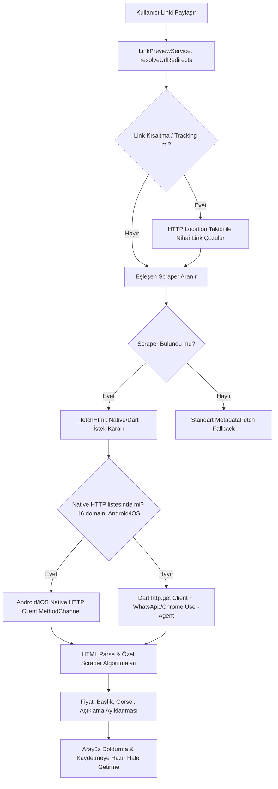

# FırsatKolik Mağaza Özel Scraping Kuralları ve Stratejileri

> [!NOTE]
> Bu doküman Mağaza Özel Scraping Kuralları kılavuzudur. Sistemin güncel 24 scraper'lık şemaları, bypass stratejileri, platform-native HTTP tünellemesi ve deployment süreçleri için lütfen **[Scraping Mimarisi ve Otonom Botlar Master Rehberi](file:///d:/firsatkolik/documentation/scraping-ve-botlar/scraping_mimarisi_rehberi.md)** dokümanını inceleyiniz.

Bu belge, FırsatKolik uygulamasında yer alan entegre mağazalar (24 scraper; Dart: `lib/services/scrapers/`, Node: `cloud-run-bot/scrapers/`) için geliştirilen scraping (veri kazıma) stratejilerini, karşılaşılan bot koruması (WAF/Akamai/Cloudflare) engellerini ve bunların nasıl aşıldığını detaylıca açıklamaktadır.

---

## 🏗️ Genel Scraping Mimarisi ve İstek Akışı

FırsatKolik'te bir ürün linki paylaşıldığında veya yapıştırıldığında süreç şu aşamalardan geçer:

---

## 🏪 Mağaza Detaylı Çözümleme Stratejileri

Her mağazanın sunucu taraflı davranışları, bot korumaları ve fiyat yerleşimleri farklılık göstermektedir. Mağazaların çalışma detayları aşağıda sınıflandırılmıştır:

### 1. Amazon (`amazon.com.tr`, `amzn.to`, `amzn.eu`, `link.amazon`, `amzlinks.in`, `fenom.io`)
*   **Domain Allowlist ve Doğrulama Kapsamı:** `amazon_tr` mağazası altında `amazon.com.tr` ana domaininin yanı sıra resmi mobil paylaşım ve kısa link alan adları (`amzn.eu`, `amzn.to`, `link.amazon`, `amzlinks.in`) allowlist'e tam entegredir.
*   **Ürün Sayfası Doğrulama Kuralları (`product_path_rules`):** Doğrudan ürün detay sayfaları (`/dp/[ASIN]`, `/gp/product/[ASIN]`, `/product/[ASIN]`, `/aw/d/[ASIN]`, `/gp/aw/d/[ASIN]`), Amazon Depo/Fırsat satıcı sayfaları (`/gp/offer-listing/[ASIN]`) ve kısa paylaşım yolları (`/d/[slug]`) katı kurallarla doğrulanır; kampanya (`/deals`), arama (`/s?`) veya anasayfa gibi sayfalar filtrelenir.
*   **User-Agent Politikası:** Akamai/WAF engellerini aşmak için `WhatsApp/2.23.4.15 A` kullanılır.
*   **Kısa Link ve Yönlendirme Desteği:** `amzn.eu`, `amzn.to` ve `link.amazon` kısa linkleri yönlendirme zinciri takibiyle (`resolveUrlRedirects`), `fenom.io` kısa linkleri ise sayfa içerisindeki JavaScript `appLink` / `fallbackLink` değişkenleri regex ile ayıklanarak (`resolveFenomShortLink`) asıl uzun linklerine çözümlenir.
*   **Görsel Kazıma Zorluğu:** Amazon bazen ürün görseli olarak 43-byte boyutunda boş siyah piksel placeholder resmi döner.
*   **Çözüm:** `isLogoUrl` fonksiyonu ve byte kontrolü ile bu boş görseller elenerek HTML içerisindeki asıl `img#landingImage` veya `img#imgBlkFront` DOM elemanları taranır.
*   **Fiyat Çekme & Çift Metin (Accordion) Ayrıştırması:** Amazon `.a-price` ve `.apex-pricetopay-value` konteynerlerinde hem ekran okuyucular için `` hem de görsel parçalı render için `` basar. Scraper'larımız doğrudan konteyner metnini almak yerine öncelikle `.a-offscreen` tekil metnini çeker, boşsa `aria-hidden` altındaki `.a-price-whole` + `.` + `.a-price-fraction` parçalarını birleştirir. Böylece tekrarlanan fiyat metinlerinin yapışarak `2699126991` gibi bozuk değerler üretmesi engellenir. Ayrıca `parsePriceText` seviyesinde ardışık tekrarlanan fiyat kalıplarına karşı çift katmanlı savunma bulunur. Amazon Depo (`smid=A215JX4S9CANSO`) tespitinde `#apex-pricetopay-accessibility-label`, `.apex-pricetopay-value`, `#usedBuySection .offer-price` ve `.aok-offscreen` seçicileri ile 2. el/Depo fiyatı öncelikli ve eksiksiz çekilir; normal ürünlerde ise birincil fiyat seçicileri önceliklidir.

### 2. DeFacto (`defacto.com.tr`)
*   **User-Agent Politikası:** `WhatsApp/2.23.4.15 A` ile Cloudflare engelleri aşılır.
*   **Fiyat Kazıma Zorluğu:** DeFacto sepete özel indirimleri HTML DOM elemanlarına basmaz; Javascript nesneleri içerisinde saklar.
*   **Çözüm:** Sayfadaki `window.PRODUCT_DETAIL_LASTVISITED` script bloğu regex ile taranır. `DiscountPrice` (Sepetteki asıl indirimli fiyat) ve `CampaignDiscountedPrice` alanları tırnaksız/tırnaklı Javascript key desteğiyle aranarak tam net fiyat çözülür.
*   **Unicode Karakter Çözümü:** script bloğundan gelen başlıklar (`ProductVariantMiniProductName`) `&#x131;` (ı) gibi HTML varlıkları veya `\uXXXX` kaçış dizileri içerebilir. Bunlar özel bir kod çözücü (`_decodeUnicode`) ile temizlenip Türkçe karakterlere çevrilir.

### 3. Hepsiburada (`hepsiburada.com`, `hb.biz`, `app.hb.biz`)
*   **Domain Allowlist ve Doğrulama Kapsamı:** `hepsiburada` mağazası altında `hepsiburada.com` ana domaininin yanı sıra resmi mobil paylaşım domainleri (`hb.biz`, `app.hb.biz`) allowlist ve kısa link çözümleme boru hatlarına entegredir.
*   **Ürün Sayfası Doğrulama Kuralları (`product_path_rules`):** Doğrudan ürün detay sayfaları (`-(?:p|pm)-[a-z0-9]+\/?$`) katı kurallarla doğrulanır; satıcı mağaza sayfaları (`/magaza/`), kampanya sayfaları (`/kampanyalar`), arama sayfaları (`/ara?q=`) veya anasayfa filtrelenerek sahte fırsat paylaşımları engellenir.
*   **Kısa Link Çözümleme (`hb.biz`, `app.hb.biz`):** Akamai WAF engeline takılmamak adına `redirect: 'manual'` GET/HEAD isteğiyle ilk 301 yönlendirmesindeki `Location` başlığından `adj.st` yakalanır ve `adjust_fallback` / `adj_fallback` parametresi çözümlenerek gerçek ürün URL'i elde edilir.
*   **Canlı Fiyat API Entegrasyonu & `_HbApiPriceResult` Modeli:** Hepsiburada normal, Premium ve sepetteki indirimli fiyatları HTML dokümanında gizler. Scraper:
    1. HTML içerisindeki `<script id="reduxStore">` JSON verisini parse eder.
    2. `sku`, `listingId`, `merchantId`, `productId`, `tagList`, `rootCategoryList` parametrelerini ayıklar.
    3. **Etiket Filtreleme (`_isIgnoredHbTag`):** `product.tagList` ve `otherMerchants` listesindeki `ilk-siparis`, `yeni-uye` gibi genel üyelik/onboarding kupon etiketleri elenir; Hepsiburada'nın tüm Premium kampanyaları (`premium-a-gec`, `premiuma-gec` vb.) ve sepete özel etiketleri ise tam yetkiyle API'ye iletilir.
    4. Hepsiburada'nın resmi `withoutAffordability` (birincil buybox satıcısı) ve `otherMerchants` (tüm diğer satıcılar) POST API'lerine paralel (`Future.wait` / `Promise.all`) istek atar.
    5. **Gotham Gateway Başlıkları:** İstek başlıklarına `x-gotham_app-key: All`, `x-gotham_is_include_premium_clubs: true`, `x-gotham_is_enabled_evaluate_coupon: true`, `x-gotham_is_enabled_next_eligible_campaign: true` ve `x-gotham_is_include_payment_campaigns: true` enjekte edilir.
    6. **Premium vs Normal Sepet İndirimi Ayrıştırması (`_isValidPremiumCampaignResult`):** Gelen API yanıtındaki `evaluateAsPremiumResult` nesnesi doğrulanır. Gerçek Premium kampanyası (`isPremium: true`) ile normal sepete özel indirimler (`evaluateResult` / `priceData`, `isPremium: false`) karşılaştırılır. Fiyatlar eşitse Premium avantajı önceliklendirilir, normal sepete özel indirimlerde ise `isPremium: false` korunarak en avantajlı sonuç `_lastApiResult` referansına kaydedilir.
*   **3 Kademeli Hiyerarşik Premium Rozet Tespiti (`scrapePriceLabel`):**
    1. **Kademe 1 (Yetkili Kaynak - Canlı API):** API başarıyla sorgulandıysa doğrudan `_lastApiResult.isPremium` referans alınır (`true` ise `'Premium ile'`, genel sepet indirimi ise `null`). Sepet baremleri, sepete özel % indirimler ve çoklu alım kuponlarının sahte Premium rozeti üretmesi %100 engellenir.
    2. **Kademe 2 (Özel DOM Rozetleri - Offline/Statik):** API'ye ulaşılamayan durumlarda `[data-test-id*="premium-price"]`, `[class*="PremiumPrice"]`, `[data-test-id="loyalty-discount"]` DOM düğümleri taranır.
    3. **Kademe 3 (Katı Metin Regex):** Sadece doğrudan yaprak fiyat içeren `^(?:hepsiburada\s*)?premium['’]?\s*(?:ile|la)\s*[\d.,]+\s*(?:tl|₺)?$` desenleri kabul edilir. Header/footer/toplinks/taksit blokları elenir.
*   **Sunucu Bypass (Node.js / VM):** Akamai Bot Manager Google datacenter IP'lerini engellediğinden, VM ortamında sistem `spawnSync('curl', [...])` + `WhatsApp` UA kullanılarak istekler atılır.

### 4. Mavi (`mavi.com`)
*   **User-Agent Politikası:** `WhatsApp/2.23.4.15 A` kullanılır.
*   **Scraping Yolu:** Tamamen `application/ld+json` standart schema yapısına dayanır.
*   **Resim CDN Kontrolü:** Mavi görsellerinin geçerliliği `sky-static.mavi.com` CDN deseniyle doğrulanır.

### 5. Pazarama (`pazarama.com`, `pzrm.me`)
*   **Domain Allowlist ve Doğrulama Kapsamı:** `pazarama` mağazası altında `pazarama.com` ana domaininin yanı sıra resmi mobil paylaşım domaini (`pzrm.me`) allowlist ve kısa link yönlendirme sistemlerine entegredir.
*   **Ürün Sayfası Doğrulama Kuralları (`product_path_rules`):** `-p-[a-z0-9][a-z0-9-]*\/?$` deseniyle ürün sayfaları katı kurallarla doğrulanır; kategori, kampanya veya anasayfalar filtrelenir.
*   **Plus Üyelik Önceliği:** Pazarama Plus üyelerine sunulan özel indirimli fiyatlar JSON-LD standart şemasında yer almaz, sadece DOM'da bulunur.
*   **Çözüm:** Scraper öncelikle sayfada `plus-icon` veya `pz-plus-icon` logolarını arar. Eğer varsa, kapsayıcı div altındaki Plus indirimli fiyatı (`span` etiketlerinden) ayıklar. Plus indirimi yoksa normal JSON-LD standart fiyatına fallback yapar.

### 6. Trendyol (`trendyol.com`, `ty.gl`)
*   **Domain Allowlist ve Doğrulama Kapsamı:** `trendyol` mağazası altında `trendyol.com` ana domaininin yanı sıra resmi mobil kısa link domaini (`ty.gl`) allowlist ve yönlendirme boru hatlarına entegredir.
*   **Ürün Sayfası Doğrulama Kuralları (`product_path_rules`):** Doğrudan ürün detay sayfaları (`-p-\d+\/?$`) katı kurallarla doğrulanır; arama sayfaları (`/sr?q=`), butik/kampanya sayfaları (`/butik/detay/`) veya anasayfa filtrelenerek sahte fırsat paylaşımları engellenir.
*   **Varyant Karmaşası:** Trendyol'da çoklu boyut/renk içeren sayfalarda şema root tipi `Product` yerine `ProductGroup` olarak gelir. Eski yapıda bu durum en üstteki asıl fiyat yerine ilk varyantın alakasız fiyatının çekilmesine yol açıyordu.
*   **Çözüm:** `findProductInJson` fonksiyonuna `ProductGroup` desteği eklenerek en üst seviyedeki ana ürünün geçerli aktif fiyatının çözümlenmesi sağlandı.
*   **Kampanyalı / Sepet İndirimli Ürünlerde JSON-LD Eksikliği:** Bazı sepet indirimli veya kampanya tanımlı ürün sayfalarında (`.campaign-price-wrapper`) Trendyol hiçbir `application/ld+json` şeması basmaz. Bu durumda fiyat DOM'da `
` ve script state'inde (`__PRODUCT_DETAIL_APP_INITIAL_STATE__`) `discountedPrice` / `sellingPrice` alanlarında saklanır.
*   **Çözüm:** DOM seçicilerine `.new-price` eklenerek ve state script fallback'i getirilerek fiyatın 0 TL dönmesi engellendi.

### 7. Zara (`zara.com`)
*   **Bot Koruması Engeli (Akamai Bot Manager):** Zara, standart Dart HTTP istemcilerini JA3/TLS parmak izi analiziyle anında engelleyerek `2.8 KB` boyutunda bir Javascript challenge sayfasına (`bm-verify`) yönlendirir.
*   **Çözüm (Platform-Native Bypass):** 
    *   Android (`MainActivity.kt`) ve iOS (`AppDelegate.swift`) taraflarında native platform kanalları (`MethodChannel`) açıldı.
    *   İstekler Android'de native JDK `HttpURLConnection`, iOS'ta ise Swift `URLSession` üzerinden atılır. Bu yerel işletim sistemi ağ kütüphaneleri, tarayıcı/mobil işletim sistemiyle 1:1 aynı JA3 TLS handshake imzasına sahip olduğundan Akamai engeline takılmadan Zara'nın asıl HTML sayfasını (`~640 KB`) indirmeyi başarır.
*   **Scraping Yolu:** HTML içindeki `zara.analyticsData` script'i regex ile taranarak `mainPrice` ve `productName` alanları ayıklanır. og:image ve og:description meta verileriyle harmanlanır.

### 8. Mango (`mango.com`)
*   Güncel Mango yapısı (React CSS Modules, `sr-only` fiyat etiketleri, Chrome 124 UA) için bkz. aşağıdaki **§12**. Eski `self.__next_f.push` / Next.js App Router anlatımı kodda artık yoktur (`mango_scraper.js`/`.dart` içinde `__next_f` geçmez), kaldırıldı.

### 9. Beymen (`beymen.com`)
*   **BEYMEN.productMain Script Entegrasyonu (Öncelikli):** Beymen ürün detay sayfalarında yer alan ve ürün bilgilerini tutan Javascript `BEYMEN.productMain` nesnesi taranır. 
    *   **Fiyat Çözme:** Sepet indirimleri dahil en güncel fiyatı veren `"promotedOrActualPrice"` değeri script'ten doğrudan regex ile yakalanır.
    *   **Başlık Çözme:** Ürünün tam ismini barındıran `"displayName"` değeri regex ile çıkarılır.
*   **Hatalı JSON-LD Yapıları (Yedek):** Şema (JSON-LD) yapılarında inç gibi çift tırnak işaretlerinin kaçışsız (`"`) kullanılması veya raw yeni satırların bulunması durumunda yedek (fallback) mekanizmaları devreye girer:
    *   **JSON-LD Sanitizer:** `BaseProductScraper.findProductJsonLd` içinde decode edilmeden önce raw yeni satır karakterleri temizlenir.
    *   **Marka/Başlık Ayrımı (DOM Fallback):** Beymen'de `h1` etiketi sadece marka adını (`Apple`, `Sony`) içerir. Asıl ürün başlığı `.o-productDetail__description` etiketinden veya script `displayName` alanından alınır.
    *   **En Ucuz Kampanya Fiyatı (DOM Fallback):** Script ve şema okunamadığında normal fiyat (`ins.m-price__new`) ve Visa/Sepet kampanya fiyatı (`.m-price__campaignPrice`) taranarak en ucuzu seçilir.

### 10. İdefix (`idefix.com`)
*   **Domain Allowlist ve Doğrulama Kapsamı:** `idefix` mağazası altında `idefix.com` ana domaini allowlist sistemine entegredir.
*   **Ürün Sayfası Doğrulama Kuralları (`product_path_rules`):** `-p-\d+\/?$` deseniyle doğrudan ürün sayfaları doğrulanır; kategori veya liste sayfaları elenir.
*   **Next.js SSR vs. Dinamik Yorum/Puan Servisi:** İdefix ilk server-side HTML GET yanıtında başlık, görsel ve fiyat verilerini `application/ld+json` şemasına basarken; değerlendirme (`averageRating`) ve oy sayısı (`reviewCount`) bilgilerini sunucu tarafında HTML'e basmayıp istemci taraflı (React/Next.js) dinamik mikroservis API'si üzerinden yüklemektedir.
*   **Çözüm (Canlı ecomapi Entegrasyonu):** 
    1. Scraper öncelikle statik HTML içerisindeki `application/ld+json`, `<script id="__NEXT_DATA__">`, ham script regex ve HTML Microdata etiketlerini tarar.
    2. Puan veya değerlendirme sayısı bulunamadığında, canonical URL veya DOM etiketlerinden ürün ID'si (`p-{productId}`) çıkarılır.
    3. İdefix'in resmi e-ticaret yorum servisine (`https://ecomapi.idefix.com/api/product/{productId}/detail/review`) istek atılarak `averageRating` ve `reviewCount` alanları canlı olarak çekilir.
*   **İdefix Premium Rozeti (`priceLabel` = "Premium'a Özel"):**
    1. İdefix web sayfalarında `__NEXT_DATA__` JSON ağacındaki `currentPrice` nesnesi altında `premiumDiscountedPrice` (> 0) ve `premiumPromotionTitle` ("Premiuma Özel Fiyatlar") alanları kontrol edilir.
    2. Script Regex ve DOM Fallback katmanlarında "Premium'a Özel", "Premiuma Özel" veya "Premium ile" ibareleri aranır.
    3. **False-Positive Koruması:** Sayfa üst bilgi çubuğundaki (header) genel "Premium'u Keşfet" pazarlama linki ürün bazlı bir rozet değildir; bu metin false-positive olmaması için kesin filtreleme ile elenir.
    4. Mobil istemci (`IdefixPremiumBadge`, `StorePriceBadge`) ve Node.js Bot scraper'ı 1-e-1 uyumlu olarak "Premium'a Özel" rozetini üretir.

### 11. N11 (`n11.com`, `sl.n11.com`)
*   **Domain Allowlist ve Doğrulama Kapsamı:** `n11` mağazası altında `n11.com` ve `sl.n11.com` (subdomain) alan adları allowlist'e tam entegredir.
*   **Ürün Sayfası Doğrulama Kuralları (`product_path_rules`):** `\/urun\/.+-\d+\/?$` deseniyle ürün detay sayfaları katı kurallarla doğrulanır; kampanya (`/kampanyalar`), arama (`/arama?`) veya mağaza sayfaları elenir.
*   **Kısa Link Çözümleme (`sl.n11.com/n/`):** N11 mobil uygulamasından paylaşılan `sl.n11.com/n/{kod}` linkleri Google Translate Proxy veya doğrudan HTTP yönlendirmesiyle saniyeler içinde asıl ürün sayfasına çözülür.
*   **Sepet İndirimi & Fiyat Çözümleme:** N11'de anlık sepet kampanyaları ("Sepette %X İndirim") ilk HTML'de yer almaz. `window.model` üzerinden ürün ID'si ve kategorisi okunarak `POST https://www.n11.com/rest/v1/personalizedDetail` API'sine istek atılır ve dinamik `instantDiscountedPrice` ile `oldPrice` çekilir. Statik fallback'te `price` ve `displayPrice` karşılaştırılarak düşük olan satış fiyatı, yüksek olan ise liste fiyatı olarak alınır.
*   **Fiyat Bütünlüğü & Ardışık Rakam Koruması (99 TL, 88 TL, 999 TL):** N11'de `window.model` veya DOM'dan gelen tam sayı fiyatlar (örneğin 99 TL, 159 TL gibi Chakra ve ev tekstil ürünleri) `BaseProductScraper.parsePriceText` motorunun çok katmanlı savunması sayesinde mükerrerlik filtrelerine takılmaz; ardışık rakamlı tam sayılar (99 -> 9) bozulmadan tam ve doğru şekilde `99.0 TL` olarak sisteme aktarılır.
*   **Abonelik Rozeti (`priceLabel`):** N11'de Prime/Plus/Premium gibi ücretli üyelik sistemi bulunmadığından `priceLabel` alanı standart dışı mağazalara uygun şekilde daima `null` döner.
*   **WAF Engeli:** WAF 403 engeli için `WhatsApp` UA taklidi ve HTTP/1.1 TLS istemcisi kullanılır.

### 12. Mango (`shop.mango.com`)
*   **User-Agent Politikası & Vercel WAF Bypass:** Mango, `WhatsApp/2.23.4.15 A` User-Agent'ı ile gelen istekleri otomatik olarak `429 Vercel Security Checkpoint` ile bloklamaktadır. Bu nedenle modern tarayıcı User-Agent'ı (`Mozilla/5.0 (Windows NT 10.0; Win64; x64) AppleWebKit/537.36 ... Chrome/124.0.0.0`) kullanılır.
*   **React CSS-Modules & Erişilebilirlik Fiyat Ayrıştırması:** Mango, Next.js altyapısından React CSS Modules mimarisine geçmiştir (`SinglePrice-module`, `ZoomableImage-module`). Fiyatlar ekranda ekran okuyucu etiketleriyle sunulmaktadır:
    *   **İndirimli / Güncel Fiyat:** `Güncel fiyat [2.299,99 TL ]` veya `[class*="SinglePrice"][class*="discounted"]` ve `itemprop="offers"` içindeki `meta[itemprop="price"]`.
    *   **İndirimsiz / İlk Fiyat:** `Üstü çizili ilk fiyat [2.999,99 TL ]` veya `[class*="SinglePrice"][class*="crossed"]`.
*   **Deterministik CDN Görsel Desteği:** `og:image` (`media.mango.com`) ve `ZoomableImage` seçicilerine ek olarak, mobil paylaşım URL'lerindeki ürün ve renk kodundan (`/(3\d{7})/(\d{2})/`) doğrudan `https://st.mngbcn.com/rcs/pics/static/T3/fotos/S/${productId}_$colorId.jpg` CDN görseli üretilir.
*   **Kategori ve Departman Başlık Temizliği:** `og:title` içerisindeki ` - Erkek | MANGO Türkiye` veya ` - Kadın | MANGO Türkiye` uzantıları regex ile elenerek yalın ürün başlığı korunur.

### 13. Vatan Bilgisayar / Teknosa / MediaMarkt / İtopya
*   Bu mağazalar görece daha standart WAF yapıları kullanırlar. Ağırlıklı olarak `application/ld+json` taranır.

### 14. Getir (`getir.com`)
*   **Çerez ve Konum Entegrasyonu:** Getir, Next.js kullanan konum tabanlı bir teslimat servisidir. Bölgesel/depoya özel ürünlerin çözümlenebilmesi için istek başlıklarına `locale=tr; language=tr; countryCode=TR; appType=GETIR` çerezleri otomatik olarak enjekte edilir.
*   **Next.js JSON-LD & DOM Verisi:**
    *   **Fiyat ve Görsel:** Ürün bilgileri HTML içerisindeki `<script id="__NEXT_DATA__">` JSON bloğundan parse edilir. Ürün adı, fiyatı ve görsel cdn linkleri (`picURLs`) buradan doğrudan çekilir.
    *   **Uzun Açıklama:** Detaylı açıklama için `shortDescription` yerine Next.js payload'undaki uzun olan `description` veya `content` alanları öncelikli olarak okunur. İkisi de yoksa fallback olarak `shortDescription` ve meta tag'ler (`og:description`) taranır.

### 15. İncehesap (`incehesap.com`, `incehesap.com/u/`)
*   **User-Agent Politikası:** İstemcide `WhatsApp/2.23.4.15 A`; sunucuda sayfa HTML'i `curl` + iPhone Safari UA ile çekilir, `/u/` kısa link çözümü `curl` + WhatsApp UA ile yapılır (`link_scraper_service.js:340`, `curlFetchHtml`).
*   **Kısa Link Çözümleme (`/u/{code}/`):** Paylaştıkça Kazan kısa linkleri HTTP 302 yönlendirmesiyle (Location başlığı okunarak) 200 ms içerisinde kanonik ürün sayfasına çözülür (`asus-tuf-...-fiyati-91918/`).
*   **Dinamik Canlı API & Doğrudan Üretim:** `POST https://www.incehesap.com/uye/paylastikca-kazan/ajax/update.php` endpoint'ine `WhatsApp` UA + `PHPSESSID` çereziyle `{"action":"getSingleProductLink","urunId":...}` isteği atılır. Mobil istemci (Flutter) ve Telegram botu (Node.js) harici proxy'ye gerek olmadan doğrudan ~200 ms'de canlı link üretir.
*   **Fiyat ve Metadata Kazıma:** Sayfadaki `window.dataLayer` (`ecommerce.items`) nesnesi taranarak tam ürün adı, ürün ID, net/brüt fiyat, marka ve kategori bilgileri eksiksiz ayıklanır.

---

## 📊 Mağaza Özelinde Scraping Özet Tablosu

| Mağaza | Hedef Bilgi Kaynağı | Karşılaşılan Temel Zorluk | Uygulanan Çözüm ve Teknik |
| :--- | :--- | :--- | :--- |
| **Amazon** | DOM & JSON-LD | Boş/Placeholder 1x1 piksel görseller | 43-byte resim filtreleme + `img#landingImage` DOM seçicisi |
| **DeFacto** | Javascript `PRODUCT_DETAIL_LASTVISITED` | Fiyatların DOM'a basılmaması, Unicode karakter bozuklukları | Tırnaksız regex anahtar eşleme + `_decodeUnicode` filtresi |
| **Hepsiburada** | `withoutAffordability` & `otherMerchants` API | Premium ve Sepetteki indirimli fiyatların HTML'de gizlenmesi | `reduxStore` verileriyle canlı POST API istekleri ve paralel en ucuz fiyat seçimi |
| **İncehesap** | `window.dataLayer` & Canlı `ajax/update.php` | Cloudflare WAF bot koruması & dinamik `/u/` hash üretimi | `WhatsApp/2.23.4.15 A` UA bypass + `PHPSESSID` oturum çerezi ile ~200 ms'de doğrudan canlı API'den dinamik `/u/` linki üretimi |
| **Mavi** | JSON-LD (`application/ld+json`) | Cloudflare / Akamai engellemesi | `WhatsApp` User-Agent taklidi + JSON-LD parser |
| **Pazarama** | DOM (Plus Alanı) & JSON-LD | Plus üye indirimli fiyatının JSON-LD şemasında bulunmaması | Plus logosu tarama + DOM fiyat önceliklendirmesi |
| **Trendyol** | JSON-LD (`ProductGroup`) | Çoklu varyantlarda (beden vb.) yanlış varyant fiyatının çekilmesi | `ProductGroup` şema desteği ile root fiyat analizi |
| **Zara** | `zara.analyticsData` Script & Meta Tags | Akamai Bot Manager (JA3 TLS parmak izi engellemesi) | **Android (`HttpURLConnection`) & iOS (`URLSession`) Native MethodChannel bypass** + Regex script tarayıcı |
| **Mango** | React CSS-Modules (`SinglePrice`) & Microdata | Vercel 429 WAF engeli, JSON-LD şemasının olmaması ve yeni `sr-only` erişilebilirlik fiyat yapısı | Modern `Chrome/124.0.0.0` UA + `Güncel fiyat` / `Üstü çizili ilk fiyat` regex + `SinglePrice` (`discounted`/`crossed`) parser + `media.mango.com` / CDN fallback görsel motoru |
| **Beymen** | JSON-LD (`application/ld+json`) & DOM | Hatalı JSON-LD karakter dizilimleri (satır sonu, kaçışsız çift tırnak) ve marka/başlık ayrımı | JSON-LD Sanitizer + DOM başlık (`.o-productDetail__description`) & en ucuz fiyat karşılaştırma |
| **N11** | `window.model` & Canlı `personalizedDetail` API | WAF bot koruması, dinamik sepet indirimleri & Kısa Linkler | `WhatsApp` User-Agent + HTTP/1.1 TLS ile canlı `personalizedDetail` POST isteği (sepet indirimli ve eski fiyat tespiti, `price`/`displayPrice` min-max analizi). `sl.n11.com/n/` linkleri Google Translate Proxy tüneli ile Play Store yönlendirmesinden kurtarılır. Ücretli üyelik olmadığından `priceLabel` daima `null` döner. |
| **Vatan Bilgisayar**| DOM Seçicileri | Dinamik render bağımlılığı | `.product-list__price` DOM seçici fallback |
| **Teknosa** | JSON-LD | Standart yapı | JSON-LD `Product` şema çözücü |
| **MediaMarkt** | JSON-LD | Standart yapı | JSON-LD `Product` şema çözücü |
| **İtopya** | DOM Seçicileri & JSON-LD | Standart yapı | `.product-details-price` DOM seçici fallback |
| **İdefix** | JSON-LD | Standart yapı | JSON-LD `Product` şema çözücü |
| **Getir** | `__NEXT_DATA__` Script & Cookies | Lokasyon kısıtları ve kısa açıklamalar | `appType=GETIR` çerez enjeksiyonu + Next.js JSON parser (`description`/`content` öncelikli açıklama çekimi) |
| **Boyner** | Next.js `PriceInfo` & Temizlenmiş DOM | "Sepette" rozetinin fiyatla bitişmesi (`Sepette11.999 TL`) ve binlik ayracının kuruş sanılması | Next.js `PriceInfo` JSON motoru (`Price`, `OldPrice`, `CampaignInfo`) + DOM'da `priceMainText` rozet izolasyonu, `priceLabel` desteği ve sanity check |
| **CarrefourSA** | SAP Hybris PDP Kartları & JSON-LD | Cloudflare TLS engeli, öneri karusellerinden fiyat sızıntısı ve çoklu alım kampanyaları | Chrome 124 UA ile `curl` spawnSync + `translate.goog` (Sunucu) / Platform-native HTTP (İstemci), PDP fiyat kapsayıcısı izolasyonu, "CarrefourSA Kart ile" ve adet kampanyası ("2 Al 1 Öde") birleşik rozetleme |

Bu tabloda yer almayan mağazaların (PttAVM, Havit, Migros, Gamer Gen, Gaming Gen vb.) kuralları ve bypass eşleşmesi için [Master Rehber §3, §4 ve §12](scraping_mimarisi_rehberi.md) bakın.

---

## 🔢 Evrensel 6 Kademeli Fiyat Metni Ayrıştırıcı (`parsePriceText`)

Tüm scraper'ların ortak `BaseProductScraper.parsePriceText` metodu (`lib/services/scrapers/base_scraper.dart`, `cloud-run-bot/scrapers/base_scraper.js`), e-ticaret sitelerinin kirli HTML/DOM çıktılarından, tekrarlanan offscreen düğümlerinden, pazarlama sloganlarından ve farklı para birimi gösterimlerinden etkilenmeksizin kurşun geçirmez ve sıfır gecikmeli (zero-lag) şekilde net fiyata ulaşır:

### 🛡️ 6 Kademeli Çözümleme Hattı:
1. **ReDoS & Güvenlik Kalkanı:** Girdi uzunluğu > 300 karakter ise anında `null` döner; CPU kilitlenmesi veya bellek sızıntısı engellenir. Precompiled statik regex'ler ile sıfır GC (çöp toplayıcı) ve sıfır derleme maliyeti sağlanır.
2. **Ham Metin Dublike Para Birimi Ayıklaması (`_rawDupRegex`):** `269,91TL269,91TL`, `99TL99TL` veya `38160 ₺ 38160 ₺` gibi ardışık tekrarlanan bloklar doğrudan yakalanır ve tekil gövdeye indirgenir.
3. **Para Birimi Arındırma:** `TL`, `₺`, `TRY`, `$`, `€` ve boşluklar metinden temizlenir.
4. **Hassas Dublike Sayı Savunması:**
   - **Ondalıklı Dublike:** `269,91269,91` veya `299.90299.90` gibi yapışık durumlar `_decimalDupRegex` ile ayrıştırılır (ondalık ayırıcı zorunludur).
   - **Güvenli Tam Sayı Dublike:** Yalnızca **en az 4 basamaklı** tam sayı tekrarlarında (`3816038160` -> `38160`) indirgeme yapılır. Böylece `99 TL`, `88 TL`, `999 TL`, `1010 TL`, `2525 TL` gibi geçerli perakende fiyatlarının duplikasyon sanılarak `9` veya `10`'a çökmesi **kesinlikle engellenir**.
5. **Pazarlama Metni & Kampanya İzolasyonu:** Temizlenen metinde yabancı harfler/kelimeler kalmışsa (örn. `"Sepette %10 indirimle 150 TL"` veya `"Sepette 269,91"`):
   - Öncelikle yanında para birimi bulunan gerçek fiyat kalıbı (`_currencyPriceRegex`) taranır; bu sayede `%10` gibi kampanya yüzdeleri elenir ve gerçek fiyat olan `150 TL` çekilir.
   - Para birimi yoksa metindeki en son geçerli sayısal aday (`_genericPriceRegex`) ayrıştırılır.
6. **Sayısal Biçim Standartlaştırma (TR / Uluslararası):**
   - Nokta ve virgül birlikteyse sonuncusu ondalıktır (`1.234,56` -> `1234.56`, `1,234.56` -> `1234.56`).
   - Tek ayırıcı ve 3 basamaksa binliktir (`1.798` -> `1798`, `48.020` -> `48020`, `6,447` -> `6447`).
   - Tek ayırıcı ve 3 basamaktan farklıysa ondalıktır (`423,99` -> `423.99`, `12.5` -> `12.5`).

| Girdi Örneği | Ayrıştırılan Değer | Çalışan Savunma Katmanı |
| :--- | :--- | :--- |
| `99 TL` / `99` (N11 Chakra Havlu) | `99.0` | Güvenli Tam Sayı Koruma (99 asla 9'a çökmez) |
| `159 TL` | `159.0` | Standart Tam Sayı |
| `269,91TL269,91TL` (Amazon) | `269.91` | Ham Para Birimi Tekrarı |
| `269,91269,91` | `269.91` | Ondalıklı Dublike Savunması |
| `3816038160` | `38160.0` | 4+ Basamaklı Tam Sayı Dublike Savunması |
| `Sepette %10 indirimle 150 TL` | `150.0` | Para Birimi Bağlı Kampanya İzolasyonu |
| `1.499,90 TL` | `1499.90` | Türkçe Standart Format |
| `2,436.93 TL` (Trendyol Plus) | `2436.93` | Uluslararası Format |
| `TRY 159` / `99 TRY` | `159.0` / `99.0` | ISO Para Birimi Desteği |

---

## 💡 Yeni Mağaza Ekleme Kuralları
Yeni bir mağaza eklenirken şu kurallara riayet edilmelidir:
1. Sitenin ilk server-side HTML yanıtında `application/ld+json` olup olmadığı bağımsız bir betikle (`curl` + `grep ld+json` yeterlidir) kontrol edilmelidir.
2. Eğer WAF koruması varsa `LinkPreviewService._getHeadersForUrl` içerisinden uygun User-Agent atanmalıdır.
3. TLS engeli (Akamai vb.) varsa doğrudan `LinkPreviewService._fetchHtml` platform kontrolü içerisine dahil edilerek **Native HTTP** akışına yönlendirilmelidir.
4. Yazılan her scraper için mutlaka `test/` dizini altında offline HTML verileriyle çalışan bağımsız unit testler (`test/magaza_scraper_test.dart`) oluşturulmalıdır.

