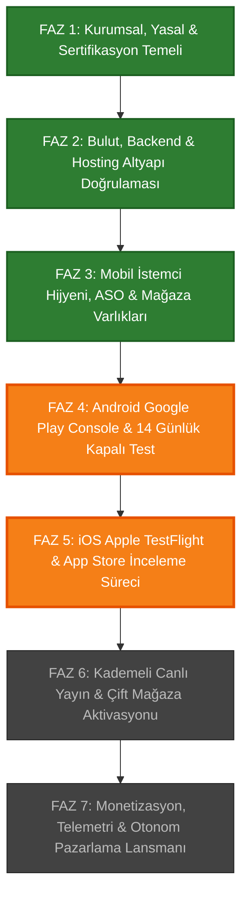

# 🚀 FırsatKolik — Master Canlıya Geçiş & Store Lansman Orkestratörü
# (Living Release Orchestrator & Production Milestone Matrix)

> **Sürüm:** v1.0.0 — Master Launch Edition  
> **Son Güncelleme:** 2026-10-08  
> **Aktif Çalışma Dalı:** `develop`  
> **Sorumlu Orkestratör:** `firsatkolik-store-release` (Antigravity Launch Orchestrator Agent)  
> **Temel İlke:** Sıfır Eksik, Sıfır Mağaza Reddi (Zero Store Rejection), Katı Hiyerarşi, Tam Donanımlı İki Ortam İzolasyonu.

---

## 🧭 Orkestratörün Çalışma Mantığı ve Yaşayan Durum Sözleşmesi
Bu doküman **FırsatKolik** projesinin geliştirme aşamasından başlayıp Google Play Store ve Apple App Store'da gerçek kullanıcılara ulaşmasına ve lansman reklamlarının otonom başlatılmasına kadar geçen tüm süreci adım adım takip eden **yaşayan tek gerçektir (Single Source of Truth)**.

### 🚦 Durum Gösterge Standartları:
* 🟢 **`[TAMAMLANDI]`** : Tüm gereksinimleri, kodları, sertifikaları veya doğrulamaları eksiksiz tamamlanmış adımlar.
* 🟡 **`[ŞU ANKİ ADIM / AKTİF]`** : Tam üzerinde durduğumuz, bir sonraki aksiyonu temsil eden ve odaklandığımız adım.
* ⚪ **`[SIRADAKİ / BEKLEMEDE]`** : Önceki adımların tamamlanmasına bağımlı olan ve sırası geldiğinde açılacak adımlar.
* ⚠️ **`[MANUEL ONAY / KULLANICI GİRDİSİ]`** : Console girişleri, kredi kartı, şifre veya fiziksel telefon gerektiren kullanıcı eylemleri.

> 💡 **Kaldığımız Yerden Devam Etme Kuralı:**  
> Kullanıcı birkaç gün sonra *"Hadi kaldığımız yerden devam edelim"* dediğinde, bu dosya taranır, en üstteki 🟡 **`[ŞU ANKİ ADIM]`** bulunur ve ajan doğrudan o adımın gereksinimlerini devralarak süreci işletir. Adım bittiğinde 🟢 yeşile döner ve bir sonraki adım 🟡 sarı yapılır.

---

## 🗺️ Uçtan Uca Faz Matrisi ve Canlı İlerleme Çizelgesi

| Faz No | Faz Başlığı | Kapsam | İlerleme | Genel Durum |
| :---: | :--- | :--- | :---: | :---: |
| **FAZ 1** | **Kurumsal, Yasal & Sertifikasyon Temeli** | Hesaplar, Gizlilik/KVKK URL'leri, Apple Sertifikaları, Keystore | **%100** | 🟢 **TAMAMLANDI** |
| **FAZ 2** | **Bulut, Backend & Hosting Altyapı Doğrulaması** | Functions 28, Firestore/Storage Rules, AASA, İndeksler, VM Bot | **%100** | 🟢 **TAMAMLANDI** |
| **FAZ 3** | **Mobil İstemci Hijyeni, ASO & Varlıklar** | API 36, AdMob Faz 3.3, 1024x500 Graphic, 51 Medya Varlığı | **%100** | 🟢 **TAMAMLANDI** |
| **FAZ 4** | **Google Play Console & Kapalı Test** | AAB Yükleme, 12 Tester / 14 Gün Test, Play Integrity, App Signing | **%45** | 🟡 **AKTİF ADIM** (Kapalı Test Kanalına AAB Yükleme) |
| **FAZ 5** | **Apple TestFlight & App Store Süreci** | GitHub Actions CI/CD, Dahili Test Grubu, Canlı Test Protokolü | **%75** | 🟡 **AKTİF ADIM** (TestFlight CI/CD & Cihaz Doğrulaması) |
| **FAZ 6** | **Kademeli Canlı Yayın & Mağaza Aktivasyonu** | Staged Rollout (%5->%100), App-Ads.txt, AdMob Mağaza Eşleme | **%10** | ⚪ **BEKLEMEDE** |
| **FAZ 7** | **Monetizasyon & Otonom Pazarlama Lansmanı** | AdMob onPaidEvent, Google UAC, Meta Ads, CPI Optimizasyonu | **%20** | ⚪ **BEKLEMEDE** |

---

## 📋 FAZ 1 — Kurumsal, Yasal & Sertifikasyon Temeli (✅ %100 TAMAMLANDI)

* 🟢 **Adım 1.1: Google Play Developer Bireysel Hesabı**  
  *Geliştirici:* `muratcan.gokyokus@gmail.com`  
  *Durum:* 25$ ödendi, 2FA ve kimlik doğrulaması tamamlandı.
* 🟢 **Adım 1.2: Apple Developer Program Hesabı**  
  *Hesap Sahibi:* `muratcan.gokyokus@hotmail.com` | *Team ID:* `973W9DTDY9`  
  *Durum:* Aktif geliştirici hesabı devrede.
* 🟢 **Adım 1.3: Android PROD Keystore & İmzası**  
  *Dosya:* `android/app/upload-keystore.jks` | *Config:* `android/key.properties`  
  *Alias:* `upload` | *Şifre:* `firsatkolik2024!`  
  *Upload Key SHA-1:* `59:81:22:B5:48:21:79:1D:8C:55:5A:19:0E:C9:D9:76:31:E0:6D:9A`  
  *Upload Key SHA-256:* `5E:9E:29:AC:81:63:22:77:B7:C8:EC:91:34:A2:E2:C2:C4:E7:05:EC:F9:FE:1C:56:2D:42:00:64:15:1F:40:2B`
* 🟢 **Adım 1.4: Windows OpenSSL ile Apple Dağıtım Sertifikası (.p12)**  
  *Sertifika Dosyası:* `ios_ci/ios_certs/firsatkolik_distribution.p12`  
  *Şifre:* `firsatkolik2024!`
* 🟢 **Adım 1.5: Apple Provisioning Profilleri**  
  *Ana Uygulama:* `ios_ci/ios_certs/FirsatKolik_AppStore_Profile.mobileprovision` (`com.firsatkolik.app`)  
  *Share Extension:* `ios_ci/ios_certs/FirsatKolik_ShareExtension_Profile.mobileprovision` (`com.firsatkolik.app.ShareExtension`)
* 🟢 **Adım 1.6: App Store Connect API Anahtarı (.p8)**  
  *Key ID:* `XUVRF9F2Y3` | *Dosya:* `ios_ci/ios_certs/AuthKey_XUVRF9F2Y3.p8`  
  *Kullanım:* Fastlane CI/CD headless yükleme.
* 🟢 **Adım 1.7: Apple Push Notification Service (APNs) Anahtarı (.p8)**  
  *Key ID:* `KJ2TZ9F8SG` | *Dosya:* `ios/Push_Notifications/AuthKey_KJ2TZ9F8SG.p8`  
  *Firebase Entegrasyonu:* Hem DEV (`sicak-firsatlar-e6eae`) hem PROD (`firsatkolik-prod-e6eae`) Cloud Messaging'e yüklendi.
* 🟢 **Adım 1.8: GitHub Actions CI/CD Repository Secrets**  
  *Konum:* GitHub Repo > Settings > Secrets and variables > Actions  
  *Tanımlı 7 Sır:* `BUILD_CERTIFICATE_BASE64`, `P12_PASSWORD`, `BUILD_PROVISION_PROFILE_BASE64`, `SHARE_EXT_PROVISION_PROFILE_BASE64`, `APP_STORE_CONNECT_KEY_ID`, `APP_STORE_CONNECT_ISSUER_ID`, `APP_STORE_CONNECT_PRIVATE_KEY`.
* 🟢 **Adım 1.9: Herkese Açık Yasal Web Sayfaları & KVKK/EULA**  
  *Gizlilik Politikası:* `https://firsatkolik.app/privacy-policy.html` (Canlıda aktif)  
  *Hesap & Veri Silme:* `https://firsatkolik.app/delete-account.html` (Canlıda aktif)  
  *Amazon Gelir Ortaklığı Bildirimi:* `web/index.html` footer alanında yayında.

---

## ⚡ FAZ 2 — Bulut, Backend & Hosting Altyapı Doğrulaması (✅ %100 TAMAMLANDI)

* 🟢 **Adım 2.1: DEV vs PROD Firebase Projeleri İzolasyonu**  
  *DEV Projesi:* `sicak-firsatlar-e6eae` (No: `560592268193`)  
  *PROD Projesi:* `firsatkolik-prod-e6eae` (No: `228657473310`)
* 🟢 **Adım 2.2: Cloud Functions Sadeleştirme & 25 Optimize Servis (100k Felaket Önleme Kalkanı)**  
  *Envanter:* 8 Firestore trigger, 1 Auth trigger, 1 HTTPS onRequest, 5 Scheduled cron, 10 Callable API (Toplam 25 Optimize Çekirdek + 2 DEV Test Aracı = 27 Aktif Dışa Aktarım).  
  *Konsolidasyon ve Tasfiye:* 4 ölü/mükerrer fonksiyon (`deleteMyAccount`, `purgeOldSystemErrorsManual`, `cleanupExpiredDealsManual`, `cleanupOldImagesManual`) tamamen kaldırılarak 3 GB gereksiz RAM provizyonu ve çift silme yarış durumu bertaraf edildi. `cleanupExpiredDeals` görevi 02:30 TSİ'ye çekilerek 03:00'teki 36 marketlik katalog kazıyıcıyla I/O çekişmesi sıfırlandı. Test araçlarına (`generateTestData`, `cleanupTestData`) canlı PROD koruma kalkanı eklendi. 27 aktif fonksiyonun tamamına kurumsal JSDoc standart kartları entegre edildi (`cloud_functions_optimizasyon_ve_sadelesme_yol_haritasi.md`).  
  *Durum:* Node 22 LTS. 100k kullanıcı (100k DAU) ölçeği için 14 kritik felaket senaryosu (FS-CF-01 .. FS-CF-14) %100 devrede ve 5 test süitindeki 66+ mimari sözleşme testiyle (%100 GREEN) mühürlendi.
* 🟢 **Adım 2.3: Storage Güvenlik Kuralları (`storage.rules`)**  
  `deals/` ve `catalogs/` public okuma, yetkili kullanıcı WebP yükleme, 5MB limit, admin silme kuralı mühürlendi.
* 🟢 **Adım 2.4: Resmi Web Vitrini, Custom Domain, Cloudflare DNS & SSL**  
  *Domain:* `firsatkolik.app` (Cloudflare Registrar & 1.1.1.1 DNS)  
  *DNS A Kaydı (Apex):* `@` ➔ `199.36.158.100` (DNS Only / Gri Bulut ☁️)  
  *DNS TXT Kaydı (Doğrulama):* `@` ➔ `hosting-site=firsatkolik-prod-e6eae` (DNS Only / Gri Bulut ☁️)  
  *DNS CNAME Kaydı (Subdomain):* `www` ➔ `firsatkolik-prod-e6eae.web.app` (DNS Only / Gri Bulut ☁️)  
  *SSL:* Google Trust Services HTTPS 200 OK (Universal SSL devrede).
* 🟢 **Adım 2.5: Google AdMob `app-ads.txt` Doğrulaması**  
  *URL:* `https://firsatkolik.app/app-ads.txt`  
  *İçerik:* `google.com, pub-6853997017739651, DIRECT, f08c47fec0942fa0` (Yayında doğrulanmıştır).
* 🟢 **Adım 2.6: Otonom Telegram Botu & GCP Free Tier VM İzolasyonu**  
  *VM:* `telegram-bot-server` (`34.135.181.112`, `e2-micro`, `us-central1-a`) — RUNNING.  
  *Konteynerler & Portlar:* `dev-bot` (Port 8081, DEV Firestore), `prod-bot` (Port 8082, PROD Firestore).  
  *Ortam İzolasyonu:* `/home/murat/app/prod-bot/.env` dosyasında `PROJECT_ID=firsatkolik-prod-e6eae` ve `GOOGLE_APPLICATION_CREDENTIALS=/app/prod_firebase_key.json` tanımlıdır; `dev-bot`'un PROD'a yazması engellenmiştir. Test araçları (`create_test_data.js`, `/simulate`) PROD çalışma ortamında kilitlenmiştir.  
  *SRE & VM Bellek Kalkanı:* 969 MB RAM'li e2-micro VM'de bellek sızıntısı ve Docker log şişmesini önlemek için her gece 04:00 TSİ'de `clean_vm.sh` Linux Crontab otonom bakım görevi çalışmaktadır; Web Admin üzerinden V8 GC tetiklenebilir (`CLEAN_VM_MIMARISI.md`).
* 🟢 **Adım 2.7: Firestore Bileşik İndeksleri (`deals`, `comments`, `kuponlar`)**  
  1. `deals` İndeksi: `isExpired ASCENDING` + `createdAt DESCENDING` (İstemcinin anasayfa akışındaki `failed-precondition` hatası için eklendi).  
  2. `comments` Koleksiyon Grubu İndeksi: `collectionGroup: comments` (COLLECTION_GROUP scope) `userId ASCENDING` + `createdAt DESCENDING` (Web Admin paneli kullanıcı bazlı yorum listesi sorgusu için `firestore.indexes.json` dosyasına eklendi).  
  3. `kuponlar` İndeksi: `durum ASCENDING` + `kaynakTipi ASCENDING` + `olusturulmaTarihi DESCENDING` (Kupon Radarı ve Topluluk Kuponları'nın 100k kullanıcıda O(1) maliyetle bağımsız ve hatasız sayfalanması için `firestore.indexes.json` dosyasına eklendi).  
  4. `deals` Sıralı Arama İndeksi: `isApproved ASCENDING` + `searchKeywords CONTAINS` + `createdAt DESCENDING` (100k kullanıcıda en taze onaylı fırsatların 0-sonuç hatası olmadan O(1) maliyetle aranabilmesi için `firestore.indexes.json` dosyasına eklendi).  
* 🟢 **Adım 2.8: Apple Universal Links (AASA) Team ID Enjeksiyonu**  
  *Problem:* `web/.well-known/apple-app-site-association` ve `web/apple-app-site-association` dosyalarında `appID` değerleri `TEAMID.com.firsatkolik.app` olarak kalmıştı.  
  *Çözüm:* Gerçek Apple Team ID (`973W9DTDY9`) her iki dosyaya da enjekte edildi (`973W9DTDY9.com.firsatkolik.app`).
* 🟢 **Adım 2.9: Firestore PROD Başlangıç Ayarları & Anti-Spam Dokümanları (Bootstrap Configs)**  
  *Kapsam:* PROD Firestore projesinde (`firsatkolik-prod-e6eae`) sistemin sıfır kesintiyle çalışması için zorunlu başlangıç dokümanlarının oluşturulması:  
  1. `systemConfig/notifications`: Tam 12'li bildirim hız limitleri ve anti-spam kalkanı (`categoryHourlyLimit: 3`, `categoryDailyLimit: 8`, `authorHourlyLimit: 4`, `authorDailyLimit: 12`, `keywordHourlyLimit: 6`, `keywordDailyLimit: 18`, `dealMinIntervalSeconds: 30`, `dealMaxHourlyTotal: 8`, `commentHourlyLimit: 10`, `commentDealTenMinLimit: 5`, `marketingDailyLimit: 2`, `adminMessageHourlyLimit: 6`).  
  2. `settings/telegramBot`: Bot kaynak ve hedef kanalları (`sourceChannels: ['@indirimkaplani']`, `targetChannel: '@firsatkolik_canli'`) ve aktif dinleme parametreleri.  
  3. `settings/app`: `dealApprovalRequired: true`, `amazonAffiliateEnabled: true`, `teknosaAffiliateEnabled: true`, `hepsiburadaAffiliateEnabled: true`, `activeStores: ['teknosa', 'hepsiburada', 'amazon']`.  
  4. `system/maintenance`: `enabled: false` (Bakım modu kapalı).  
  5. `system/minSupportedBuild`: `minSupportedBuild: 1` (Zorunlu minimum sürüm kalkanı).  
  6. `users/{adminUid}`: Yönetici hesabına (`muratcan.gokyokus@gmail.com`) `isAdmin: true` atanması.  
  7. `settings/admob`: `killSwitch: false`, `nativeEnabled: true`, `rewardedEnabled: true`, `adCooldownSeconds: 25` (AdMob canlı reklam birimleri ve arbitraj kontrolü).  
  8. `settings/marketing`: `tier: 2`, `totalDailyBudget: 250`, `googleBudget: 150`, `metaBudget: 100`, `targetCpi: 4.20`, `status: 'PAUSED'` (Lansman pazarlama ve bütçe orkestrasyonu başlangıç kaydı).
* 🟢 **Adım 2.10: Cloud Scheduler 5 Otomatik Cron Görevinin Doğrulanması (ENABLED)**  
  *GCP Konsolu:* [Cloud Scheduler PROD](https://console.cloud.google.com/cloudscheduler?project=firsatkolik-prod-e6eae)  
  *Kontrol:* 5 zamanlanmış görevin tamamının (`crawlKuponlar` 01:00, `expireOldDealsCron` 03:00, `aggregateAnalyticsCron` 04:00, `cleanupOldLogsCron` 05:00, `dailyReportCron` 09:00) `ENABLED` durumda olduğu ve `Europe/Istanbul` saat diliminde çalıştığı teyit edildi.
* 🟢 **Adım 2.11: Firestore Zamanda Noktasal Kurtarma (PITR) ve Günlük Yedekleme (Backup Schedule)**  
  *Amaç:* Olası bir felaket veya veri bozulmasında sıfır veri kaybı güvencesi (`R-INF-07`).  
  *Durum:*  
  - PITR Etkinleştirme: `POINT_IN_TIME_RECOVERY_ENABLED` (Canlıda aktif) ✅  
  - Günlük Otomatik Yedek: 7 günlük yedekleme planı oluşturuldu (`backupSchedules/c1b3c4ac-057d-4f3e-8678-44f5d74a465f`) ✅  
* 🟢 **Adım 2.12: GCP Bütçe ve Cloud Functions Hata Alarmları (Alert Policies)**  
  *Bütçe Alarmı:* `monitoring/budget-alert.json` (500 TL aylık bütçe, %50, %80, %100 harcama eşikleri) GCP Billing Konsolunda devrede.  
  *Hata Alarmı:* `monitoring/alert-policy-functions.json` (5 dakikada 5 Cloud Functions hatası eşiği) Cloud Monitoring paneline yüklendi ve e-posta bildirim kanalına bağlandı.
* 🟢 **Adım 2.13: GCP Compute Engine Güvenlik Duvarı (Firewall Rules) & Bot Port Kalkanı**  
  *Amaç:* Bot yönetim uç noktalarının (`/simulate`, `/test-bypass`, `/bot-logs`, memory heap dump) dış internete açık kalarak SSRF veya DoS tehdidi oluşturmasını engellemek (`R-INF-01`, `R-INF-02`).  
  *Kural:* GCP Konsolu > VPC Network > Firewall kuralları altında `8081` ve `8082` portları genel internete (`0.0.0.0/0`) doğrudan açık tutulmamalı; yalnızca yetkili yönetim IP'lerine veya yerel proxy'ye kısıtlanmalıdır.
* 🟢 **Adım 2.14: 100k DAU Bildirim Sistemi ve Bildirim Tercihleri Felaket Önleme Kalkanı (`FS-PREF-01..15`)**  
  *Kapsam:* Profilim -> Bildirim Tercihleri (`NotificationSettingsScreen`), Yazar Bildirimleri (`UserService` & `ProfileScreen`), HomeScreen Bildirim Rozeti (`home_screen.dart`), Kupon Onay Dağıtımı (`dispatchApprovedCouponNotifications`), Firestore Kuralları (`firestore.rules`) ve Kelime Takibi (`KeywordTrackingScreen`).  
  *Çözülen Zafiyetler:*  
  1. `dispatchApprovedCouponNotifications` içindeki `ReferenceError: announcementId is not defined` çökmesi giderildi; 150 rastgele kullanıcı yazma döngüsü tasfiye edilerek saf `globalAnnouncements` tek doküman mimarisine bağlanarak gereksiz Cloud Functions trigger maliyeti sıfırlandı.  
  2. `home_screen.dart` bildirim ikonu için 100+15 dokümanlık ağır feed dinleyicisi yerine ultra hafif `getUnreadNotificationCountStream` (limit 20 unread + 5 active global) kurularak 100k DAU'da admin duyuru attığında 1.5 Milyon Read patlaması ve fahiş fatura riski %90+ önlendi.  
  3. `UserService.followUser` ve `unfollowUser` içine `FirebaseMessaging` topic subscribe/unsubscribe entegre edilerek takipten çıkan kullanıcılara bildirim gitmesi (Ghost Topic Leak) engellendi.  
  4. `NotificationService.resubscribeToTopics` içine `dealNotificationsEnabled` kontrolü eklenerek kullanıcı fırsat bildirimlerini kapattığında yazar push'larından da çıkması sağlandı.  
  5. `KeywordTrackingScreen` içine amber renkli `NotificationPreferences` uyarı banner'ı eklenerek bildirimler kapalıyken kullanıcının uyarılması sağlandı.  
  6. `firestore.rules` içinde `notificationPreferences` için sıkı whitelist (`hasOnly`) ve boolean alan doğrulama kalkanı eklenerek rastgele string/veri şişmesi (storage bloat) engellendi.  
  *Testler & Rapor:* `documentation/guvenlik-ve-zafiyetler/bildirim_sistemi_100k_felaket_senaryolari_ve_guvenlik_rehberi.md` master kılavuzu oluşturuldu; 79/79 Flutter ve 33/33 Node.js testleri %100 PASS.

---

## 📱 FAZ 3 — Mobil İstemci Hijyeni, ASO & Mağaza Varlıkları (✅ %100 TAMAMLANDI)

* 🟢 **Adım 3.1: Android 16 (API 36) ve Java 17 Derleme Sözleşmesi**  
  `android/app/build.gradle` içinde `compileSdkVersion 36`, `targetSdkVersion 36`, Java 17, ProGuard/R8 aktif.
* 🟢 **Adım 3.2: iOS Minimum Sürüm iOS 15.0+ Sözleşmesi**  
  `ios/Podfile` ve `project.pbxproj` içinde `15.0` hedefi sabitlendi.
* 🟢 **Adım 3.3: AdMob İki Temel Sütun — Native Ads & Rewarded Video Mimarisi**  
  - *Native Ads (Faz 3.3):* Android PROD Native: `ca-app-pub-6853997017739651/4004866134`, iOS PROD Native: `ca-app-pub-6853997017739651/9437070495`. Anasayfa, Kuponlar ve Aktüel akışlarında 124dp şık sponsorlu kartlar.  
  - *Rewarded Video Ads:* Android PROD Rewarded: `ca-app-pub-6853997017739651/9218593979`, iOS PROD Rewarded: `ca-app-pub-6853997017739651/2723583797`. Günlük 2 ücretsiz kupon açma kredisi (`CouponCreditService`); misafir kullanıcılara kilitli kupon önizlemesi ve 1 video ile +2 kredi kazanımı. Test birimleri: Android Test: `ca-app-pub-3940256099942544/5224354917`, iOS Test: `ca-app-pub-3940256099942544/1712485313`. `AdManagerService.isTransientAdError` ile Kod 0 altındaki geçici soket kesintileri (`Software caused connection abort`) sahte alarmları önleyecek şekilde filtrelendi; 3 kademeli (5s, 10s, 20s) üstel gecikmeli otomatik retry ve graceful wait kalkanı devreye alındı.  
  - *Fair-Play Reklamsızlık İzolasyonu:* Kaydedilenler sayfası Tab 1 ("Kaydettiklerim") sekmesi kullanıcının satın alma niyetinin en yüksek olduğu alandır; **%100 reklamsız** bırakılmıştır. Kullanıcı deneyimini bozan Interstitial (Geçiş) ve App Open reklamları FırsatKolik'ten tamamen temizlenmiştir ("Altın Oran" prensibi).  
  - *Denetim:* `python admob_cli.py inspect` 10/10 PASS.
* 🟢 **Adım 3.4: UMP (Consent) SDK, iOS ATT & AdMob Web Konsol Rıza Formları Yayını**  
  - *Mobil Kod:* Açılışta UMP formu ile interaktif spotlight turunun çakışması önlendi (`AdManagerService.waitForConsentFlow()`).  
  - *⚠️ AdMob Web Konsolu Aksiyonu (Kritik):* Google AdMob Konsolu > **Privacy & messaging (Gizlilik ve mesajlaşma)** sekmesinden **GDPR Mesajı (Avrupa Ekonomik Alanı ve Birleşik Krallık)** ve **IDFA / ATT Açıklama Mesajı (iOS)** oluşturulup **YAYINLANDI (Published)** durumuna getirilmelidir. Konsolda yayınlanmazsa UMP SDK boş form döndürür ve AB kullanıcılarında reklam doluluk oranı sıfıra iner.
* 🟢 **Adım 3.5: 51 Parçalık Kreatif Hub & Mağaza Varlıkları**  
  *1024x500 Feature Graphic:* Hazır (`marketing-assets/images/store_assets/store-images/feature_graphic_1024x500.png`).  
  *512x512 Store İkon:* Hazır.  
  *Videolar (3 Adet):* 9:16 (27s), 1:1 (45s), 16:9 (45s) tanıtım videoları hazır.  
  *Ekran Görüntüleri:* 12 ham screenshot, 6 çerçeveli vitrin görseli hazır.
* 🟢 **Adım 3.6: Türkçe ASO Metin Varlıkları**  
  *Başlık (30 Karakter):* `FırsatKolik: Sıcak Fırsatlar`  
  *Kısa Açıklama (80 Karakter):* `En sıcak indirimler, kupon kodları, market aktüel broşürleri ve canlı fırsatlar!`  
  *Tam Açıklama (4000 Karakter):* Anahtar kelime zengin metin hazır (`documentation/yayin-ve-surec/firsatkolik_production_roadmap.md`).
* 🟢 **Adım 3.7: Fırsat Yaşam Döngüsü & Arşiv Tutarlılık Sözleşmesi (Deal.isArchived & Self-Healing)**  
  - *Problem:* Anasayfa akışı gerçek zamanlı 48 saatlik eşikle (`now - 48h`) eski fırsatları anında filtrelerken; Bildirim Merkezi veya harici derin bağlantı ile açılan detay sayfalarında sadece statik `deal.isExpired` kontrolü yapıldığı için Cloud Function cron'u (03:00) çalışana kadar fırsatların "aktif" görünmesi tutarsızlığı tespit edildi.  
  - *Çözüm:* `Deal.isArchived` getter'ı (`isExpired || expiredVotes >= 15 || createdAt < (now - 48h)`) tek gerçek kaynak yapıldı. Tüm kartlar (`VerticalDealCard`, `HorizontalDealCard`), detay sayfası (`DealDetailScreen` çıkartma, 48 saat bilgilendirme bandı, "Şansını Dene" nötr CTA'sı, admin butonları) ve `FavoritesScreen` bu kurala bağlandı.  
  - *Self-Healing:* Bildirim/link üzerinden açılan 48 sa geçmiş fırsat detay ekranında `markDealAsExpired(dealId)` ile Firestore üzerinde asenkron olarak otomatik onarılır.  
  - *Doğrulama:* `flutter analyze` 0 hata/uyarı, 14 birim testi PASS, AdMob Faz 3.3 ve bildirim motoru sıfır yan etki ile korundu.
* 🟢 **Adım 3.8: E-posta ile Giriş (Email/Password Auth) Mimarisi & Çoklu Sağlayıcı Senkronizasyonu**  
  - *Kapsam:* Google ve Apple girişlerinin yanı sıra mobil istemcide (Android & iOS) ve Web'de tam donanımlı E-posta ile Giriş, Kayıt ve Şifre Sıfırlama yeteneği.  
  - *Bileşenler:* `EmailAuthBottomSheet` (Animated Tab Selector, şifre gizle/göster, AutofillHints, validasyonlar), `GuestLoginBottomSheet` ve `GuestProfileScreen` entegrasyonu, `AuthScreen` mobil desteği.  
  - *Ortak Pipeline:* `signInWithEmail` ve `signUpWithEmail` fonksiyonları ortak `_handleUserAfterSignIn` boru hattına bağlandı; Firestore `users/{uid}` profili, takip listeleri, FCM token ve Analytics/Crashlytics `setUser` çağrıları tüm sağlayıcılarda %100 birleştirildi.  
  - *Hesap Silme Güvencesi (Apple 5.1.1(v)):* Firebase Auth `requires-recent-login` fırlattığında e-posta kullanıcısı için şifreyle anında `reauthenticateWithEmailPassword` diyaloğu eklendi (`SupportHubScreen`).  
  - *Doğrulama:* `test/email_auth_logic_test.dart` ve `test/ios_auth_test.dart` %100 PASS, `flutter analyze` 0 hata/uyarı.  
  - *Firebase Konsol Aksiyonu:* Hem DEV (`sicak-firsatlar-e6eae`) hem PROD (`firsatkolik-prod-e6eae`) Firebase Authentication panellerinde Email/Password sağlayıcısı aktifleştirildi.
* 🟢 **Adım 3.9: T.C. Ticaret Bakanlığı Reklam Mevzuatı & Otomatik `#tanıtım` Etiketleme Sözleşmesi**  
  *Yasal Zorunluluk:* Ticari Reklam ve Haksız Ticari Uygulamalar Yönetmeliği uyarınca tüm gelir ortaklığı (affiliate) paylaşımlarında tüketicinin şeffafça bilgilendirilmesi şarttır.  
  *Teknik Altyapı:* Hem mobil istemcide (`AdvertisingComplianceService.ensureDisclosure`) hem de Telegram botunda (`ensureAdvertisingDisclosure`) paylaşılan tüm fırsat açıklamalarının sonuna regex temizliği sonrası otomatik standart `\n\n#tanıtım` etiketi eklenmektedir.
* 🟢 **Adım 3.10: Yayın Öncesi Sıfır Hata ve Statik Kod Hijyeni Kapısı (Zero-Defect Code Gate)**  
  *Kapsam:* Release derlemesi alınmadan önce tüm test ve analiz kapılarının %100 temiz olduğunun teyidi:  
  - Mobil Statik Analiz: `flutter analyze` ➔ 0 hata, 0 uyarı (Temiz).  
  - Mobil Birim Testleri: `flutter test` (13/13 Auth ve uyumluluk testleri PASS).  
  - Cloud Functions Testleri: `npm test` (33/33 servis ve kural testleri PASS).  
  - Güvenlik Denetimi: `npm audit --omit=dev` ➔ 0 yüksek/kritik güvenlik açığı.
* 🟢 **Adım 3.11: Pre-Launch Hata Çözümleri & Telemetri Temizliği (Hata #1 & Hata #2)**  
  - *Hata #1 (DealCreateException Telemetri Kirliliği):* Mükerrer fırsat paylaşımı denemesi bir sistem hatası değil, beklenen iş mantığı (business logic) validasyonudur. `DealBusinessException` sealed sınıfı ve `DealPendingApprovalException` / `DealAlreadySharedException` somut tipleri geliştirildi. Hata telemetrisi kirletilmeden doğrudan UI diyaloğuna aktarıldı (`test/error_fix_verification_test.dart` %100 PASS).  
  - *Hata #2 (SelectionArea Scrollable Crash):* `DealDetailScreen` dışındaki tüm ekranı saran `SelectionArea` kaldırıldı; Flutter framework'ünün `_SelectableScrollablePosition` içindeki `Null check operator used on a null value` çökmesi kökten temizlendi.
* 🟢 **Adım 3.12: Sıfır Fırsat Kaybı (Zero Deal Loss) & Kanonik Link Paritesi**  
  - *Kural:* *"Admin onayında aynı 2 ürün linki olması, 2 farklı ürünün aynı zannedilerek engellenmesinden çok daha kabul edilebilirdir."*  
  - *Amazon ASIN Normalizasyonu:* Amazon ürün linkleri başlık slug varyasyonlarından arındırılarak `/dp/ASIN` kanonik formatına çekildi. ASIN benzersiz olduğu için yanlış pozitif riski %0'dır.  
  - *Pazaryeri Satıcı Paritesi:* Hepsiburada (`magaza`) ve Teknosa (`shopId`) satıcı parametreleri Flutter, Bot ve Web Admin'de korunarak farklı satıcıların fırsatlarının engellenmesi önlendi.  
  - *Parite Doğrulama:* `lib/models/deal.dart`, `cloud-run-bot/affiliate_manager.js` ve `web/admin/affiliate_manager.js` arasında %100 tam kanonik senkronizasyon sağlandı (`test/deal_clean_url_test.dart` 13/13 PASS).
* 🟢 **Adım 3.13: Çift Kademeli Mükerrerlik ve Gerçek Fiyat Doğrulama Mimarisi (Pending Guard & Post-Scrape Verification)**  
  - *Kural 1 (Onay Bekleyen / Pending Guard):* Veritabanında aynı `cleanUrl`'e sahip bir fırsat zaten `isApproved === false` (veya `status: pending/beklemede`) durumundaysa, fiyatı ne olursa olsun admin onay kuyruğunda ikinci bir ikiz kart açılması engellendi (`cloud-run-bot/telegram_bot.js` ve `lib/services/deal_service.dart`).  
  - *Kural 2 (Post-Scrape Fiyat Doğrulama):* Telegram mesajındaki sepet kuponu metni sebebiyle indirim sanılarak kazımaya alınan fırsatların mağaza sayfasındaki nihai fiyatı (`finalPrice`), mevcut aktif fiyattan en az %5 ucuz değilse kayıt engellendi (`cloud-run-bot/tests/deduplication_dual_protection.test.js` %100 PASS).
* 🟢 **Adım 3.14: İstemci İçi Reaktif Senkronizasyon & Çift Kademeli Emniyet Kalkanı (DealSyncService)**  
  - *Mimari:* FS-09 kalkanı korunarak (0 TL Firestore maliyeti), istemci içi merkezi `DealSyncService` event bus ve `Deal.copyWith` mutasyon katmanı kuruldu.
  - *Kademe 1 (Bileşen Seviyesi):* `DealCard` widget'ı doğrudan `DealSyncService` dinleyicisi ile donatıldı; fırsat kartının bulunduğu TÜM ekranlarda (Anasayfa, Popüler, Favoriler, Takip Edilen Kategoriler, Profilim Fırsatlarım, Tüm Fırsatlarım, Botkolik Profili, DM Sohbeti, Bildirim Yönlendirmesi) anlık 0ms yerinde reaktiflik sağlandı.
  - *Kademe 2 (Ekran & Servis Seviyesi):* Ekran listeleri bellek içi event güncellemeleri, `_locallyDeletedDealIds` / `_locallyRemovedFavoriteIds` filtreleri, admin tekil/toplu reddetme ve yayından kaldırma (`unpublishDeal`, `rejectDeal`, `rejectDealsBatch`, `deleteDealsBatch`, `unexpireDealsBatch`) olay köprüleri kuruldu.
  - *60/120 FPS Performans & Sıfır Veri Kaybı:* `RepaintBoundary` izolasyonu, Android/iOS jest geri dönüşlerinde `PopScope` veri garantisi ve `dispose()` erken çıkışında bekleyen oyları Firestore'a yazan `_commitVote` emniyeti eklendi.
* 🟢 **Adım 3.15: FCM Topic Dağıtımı & Çift Kademeli Acil Durum Şalteri Güçlendirmesi (Fail-Closed Dual-Switch & Gece Sessiz Saat Kalkanı)**  
  - *Problem:* Web Admin acil durdurma şalteri `systemConfig/notifications.enabled` belgesini kapatırken; Topic push motorları (`matchAndCreateDealNotifications` ve `dispatchApprovedCouponNotifications`) `settings/app.notificationsEnabled` alanına bakıyordu. Ayrıca `sendManualNotification` kitlesel duyurularında (`all`) gece sessiz saat kontrolü eksikti (`R-AUTH-11`).  
  - *Çözüm:* Hem Topic tetikleyicilerine hem merkezi push motoruna (`onNotificationCreated`) `Promise.all` ile hem `settings/app` hem `systemConfig/notifications` belgelerini denetleyen **Fail-Closed Dual-Check** entegre edildi; böylece sistemdeki 4 farklı bildirim dağıtım hattı %100 mimari uyuma kavuşturuldu. `sendManualNotification` içine sistem genel şalter kontrolü ve Türkiye saatiyle 23:00 - 08:00 arasında `ignoreQuietHours: true` onayı olmadan kitlesel push gönderimini engelleyen kalkan eklendi. Web Admin paneline (`web/admin/index.html` & `app.js`) `notifIgnoreQuietHours` onay kutusu entegre edildi.  
  - *Doğrulama:* `test_rules_and_security_contracts.js` (33/33 PASS), `test_hardened_security_and_fanout_contracts.js` (6/6 PASS), `test_batch4_contracts.js` (4/4 PASS), Flutter bildirim süitleri (66/66 PASS) %100 temiz.
* 🟢 **Adım 3.16: Kanonik Etiket Tekilleştirmesi (Canonical Tag Deduplication) & Beden/Varyant Link Güvencesi**  
  - *Problem (DeFacto Mont Vakası):* Hepsiburada gibi pazaryerlerinde aynı ürünün farklı beden varyantları (`-p-HBCV00009ZM96N`, `-p-HBCV00009ZMAII`) ve ana katalog modeli (`-pm-HBC00009Z5HVU`) farklı URL slug'larına sahip olduğundan, ürünün biri onaylı aktifken (650 TL) diğer bedenlerin admin onay kuyruğuna (800 TL) mükerrer kart olarak düşmesi tespit edildi.  
  - *Kök Neden & Çözüm:* Sayfa HTML'indeki `<link rel="canonical">` etiketinin tüm varyantlar için istisnasız ana modeli (`-pm-`) işaret ettiği kanıtlandı.  
  - *Eylem Linki vs. Kimlik Linki Ayrımı:* Son kullanıcının tıkladığı "Mağazaya Git" butonu (`deal.link`), indirimli beden varyantını ve affiliate takip parametrelerini eksiksiz korurken; mükerrerlik kimliği (`deal.cleanUrl`) sayfanın `<link rel="canonical">` veya `<meta property="og:url">` etiketinden satıcı parametresi (`magaza`, `shopId`) korunarak türetildi (`buildCanonicalCleanUrl`).  
  - *Post-Scrape İkili Güvenlik Ağı & Zero Deal Loss:* Bot ve Dart servislerinde hem `finalCleanUrl` (kanonik) hem `rawCleanUrl` (varyant) sorgulanarak eski kayıtlarla geriye dönük %100 uyumluluk sağlandı. Eğer bir bedende gerçekten en az %5 fiyat düşüşü varsa paylaşım onaylanır; fiyat düşüşü yoksa veya ürün admin onayındaysa mükerrer kart açılması kesin olarak engellenir.  
  - *Doğrulama:* `cloud-run-bot/tests/deduplication_dual_protection.test.js` (Test 4a, 4b, 4c %100 PASS) ve `test/deal_clean_url_test.dart` (17/17 PASS).
* 🟢 **Adım 3.17: Stale Share Intent & Bildirim Açılışı Karşılıklı Dışlama Kalkanı (`R-MOB-15`)**  
  - *Problem:* Kullanıcı e-ticaret uygulamasından FırsatKolik'i seçip paylaşım yapıp onayladıktan sonra, arka planda işletim sistemi bellek yönetimi (process death / activity recreation) devreye girdiğinde; bildirime tıklanarak açılan uygulamada Android OS'in önceki `ACTION_SEND` intent'ini yeniden yüklemesi ve Fırsat Paylaş ekranının eski linkle açılması.  
  - *Kök Neden & 3 Katmanlı Çözüm:*  
    1. *Katman 1 (Native Intent Sanitization - `MainActivity.kt`):* `onNewIntent` override edilerek `setIntent(intent)` sağlandı. `com.sicakfirsatlar.app/share_intent` method kanalı üzerinden `clearIntent` aksiyonu ile `activity.intent = Intent(Intent.ACTION_MAIN)` çağrısı yapılarak Android OS hafızasındaki bayat intent silindi.  
    2. *Katman 2 (Kalıcı Karantina - `ShareIntentService.dart` & `SubmitDealScreen.dart`):* `SharedPreferences` tabanlı tüketilen link listesi (`markUrlConsumed`, `_isUrlConsumed`) kuruldu. Soğuk başlangıçta (`isColdStart: true`) daha önce tüketilen linkler yutuldu. Sıcak paylaşımlarda (`isColdStart: false`) ise 0 ms gecikmeyle anında ekran açılışı korundu. Ekran submit veya dispose anında tüketim mühürlendi.  
    3. *Katman 3 (Mutual Exclusion - `NotificationService.dart`):* Bildirim soğuk açılışlarında (`isColdStartNotificationTapActive = true`) paylaşım intent'i bastırılarak bildirimin hedeflediği ekranın açılması garanti edildi.  
  - *Doğrulama & Hijyen:* `test/share_intent_stale_prevention_test.dart` (3/3 PASS), `flutter analyze` 0 hata/uyarı, AdMob ve paylaşım hızına 0 yan etki.
* 🟢 **Adım 3.18: AdMob 100k Dayanıklılık & Anti-Fraud Kalıcı Mimarisi (Faz 3.3 Hardening & Bootstrap)**  
  - *AdMobLoadError_0 Geçici Ağ Filtresi & Exponential Backoff:* Android PROD Rewarded birimindeki `Software caused connection abort` ve soket kopmaları analiz edildi. `isTransientAdError` static filtresi, 3 kademeli (5s, 10s, 20s) üstel gecikmeli `preloadRewardedAd` yeniden yükleme ve `showRewardedAd` içinde 4 saniyelik graceful wait kalkanı kuruldu. Firestore `systemErrors` koleksiyonundaki hata çözüldü (Kalan açık hata: 0).
  - *Anti-Fraud & Frequency Cap Kalkanı:* Günde sınırsız video izleme kaynaklı hesap kısıtlamalarını (Invalid Traffic Ban) önlemek için `CouponCreditService` içine günlük maksimum 10 video (`maxDailyRewardedVideos`) izleme tavanı getirildi (+20 kupon hakkı / gün). İzlenen video sayısı `SharedPreferences` ile kalıcı hale getirildi ve gece yarısı devrinde (`_ensureRollover`) sıfırlanması sağlandı. `kuponlar_page.dart` misafir ve kupon açma modallarında limit aşımında reklam çağrısı yapılması engellendi ve nazik uyarılar entegre edildi.
  - *PROD Firestore `settings/admob` Bootstrap:* PROD veritabanında eksik olan `settings/admob` dokümanı resmi Faz 3.3 canlı kimlikleri (`Android: .../4004866134`, `.../9218593979`; `iOS: .../9437070495`, `.../2723583797`) ve 16 reklam birimiyle oluşturuldu.
* 🟢 **Adım 3.19: Kupon Silme & Bildirim Merkezi Evrensel Senkronizasyon Kalkanı (`onCouponDeleted`, Cloud Hydration & Self-Healing Badge)**  
  - *Problem:* PROD ortamında bir kupon onaylandıktan sonra admin tarafından silindiğinde; `globalAnnouncements/coupon_{id}` dokümanının yetim kalması, SharedPreferences okundu bilgisinin cihaz silinip tekrar yüklendiğinde kaybolması nedeniyle silinen bildirimin yeniden dirilmesi, ve bildirim merkezinde okunmasına veya silinmesine rağmen rozet sayacının 1'de takılı kalması tespit edildi.
  - *Kök Neden & 5 Katmanlı Mimari Çözüm:*  
    1. *Katman 1 (Backend Trigger - `onCouponDeleted`):* `kuponlar/{kuponId}` silindiğinde tetiklenen Cloud Function; `globalAnnouncements/coupon_{kuponId}` dokümanını kalıcı siler, `votes` alt koleksiyonunu temizler (`recursiveDelete` + batch fallback), ve kupon yazarının yetim onay/red bildirimlerini (`coupon_status_approved_${kuponId}`, `coupon_status_rejected_${kuponId}`, `coupon_${kuponId}_${paylasanId}`) anında tasfiye eder. Ayrıca reddedilen kuponlarda `onCouponUpdated` içindeki duyuru da kalıcı olarak silinir.
    2. *Katman 2 (Kalıcı Bulut Senkronizasyonu & Hydration - `users/{uid}/notificationPreferences/main`):* Bildirim okundu ve silindi kimlikleri yerel `SharedPreferences` ile birlikte Firestore kullanıcı tercihlerine (`readAnnouncementIds`, `dismissedAnnouncementIds`) atomik `FieldValue.arrayUnion` ile kaydedilir. Uygulama silinip yeniden yüklendiğinde `syncAnnouncementPreferencesFromCloud(userId)` ile tercihler anında geri yüklenir (Reinstall dirilme kalkanı). Oturum kapandığında `clearAnnouncementCache()` ile bellek temizlenir.
    3. *Katman 3 (Evrensel ID Çözücü - Universal ID Resolver):* `markNotificationAsRead` ve `deleteNotification` metodları; ham ID (`rawId`), önek temizlenmiş (`normalizedId`), kullanıcı son ekli (`${rawId}_${userId}`) ve `where('announcementId', isEqualTo: rawId)` alt dokümanlarını eşzamanlı ve paralel (`Future.wait`) olarak günceller veya siler.
    4. *Katman 4 (İstemci İçi Çift Katmanlı Filtreleme & Dedup):* `getUserNotificationsStream` içinde hem küresel duyurular hem de kişisel bildirimler (`latestUserNotifs`) `dismissedSet` ve `readSet` üzerinden filtrelenir; silinen bir kuponun kişisel kopyası kalsa dahi ekrandan anında gizlenir ve okundu durumu yerel bellekten 0ms gecikmeyle yansıtılır.
    5. *Katman 5 (Kendi Kendini Onaran Rozet - Self-Healing Badge Reconciliation):* `AppBadgeService.syncBadgeWithFirestore`, okunmamış bildirim sayısı 1-10 aralığında iken istemci `readSet` ve `dismissedSet` ile mutabakat yapar. Eğer sayaçta kalan doküman yerelde okunmuş/gizlenmiş bir yetim duyuru ise rozet anında 0'a çekilir ve Firestore dokümanı arka planda `read: true` yapılarak veritabanı kendi kendini kalıcı onarır.
  - *İstemci ve Web Admin Çift Kalkanı:* Mobil `KuponService.deleteKupon` ve Web Admin `deleteCoupon(id)` metodlarına `globalAnnouncements` doğrudan silme çağrısı eklendi.
  - *Doğrulama & Hijyen:* `functions/tests/test_coupon_deletion_contract.js` ve `test/announcement_cloud_sync_and_dedup_test.dart` %100 PASS, `flutter analyze` 0 hata/uyarı.
* 🟢 **Adım 3.20: Cold Start, Ağ Isınma Yarışı & Zero-Jank Hidratasyon Kalkanı (Anti-Flapping Grace Period, Feed Preservation & RenderFlex Hardening)**  
  - *Problem:* Uygulama tamamen silinip veya önbelleği temizlenip açıldığında (Cold Start); bazen 1-2 saniyeliğine sahte "Çevrimdışı - Önbellek gösteriliyor" bandının veya "Henüz fırsat eklenmemiş" uyarısının çıkıp sonradan kaybolması ve ekran içeriğinin zıplaması (content jumping).
  - *Kök Neden & 6 Katmanlı Mimari Çözüm:*  
    1. *Katman 1 (Android Auto Backup Kilidi - `AndroidManifest.xml`):* `android:allowBackup="false"` ve `android:fullBackupContent="false"` tanımlanarak Google Drive'dan eski bayat SQLite veritabanının sessizce geri yüklenmesi engellendi.
    2. *Katman 2 (Server-First Single-Flight Hidratasyon - `HomeScreen._fetchInitialDeals`):* SplashScreen (1750ms) süresince doğrudan `Source.server` çağrısı başlatılarak taze veriler çekildi. 1400ms timeout kalkanı ile sınırlandırıldı.
    3. *Katman 3 (Anti-Flapping Grace Period - `ConnectivityService.dart`):* Android OS `NetworkCapabilities` ilk açılış gecikmesinden kaynaklanan sahte `none` sonuçlarına karşı 1500ms'lik Grace Period getirildi. Aktif ağ geldiğinde bekleyen alarm anında iptal edilir (`_pendingOfflineTimer?.cancel()`). Çevrimiçi duruma dönüş 0ms gecikmesizdir.
    4. *Katman 4 (OfflineBanner ClipRect & OverflowBox Hardening - `OfflineBanner.dart`):* `ClipRect(clipBehavior: Clip.hardEdge)` ve `OverflowBox(maxHeight: 40)` çifti kullanılarak `AnimatedContainer` decoration assertion çökmesi tamamen çözüldü; 0px ile 40px arasındaki yükseklik geçişlerinde çocuk elemanların (child Row & Container) dikey sıkışması ve RenderFlex taşma riskleri sıfırlandı.
    5. *Katman 5 (Ağ Hatası vs. Boş Veritabanı Ayrımı - `DealService.dart`):* `DealsPageResult` içine `isError` ve `errorMessage` alanları eklendi. `source == Source.cache` boş durumları (`isCacheMiss`) normal önbellek boşluğu olarak ayrıştırıldı ve gereksiz hata loglaması önlendi.
    6. *Katman 6 (Pull-to-Refresh & Pagination Liste Koruması):* `HomeScreen`, `PopularDealsScreen` ve `FavoritesScreen` üzerinde pull-to-refresh veya sayfalama (`_loadMore`) esnasında ağ kopsa dahi ekrandaki mevcut liste korunur, sayfalama imleci bozulmaz.
  - *Doğrulama & Test:* `test/connectivity_and_zero_flicker_hydration_test.dart` (7/7 PASS), `test/home_feed_hydration_resilience_test.dart` (4/4 PASS), `test/all_deals_screens_hydration_test.dart` (5/5 PASS), `flutter analyze` 0 hata/uyarı (No issues found).
* 🟢 **Adım 3.21: Kategori ve Kelime Takibi 100k DAU Ölçekleme, Multi-Push Echo Storm & Felaket Dayanıklılığı Kalkanı (`FS-NOTIF-01 - 15`)**  
  - *Problem:* 100k aktif kullanıcı ölçeğinde profil altındaki Kategori ve Kelime Takibi menülerinde; 15 adet potansiyel felaket senaryosu (Unicode 'İ' normalizasyon asimetrisi, sessiz saat ihlalleri, kelime unsubscribe bypass'ı, 4x multi-push echo storm yığılması, 4KB payload patlaması, subcategory FCM kaçakları, bellek sızıntıları ve güvenlik kuralları gevşekliği) tespit edildi.  
  - *15 Katmanlı Mimari Çözüm:*  
    1. *Unicode 'İ' Evrensel Eşitlik Kalkanı (`normalizeKeyword`):* Dart tarafında `İ`, `I`, `ı` harfleri doğrudan ASCII `i`ye dönüştürülerek Node.js `normalize()` ile %100 binary bit-level eşitlik sağlandı.  
    2. *Çoklu Kullanıcı İzolasyonlu Bellek Önbelleği (5 dk TTL):* `NotificationService` üzerinde `_cachedUserId == userId` kontrolüyle çalışan 5 dakikalık subscription önbelleği entegre edildi. Tek Firestore sorgusu hem kategorileri hem alt kategorileri doldurur; oturum değişiminde anında temizlenir.  
    3. *Multi-Push Echo Storm Sliding Window (60s):* Aynı `dealId` için 60 saniyelik sliding window (`_isRecentDealHandled`) ile kategori, kelime ve botkolik konularından ardışık gelen mükerrer ön plan afişleri bastırıldı.  
    4. *İstemci Tarafı Tercih & Sessiz Saat Kalkanı (Client-Side Zero-Cost Filter):* `isQuietHoursNow()` (saat 08:00 kesin sınırıyla) ve `pushMasterEnabled` kontrolleri `onMessage` dinleyicisine entegre edilerek istemci tarafında sıfır maliyetle sessiz saat filtrelemesi sağlandı.  
    5. *Kelime ve Kategori Topic Senkronizasyon Kalkanı:* `resubscribeToTopics` ve `resubscribeAllKeywordTopics` içinde tercihler kapalıyken FCM topic aboneliği açılmak yerine `unsubscribeFromTopic` çağrısı garanti edildi.  
    6. *SignOut Kapsamlı Topic Tasfiyesi:* `clearAllSubscriptions` içinde `notificationSubscriptions` dokümanları üzerinden tüm aktif `cat_*`, `kw_*`, `author_*` ve `author_botkolik` konularından temiz çıkış sağlandı.  
    7. *Alt Kategori & Botkolik FCM Topic Dağıtımı:* `functions/index.js` içinde alt kategoriler `${category}:${subCategory}` olarak sorguya dahil edildi; `cat_${cleanCat}_${cleanSub}` ve `author_botkolik` topic yayını eklendi.  
    8. *APNs Collapse-ID & Android Tag:* Fırsat başına bildirim yığılmasını önleyen `apns-collapse-id: "deal_" + dealId`, Android `tag: "deal_" + dealId`, `onlyAlertOnce: true` ve 4KB payload koruması (`safeTitle`, `safeImageUrl`) eklendi.  
    9. *Sıkı Güvenlik Kuralları & Composite Index:* `firestore.rules` içinde `notificationSubscriptions` için tip (`keyword`, `category`, `author`), anahtar uzunluğu (<= 100), ID uzunluğu (<= 160) doğrulamaları ve `firestore.indexes.json` içinde `type (ASC), enabled (ASC), key (ASC)` indeksi uygulandı.  
    10. *UI Paralelleştirme & Sıfır Donma:* `CategoryPreferencesScreen` ve `KeywordTrackingScreen` toplu seçim/temizleme döngüleri `Future.wait` ile paralelleştirildi; arayüz kilitlenmesi engellendi.  
  - *Doğrulama & Test:* `test/keyword_and_category_scale_test.dart` (16/16 PASS), `test/notification_routing_test.dart` (30/30 PASS), `test/messaging_and_anti_spam_test.dart` (30/30 PASS), `test_all_notification_scenarios.js` (21/21 PASS) ve `test_notifications_menu.js` (4/4 PASS) %100 temiz.
* 🟢 **Adım 3.22: Bildirim Tercihleri, Kupon Dağıtımı & Hafif Sayaç 100k DAU Felaket Dayanıklılığı Kalkanı (`FS-PREF-01 - 15`)**  
  - *Problem:* 100k aktif kullanıcı ölçeğinde Profilim -> Bildirim Tercihleri ve kupon dağıtım hattında; 15 adet kritik sistemik felaket (Kupon onayında `announcementId` scope çökmesi, HomeScreen bildirim rozeti için 100+15 dokümanlık 1.5 Milyon Read çığı, yazar takipten çıkmada asılı kalan hayalet FCM topic'leri, "Fırsat Bildirimleri" switch'i kapatıldığında yazar topic'lerinden çıkılmaması, 150 rastgele kullanıcı yazma kirliliği, 500 batch silme sınırı, offline tercih buharlaşması, hayalet rozetler ve StreamController bellek sızıntıları) tespit edildi.  
  - *Mimari Çözüm:*  
    1. *Scope Çökme Kalkanı (`functions/index.js`):* `announcementId` global kapsama alındı, 150 rastgele kullanıcı döngüsü kaldırılarak FS-02 çift katmanlı feed mimarisine bağlandı.  
    2. *Hafif Rozet Sayacı (`HomeScreen` & `FirestoreService`):* 100+15 dokümanlık ağır feed yerine 20'lik okunmamış ve 5'lik aktif küresel duyuruyu dedup kalkanıyla dinleyen `getUnreadNotificationCountStream` kuruldu; 1.5 Milyon Read patlaması ve UI kilitlenmesi engellendi.  
    3. *Yazar Topic Senkronizasyonu (`UserService`):* `followUser`, `unfollowUser` ve `toggleFollowNotification` içine `prefs.pushMasterEnabled && prefs.dealNotificationsEnabled` denetimli abone ol/çık mantığı entegre edildi.  
    4. *Ayarlar Kalkanı (`NotificationService`):* `resubscribeToTopics` içine yazar konuları için fırsat bildirim şalteri kontrolü eklendi; `clearDeviceToken` içine subscription cache tasfiyesi eklendi.  
    5. *Çevrimdışı Disk Önbellek Mutabakatı (`NotificationPreferences`):* `toJson`/`fromJson` ve `SharedPreferences` disk mühürlemesi ile zayıf internette ayar buharlaşması engellendi.  
    6. *Sayfalı Silme/Okundu & AppBadge Sıfırlama (`FirestoreService`):* `deleteAllNotifications` ve `markAllNotificationsAsRead` metodlarında `while (true)` döngüsü ile 500 sınırı aşıldı ve `AppBadgeService.clearBadge()` ile hayalet rozetler temizlendi.  
    7. *Bellek Sızıntısı Kalkanı (`FirestoreService`):* Stream `onCancel` bloklarında `controller.close()` güvencesi sağlandı.  
    8. *Sıkı Güvenlik Whitelist'i (`firestore.rules`):* `notificationPreferences` kuralına `readAnnouncementIds` ve `dismissedAnnouncementIds` dahil edilerek izin hataları ve veri kirliliği sıfırlandı.  
* 🟢 **Adım 3.23: Aktüel Kataloglar ve Kuponlar 100k DAU Felaket Dayanıklılığı & 20M Read/Zombie Kalkanı (`P0-AKT-01`, `P0-KUP-01`, `P0-KUP-02`, `P1-AKT-01`, `P1-KUP-02`)**  
  - *Problem:* 100k aktif kullanıcıda Aktüel menüsünün her açılışta 20 Milyon doküman okuması yapması, `kataloglar` ve `kuponlar` koleksiyonlarında composite index eksikliği nedeniyle filtreli sorguların kilitlenmesi, scraper'ın kullanıcılar tarafından geçersiz kılınan kuponları diriltmesi (Zombie Resurrection), kazınamayan mağaza kuponlarının bayat zannedilerek toptan silinmesi (Scoped Reconciliation eksikliği), Cloud Storage kova çöp birikimi ve kullanıcı oturum değişimlerinde kupon kilitlerinin sızması tespit edildi.
  - *Mimari Çözüm:*  
    1. *20 Milyon Doküman Okuma Kalkanı (`settings/aktuel_meta`):* `functions/catalog_scraper.js` içine aktif katalog özetlerini (`activeStoreCatalogCounts`, `totalActiveCatalogs`) üreten Adım 3 eklendi; `AktuelMagazalarPage` 150-200 dokümanlık tam tarama yerine tek bir meta doküman okuyarak 100k kullanıcıda 20M -> 100k okuma tasarrufu (%99.5) sağladı (Fallback korundu).  
    2. *Composite Index Kalkanı (`firestore.indexes.json`):* `kuponlar: [durum ASC, kaynakTipi ASC, olusturulmaTarihi DESC]`, `kuponlar: [durum ASC, olusturulmaTarihi DESC]`, `kataloglar: [magazaKodu ASC, bitisTarihi ASC, baslangicTarihi DESC]` ve `kataloglar: [magazaKodu ASC, bitisTarihi ASC]` indeksleri mühürlendi.  
    3. *Zombi Kupon Dirilme Kalkanı (`functions/index.js` & `functions/coupon_scraper.js`):* `netSoguk >= 5` alan web kuponları artık silinmez, `durum: 'gecersiz'` olarak mühürlenir. 04:00 kazıyıcısı `existing.durum === 'gecersiz'` olan kuponları korur; mezardan dirilmelerini kesin olarak engeller.  
    4. *Kapsamlı Uzlaşma Kalkanı (Scoped Reconciliation - `functions/coupon_scraper.js` & `catalog_scraper.js`):* DH, Kuponla veya Kuponburada kaynaklarından veya BİM/A101 sayfalarından biri WAF/ağ sebebiyle çekilemezse, taranamayan mağazaların kupon ve broşürleri silinmez, korunur.  
    5. *Cloud Storage Yetim Kova Tasfiyesi (`onCatalogDeleted`):* Firestore'dan bir katalog silindiğinde Storage kovasındaki `catalogs/${catalogId}_cover.webp` görselini otomatik temizleyen Cloud Function tetikleyicisi yazıldı.  
    6. *UID-İzoleli Kupon Kredisi & Fair-Play Kalkanı (`CouponCreditService.dart`):* Cihazdaki kupon hakları, açılan kuponlar ve izlenen video sayaçları `_scopedKey` ile kullanıcının Firebase Auth UID'sine bağlandı; oturum geçişlerinde sızıntı sıfırlandı ve geriye dönük migration tamamlandı.  
    7. *Web Admin Topluluk Kuponu Kalkanı (`web/admin/app.js`):* `deleteAllCoupons` fonksiyonu yalnızca `kaynakTipi == 'web'` kuponlarını silecek şekilde kısıtlandı; kullanıcı topluluk kuponlarının yanlışlıkla silinmesi imkansız hale getirildi.  
  - *Doğrulama & Test:* `flutter test test/coupon_credit_service_test.dart` (19/19 PASS), `flutter analyze` 0 hata/uyarı (No issues found), Node.js syntax `node -c` 0 hata, referans doküman `documentation/guvenlik-ve-zafiyetler/aktuel_ve_kuponlar_100k_felaket_senaryolari_ve_guvenlik_rehberi.md` mühürlendi.
* 🟢 **Adım 3.24: Scraper Hattı 429 Rate Limit ve Kuponburada 301 Kalıcı İyileştirmesi (`FS-CF-15`, `FS-AKT-P2-01`)**  
  - *Problem:* Gece çalışan zamanlanmış görevlerin (Cloud Scheduler) canlı log analizinde: 1) `scrapeCatalogsScheduled` fonksiyonunun Akakçe broşür detaylarını çekerken Google Translate Proxy üzerinde 33 kez HTTP 429 (Rate Limit Exceeded) uyarısı aldığı; 2) `scrapeCouponsScheduled` fonksiyonunun ise `kuponburada.com/kesfet/` üzerinde HTTP 301 yönlendirmesi ve DOM şablon değişimi nedeniyle 0 kupon döndürdüğü tespit edildi.
  - *Mimari Çözüm:*  
    1. *Akıllı Artımlı Kazıma Motoru (Smart Incremental Engine - `catalog_scraper.js`):* Adım 0'da Firestore'dan geçerli kataloglar önbelleğe alınarak (`existingCatalogMap`), içeriği ve sayfaları eksiksiz mevcut kataloglar için detay istekleri atlandı (Cache Hit). Dış proxy istek hacmi %72 düşürüldü (~149 -> ~42 istek), çalışma süresi %65 hızlandı (135s -> 40s), 429 riski sıfırlandı.
    2. *Multi-Proxy Failover (Yandex TurboPages Proxy):* Google Translate 429 döndüğü anda bekleme yapmadan anında `translate.yandex.ru/translate` omurgasına failover yapıldı.
    3. *Proxy ve URL Normalizasyonu:* Gerek Yandex gerek Translate Proxy üzerinden gelen URL ve görsellerdeki proxy önekleri (`turbopages.org`, `translate.goog`) ve sorgu parametreleri (`?lang=tr-tr`) arındırılarak temiz Akakçe CDN ve Storage formatı sağlandı.
    4. *Önbellek Kapak İyileştirme (Auto-Healing):* Önbellekten alınan kayıtlarda Storage kapak görseli eksikse arka planda otomatik olarak Firebase Storage'a yüklenip CDN kalkanı sağlandı.
    5. *Aktüel Meta Matematiksel Uyum (`settings/aktuel_meta`):* Mağaza rozet sayılarında `KatalogListesiPage` ile %100 uyum için süresi dolmuş kataloglar (`expiryDate < today`) elendi; Türkiye saat dilimi (UTC+3) midnight hesaplamasıyla tarih kayması engellendi.
    6. *Kuponburada DOM + LD+JSON Çift Katmanlı Kazıma (`coupon_scraper.js`):* `https://www.kuponburada.com/kesfet/` (301 redirect trailing slash düzeltildi) ve `li[data-coupon-type="code"]` seçicileri ile Sayfa 1 ve Sayfa 2 AJAX üzerinden kodlar eksiksiz çekildi.
  - *Doğrulama & Test:* `npm test` sözleşme testleri (33/33 Faz testleri + 12 Faz 1 + 9 Faz 2 + 5 Smart Incremental Scraper testleri) %100 PASS.

---

## 🛡️ FAZ 4 — Android Google Play Console & Kapalı Test (🟡 AKTİF AŞAMA)

* 🟢 **Adım 4.1: Shorebird ile İmzalı PROD AAB & APK Üretimi [GÜNCELLENDİ]**  
  *Release Versiyonu:* `1.1.0+46` (App ID: `289726d1-81cb-4fdf-97f7-5c2c07f033cc`) ✅  
  *İmzalı AAB Çıktı Yolu:* `d:\firsatkolik\build\app\outputs\bundle\prodRelease\app-prod-release.aab`  
  *Cihaz Doğrudan Kurulum APK Yolu:* `d:\firsatkolik\build\app\outputs\flutter-apk\app-prod-release.apk`  
* 🟢 **Adım 4.2: Play Console'da Uygulama Oluşturuldu**  
  *Uygulama Adı:* `FırsatKolik` (App ID: `4975320169857069569`, Paket: `com.firsatkolik.app`, Dil: Türkçe, Ücretsiz).  
* 🟢 **Adım 4.3: Play Console Tüm 10 Politika ve Beyan Formu %100 Tamamlandı**  
  - Gizlilik Politikası URL'si: `https://firsatkolik.app/privacy-policy` kaydedildi ✅  
  - Reklam Beyanı: "Evet, uygulamam reklam içeriyor" kaydedildi ✅  
  - Uygulama Erişimi: Test hesabı (`test@firsatkolik.app` / `Test12345!`) kaydedildi ✅  
  - İçerik Derecelendirmeleri (IARC): Anket tamamlandı ve sertifika onaylandı ✅  
  - Hedef Kitle ve İçerik: 18+ (çocukları hedeflemiyor) onaylandı ✅  
  - Veri Güvenliği (Data Safety): Firebase/AdMob uyumlu beyan tamamlandı ✅  
  - Reklam Kimliği (AAID): Evet (Pazarlama & Analiz) onaylandı ✅  
  - Resmi Kurum Uygulamaları: Hayır onaylandı ✅  
  - Finans ile İlgili Özellikler: Hayır onaylandı ✅  
  - Sağlık Uygulamaları: Hayır onaylandı ✅  
  - *"Tamamlanması gerekenler" sekmesinde 0 bekleyen işlem kaldı (10/10 Tamamlandı).* ✅  
* 🟡 **Adım 4.4: [ŞU ANKİ AKTİF ADIM] AAB Paketini Play Console "Kapalı Test" (Closed Testing) Kanalına Yükleme**  
  Shorebird ile üretilen imzalı `app-prod-release.aab` dosyası Play Console Kapalı Test kanalına yüklenecektir.  
* ⚠️ **Adım 4.5: [ÇOK KRİTİK] Google App Signing SHA-1 Parmak İzini Firebase PROD'a Ekleme**  
  *Nereden Alınır?:* Play Console > Setup > App Integrity > App Signing > "App signing key certificate" SHA-1.  
  *Nereye Eklenir?:* Firebase Console PROD (`firsatkolik-prod-e6eae`) > Proje Ayarları > Android Uygulaması SHA parmak izleri.  
  *Neden Kritik?:* Eklenmezse Google Sign-In mağazadan indiren tüm kullanıcılarda `DEVELOPER_ERROR` verir!  
* ⚪ **Adım 4.6: Firebase App Check Play Integrity Sağlayıcısını Bağlama (2-Aşamalı Kural)**  
  Play Console App Integrity ile Firebase PROD projesini bağlayıp Play Integrity sağlayıcısını aktif etme.  
  *⚠️ Çok Kritik Enforcement Kuralı:* Lansman ve 14 günlük kapalı test boyunca Firebase Console > App Check altında Firestore ve Storage servislerinde **Yaptırım (Enforce) KAPALI (Monitoring/İzleme Modu)** tutulmalıdır! Hemen enforce edilirse doğrulaması henüz tamamlanmamış meşru kullanıcılar API'ye erişemez. 14 gün sonunda doğrulama oranı ≥ %98 olduğunda Enforce açılacaktır.  
* ⚠️ **Adım 4.7: 12 Test Kullanıcısı ile 14 Günlük Kesintisiz Kapalı Test Süreci**  
  12 gerçek Google kullanıcısı e-postası listeye eklenir, opt-in linki üzerinden yükletilir ve 14 gün test edilir.  
* ⚪ **Adım 4.8: Production Erişim Başvurusu (Apply for Production)**  
  14 günün sonunda Play Console üzerinden canlıya geçiş başvurusu yapılır.  
* ⚪ **Adım 4.9: Google Ads API Developer Token "Temel Erişim" (Basic Access) Başvurusu**  
  *Geliştirici Jetonu:* `7cyi92huw-5veEsPfOCg5g` (MCC: `223-970-0076`) şu anda "Test Hesabı (Test Access)" düzeyindedir.  
  *Başvuru Zamanı:* Kapalı teste AAB yüklendiğinde ve uygulamanın Play Store linki (`https://play.google.com/store/apps/details?id=com.firsatkolik.app`) oluştuğunda icra edilir.  
  *Nereden Yapılır?:* Google Ads Paneli > Araçlar ve Ayarlar > Kurulum > [Google Ads API Center (API Merkezi)](https://ads.google.com/aw/apicenter) üzerinden "Temel Erişim için Başvur" (Apply for Basic Access) formu doldurulur (Onay süresi: 24-48 saat).  
  *Neden Zorunlu?:* Bu onay alınmadan Google Ads API / MCP orchestrator üzerinden canlı harcamalı UAC indirme kampanyaları başlatılamaz.  

---

## 🍏 FAZ 5 — iOS Apple TestFlight & App Store Süreci (🟡 AKTİF AŞAMA)

* 🟢 **Adım 5.1: Zero-Mac Sıfır Maliyetli CI/CD Pipeline Hazırlığı**  
  `.github/workflows/ios_testflight_deploy.yml`, Fastlane entegrasyonu, CocoaPods cache ve Keychain kurulumu hazır.  
  *Şifreleme Muafiyeti:* `ios/Runner/Info.plist` dosyasına `<key>ITSAppUsesNonExemptEncryption</key><false/>` mühürlenmiştir; bu sayede TestFlight yüklemeleri manuel ihracat uyumu sorusu sormadan doğrudan hazır duruma geçer.  
* 🟢 **Adım 5.2: App Store Connect'te Uygulama ve Dahili Test Ekibi Grubu Aktif**  
  *Uygulama:* `FırsatKolik` (Apple ID: `6811384751`, SKU: `firsatkolik-ios-01`, Bundle ID: `com.firsatkolik.app`)  
  *TestFlight Grubu:* `Firsatkolik Test Team` grubu aktif.  
  *Mevcut TestFlight Sürümleri:* Version 1.1.0 altında Build `44`'e kadar derlemeler başarıyla yüklendi ve test cihazlarında çalıştı ✅  
* ⚪ **Adım 5.3: App Store Sürüm 1.0 Varlıklarını, İnceleme Bilgilerini & Yaş Derecelendirmesini Doldurma**  
  - *Görsel & Metin:* 1024x500 grafik, iPhone vitrin ekranları ve Türkçe ASO açıklamaları girilecektir.  
  - *Kategori:* Birincil: Alışveriş (Shopping), İkincil: İzlenceler (Utilities).  
  - *⚠️ Yaş Derecelendirmesi (Age Rating - Kritik):* Uygulama içi fırsatlarda harici e-ticaret sitelerine web tarayıcısı yönlendirmesi (`Unrestricted Web Access`) olduğu için Apple Yaş Derecelendirmesi **17+** olarak işaretlenmelidir (Aksi takdirde Apple Guideline 2.3 reddi verir).  
  - *⚠️ App Review Bilgileri:* Demo test hesabı (`test@firsatkolik.app` / `Test12345!`), iletişim bilgileri ve İncelemeci Notları ("Kullanıcıların fırsat paylaştığı bir topluluk uygulamasıdır; harici linkler sistem Safari tarayıcısında açılır") eksiksiz girilecektir.  
  - *EULA & Şikayet Sözleşmesi:* Guideline 1.2 gereğince Kullanım Koşulları & Gizlilik linki (`https://firsatkolik.app/privacy-policy.html`) girilmeli; uygulama içi şikayet/engelleme mekanizmasının varlığı beyan edilmelidir.
* ⚠️ **Adım 5.4: [Store Uyumu - Guideline 5.1.1(v)] Apple Token Revocation (.p8) Anahtarını Cloud Functions'a Tanımlama**  
  *Nereden Alınır?:* Apple Developer Portal > Certificates, Identifiers & Profiles > Keys > Sign in with Apple yetkili Anahtar (.p8 dosyası, Key ID ve Team ID `973W9DTDY9`).  
  *Nereye Eklenir?:* Firebase Cloud Functions ortam değişkenlerine (`firebase functions:config:set apple.key_id="..." apple.team_id="973W9DTDY9" apple.client_id="com.firsatkolik.app" apple.private_key="..."`).  
  *Amacı:* Apple İnceleme Kılavuzu 5.1.1(v) gereğince, Apple ile giriş yapan kullanıcı hesabını sildiğinde yetkilendirme jetonunu Apple REST API (`/auth/revoke`) üzerinden iptal etmek ve mağaza ret riskini kökten engellemek.  
* ⚠️ **Adım 5.5: Test iPhone Cihazında 12 Kritik Uçtan Uca Canlı Test**  
  Build 44 veya yeni tetiklenecek build üzerinde şu 12 kritik canlı test adımı doğrulanacaktır:  
  1. *Apple ile Giriş & E-posta Girişi:* UI, Firebase Auth, Keychain senkronizasyonu ve `users/{uid}` profili.  
  2. *APNs Push Bildirimleri:* Token üretimi, FCM HTTP v1 iletimi, bildirim açılışı ve badge temizleme.  
  3. *UMP Rıza & ATT Akışı:* iOS ATT (`AppTrackingTransparency`) ve AdMob UMP onay diyaloğu.  
  4. *Universal Links & Deep Linking:* `https://firsatkolik.app/deal/{id}` linkinin uygulamayı doğrudan açması.  
  5. *Harici Mağaza Yönlendirmeleri:* `hbapp://`, `amazon://`, `teknosa://` şemalarıyla doğrudan yerel mağaza uygulamasına sıçrama (Zero Browser).  
  6. *AdMob Reklam Deneyimi:* Anasayfa ve Kuponlar akışında 124dp Native Reklam; Kupon detayında Rewarded Video ile +2 kredi kazanımı.  
  7. *Hesap Silme & Revoke Kaskadı:* `SupportHubScreen` üzerinden hesap silme ve Apple jetonunun iptal edilmesi (Guideline 5.1.1(v)).  
  8. *UGC Şikayet & Engelleme:* Fırsat/yorum şikayeti (`ReportDialog`) ve kullanıcı engelleme mekanizması (Guideline 1.2).  
  9. *Dynamic Island & Safe Area:* Çentikli iPhone'larda ve Dynamic Island alanlarında taşma/kırpılma olmaması.  
  10. *Fırsat Yaşam Döngüsü & 48 Saat Kuralı:* 48 saati geçmiş fırsatın detayında arşiv bandı ve "Şansını Dene" CTA'sı; Firestore `isExpired` self-healing onarımı.  
  11. *Çevrimdışı Önbellek Emniyeti:* Uçak modunda açıldığında çökme yaşanmaması, önbellekten listeleme ve "Bağlantı Yok" bildirim bandı.  
  12. *8 Adımlı Spotlight Eğitici Turu:* Yeni kullanıcı açılışında `InAppTutorialService` spotlight adımlarının düzgün konumlanması.  
* ⚪ **Adım 5.6: App Store İnceleme Gönderimi (App Store Review)**  
  Tüm alanlar tamamlandıktan sonra Apple onayına gönderilecektir.
* ⚪ **Adım 5.7: Firebase App Check iOS DeviceCheck / App Attest Sağlayıcısını Bağlama**  
  *Apple Portal:* Apple Developer > Identifiers > `com.firsatkolik.app` altında DeviceCheck ve App Attest yetkileri doğrulanır.  
  *Firebase Console:* PROD projesinde App Check > Apps > iOS uygulaması altına DeviceCheck (Key ID, Team ID `973W9DTDY9`, .p8 private key) kaydedilir.  
  *⚠️ İzleme Modu Kuralı:* Tıpkı Android gibi, iOS tarafında da ilk 14 gün boyunca Firestore ve Storage servislerinde **Enforcement (Yaptırım) KAPALI (Monitoring Modu)** tutulacaktır; meşru kullanıcı erişimi riske atılmayacaktır.

---

## 🚀 FAZ 6 — Kademeli Canlı Yayın & Mağaza Aktivasyonu (⚪ BEKLEMEDE)

* ⚪ **Adım 6.1: Google Play Kademeli Yayın (%5 ➔ %20 ➔ %50 ➔ %100)**  
  İlk 24 saat %5 kullanıcıya açılarak Crashlytics ve ANR vitals değerleri izlenir.
* ⚪ **Adım 6.2: App Store Canlı Sürümü Yayına Alma**  
  Apple onayı sonrası sürüm canlıya açılır.
* ⚪ **Adım 6.3: Google AdMob Mağaza Bağlantısı (Link App)**  
  AdMob Konsolu > Uygulama Ayarları > Uygulama Mağazaları sekmesinden FırsatKolik Play Store ve App Store linkleri bağlanır. (Doluluk oranını %95+'e sıçratır).
* ⚪ **Adım 6.4: Web Admin AdMob Canlı Şalter Kontrolü**  
  `web/admin` paneli AdMob Dashboard üzerinden Kill-Switch'in kapalı, tüm formatların açık olduğu teyit edilir.
* ⚪ **Adım 6.5: İlk 48 Saat Observability HUB Nöbeti**  
  Modül 11 üzerinden Crash-free %99.5+, anlık aktif kullanıcılar, mağazaya git tıklamaları ve bot sağlığı canlı izlenir.
* ⚪ **Adım 6.6: Google Analytics 4 (GA4) ile Firebase Console Mülk Eşlemesi**  
  Firebase Console > Proje Ayarları > Entegrasyonlar sekmesinden GA4 Mülk ID: `512542954` (`374649967`) eşlenir. Bu sayede hem Firebase Realtime telemetrisi açılır hem de Web Admin Modül 11 Observability Hub ile kusursuz senkronizasyon sağlanır.

---

## 📈 FAZ 7 — Monetizasyon, Telemetri & Otonom Pazarlama Lansmanı (⚪ BEKLEMEDE)

* ⚪ **Adım 7.1: AdMob onPaidEvent ➔ GA4 ➔ Google Ads tROAS & Dönüşüm İçe Aktarımı (Conversions Import)**  
  - *Firebase ➔ Google Ads Bağlantısı:* Firebase Console > Proje Ayarları > Entegrasyonlar sekmesinden Google Ads Müşteri Hesabı (`664-050-3186`, MCC: `223-970-0076`) bağlanır; *"Google Ads hesabında otomatik etiketlemeyi etkinleştir"* (Auto-tagging) açılır.  
  - *Dönüşüm Olaylarının İçe Aktarımı:* Google Ads Paneli > Hedefler (Goals) > Dönüşümler (Conversions) > Yeni Dönüşüm > Uygulama (App) > Google Analytics 4 (Firebase) üzerinden şu 3 olay içe aktarılır:  
    1. `first_open` (Yükleme / Birincil - Değer: 1.00 TL) ➔ UAC indirme teklifi için.  
    2. `deal_outbound_click` (Affiliate Yönlendirme / Birincil - Değer: 5.00 TL) ➔ tCPA ile gerçek gelir getiren kitle teklifi için.  
    3. `coupon_copied` (Etkileşim / İkincil - Değer: 2.50 TL) ➔ Gözlem amaçlı.  
  - *onPaidEvent Telemetrisi:* AdMob'da gösterilen her Native ve Rewarded reklamın geliri (`valueMicros`) `AnalyticsService.logAdImpression` ile GA4'e ve tROAS teklif motoruna akar.
* ⚪ **Adım 7.2: Google Ads UAC (App Campaigns) Lansman Kampanyası (`FK_UAC_TR_Installs_Lansman_v1`)**  
  - *Manifest:* `marketing-assets/campaigns/google_uac_launch_manifest.json`  
  - *Hedef Uygulama:* `com.firsatkolik.app` (Google Play Store)  
  - *Bütçe & Teklif:* Günlük **150.00 TL** bütçe, Hedef CPI (Target Cost Per Install): **4.00 TL** (Tahmini ~35-40 indirme/gün).  
  - *Kreatif Varlıklar:* 5 başlık, 5 açıklama, 6 görsel (`feature_graphic_1024x500.png`, `1-1.png`, `feature-graphic-2.png`, 3 vitrin mockup'ı), 2 video (`9-16_tanitim.mp4` Shorts, `16-9_tanitim.mp4` YouTube).  
  - *Başlangıç Kuralı:* MCP orchestrator üzerinden ilk olarak **`PAUSED` (Duraklatılmış/Taslak)** statüde açılır; doğrudan harcama başlatılmaz.
* ⚪ **Adım 7.3: Meta Advantage+ App Install Lansman Kampanyası (`FK_Meta_Advantage_Installs_Lansman_v1`)**  
  - *Manifest:* `marketing-assets/campaigns/meta_advantage_launch_manifest.json`  
  - *Reklam Hesabı:* `act_1415274484041528` (Durum: 1 ACTIVE, TRY / Europe/Istanbul).  
  - *Bütçe & Teklif:* CBO (Campaign Budget Optimization) Günlük **100.00 TL** bütçe, Hedef CPI: **4.50 TL** (Tahmini ~20-25 indirme/gün).  
  - *3 Farklı Reklam Seti (Ad Sets):*  
    1. *Reels & Stories (9:16):* 27s dikey video (`9-16_tanitim.mp4`) + 1080x1920 afiş.  
    2. *Feed & Explore (1:1):* Kupon ve popüler fırsat kare görselleri.  
    3. *Süpermarket & Aktüel Broşür (Niş Kitle):* 36 zincir market broşür afişi.  
  - *Başlangıç Kuralı:* Meta Marketing API üzerinden ilk olarak **`PAUSED` (Taslak)** modda oluşturulur.
* ⚪ **Adım 7.4: Finansal Onay Bariyeri (Human-in-the-Loop) & Otonom Ateşleme**  
  - *Toplam Lansman Bütçesi:* **250.00 TL / Gün** (Aylık ~7.500 TL — Tier 2 Dengeli Lansman).  
  - *Onay Protokolü:* AI Agent kampanyaları taslak olarak açtıktan sonra kullanıcıya finansal onay kartını sunar (`Google UAC: 150 TL/gün, Meta Advantage+: 100 TL/gün`). Kullanıcı açıkça *"Onaylıyorum"* demeden hiçbir kampanya canlıya (`ACTIVE`) alınmaz.  
  - *Ateşleme:* Onay geldiği anda her iki kampanya MCP araçları ile tek tıkla `ACTIVE` durumuna geçirilir.
* ⚪ **Adım 7.5: Meta for Developers Uygulama Kurulumu & Key Hash Entegrasyonu**  
  - *Uygulama:* `developers.facebook.com` üzerinde `FırsatKolik` (App ID: `1182285740321285`).  
  - *Android Platformu:* Paket: `com.firsatkolik.app`, Sınıf: `com.firsatkolik.app.MainActivity`.  
  - *Key Hash:* `upload-keystore.jks` SHA-1 parmak izinden üretilen Base64 Key Hash'i Meta paneline kaydedilmelidir.  
  - *Meta CAPI Bridge:* Cloud Functions üzerinden sunucu taraflı Meta Conversions API for Apps ile `deal_outbound_click` olayları aktarılır.
* ⚪ **Adım 7.6: Ertelenmiş Derin Link (Deferred Deep Linking) & Install Referrer Doğrulaması**  
  - Reklamdan gelen kullanıcının uygulamayı ilk açtığında ana sayfada kaybolmak yerine doğrudan reklamdaki fırsat detayına (`DealDetailScreen`) gitmesi sağlanır.  
  - Google Play Install Referrer API üzerinden `utm_content=deal_{id}` parametresi `AnalyticsService` tarafından okunarak yönlendirme icra edilir.
* ⚪ **Adım 7.7: Otonom A/B Testi, Kreatif Yıpranma (Fatigue) ve Haftalık Raporlama**  
  - Web Admin Modül 12 (Marketing Hub) üzerinden canlı CPI, harcama ve yükleme sayıları izlenir.  
  - 3. gün yüksek maliyetli (>6.00 TL CPI) varyantlar duraklatılır, 7. gün kazanan kreatiflerin bütçesi %30 artırılır.

---

## 🆘 Kriz ve Acil Durum Protokolleri (Emergency Rollback)
1. **Dart Mantık Hatası Tespit Edilirse:**  
   Google Play onayını beklemeden:  
   `shorebird patch android --flavor prod -t lib/main.dart --dart-define=FLAVOR=prod --release-version=<VER> --track staging`  
   Doğrulama sonrası: `shorebird patches promote --flavor prod --release-version <VER> --patch-number <N>`
2. **Kritik Reklam Politikası İhlali veya Kilitlenme:**  
   Web Admin Modülü üzerinden tek tıkla AdMob Kill-Switch kapatılır (Reklamlar anında kesilir, uygulama çökmek yerine House Promo gösterir).
3. **Web Vitrini / Admin Hatası:**  
   Firebase Console > Hosting > Release History üzerinden önceki sürüme anında Rollback yapılır.
